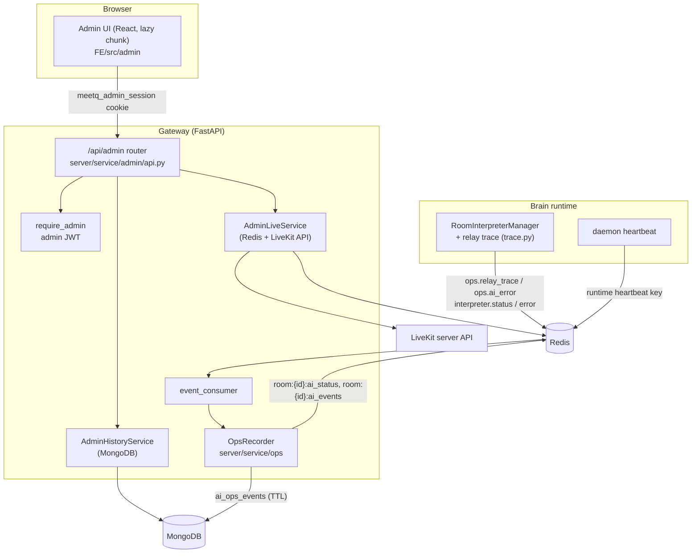

# MeetQ Admin Portal — Overview

> **Auth (2026-10-04):** operators sign in at `/admin/login` with **Username + Password** (`POST /api/admin/auth/login`), and every `/api/admin/*` route is authorized by the HttpOnly **`meetq_admin_session`** cookie (`Path=/api/admin`, `SameSite=Strict`), checked with `GET /api/admin/auth/me` and ended with `POST /api/admin/auth/logout`. Configure `ADMIN_USERNAME` + `ADMIN_PASSWORD_HASH` (see [../auth-backend-contract.md](../auth-backend-contract.md)). The former password-only `POST /api/admin/session` → bearer-token flow and `ADMIN_SESSION_SECRET` have been removed.


Operations control center for MeetQ at **`/admin`**. Built so that when a customer says "BRSE AI isn't translating", an operator can open the room and see within a minute whether the problem is the participant/media, the realtime connection, STT, speech filtering, overlap/queueing, translation, AI voice, delivery, or the summary.

Product behavior is defined by [`docs/system-design/03-product-features-and-workflows.md`](../system-design/03-product-features-and-workflows.md). The admin portal reads that behavior; it does not change it.

- [Architecture](#architecture)
- [Routes](#routes)
- [Data sources](#data-sources)
- [Authentication](#authentication)
- [Realtime / polling](#realtime--polling)
- [Metrics: what is real and how it is computed](#metrics)
- [Not available (and why)](#not-available)
- [Known limitations](#known-limitations)
- [Discrepancies found against the product doc](#discrepancies-found-against-the-product-doc)
- [Run locally](#run-locally)
- [Files](#files)

API reference: [`admin-api.md`](admin-api.md).

---

## Architecture



```text
Admin UI  →  /api/admin (typed, paginated, authorized)
          →  AdminLiveService / AdminHistoryService (+ pure metrics module)
          →  existing MeetQ data: Redis room state, Mongo archive
             + new ops data: relay traces & AI errors (OpsRecorder)
```

**What was added to the runtime (minimal, ops-only):**

| Addition | Where | Effect on meetings |
| --- | --- | --- |
| One `ops.relay_trace` per utterance (timings + decision, **no text**) | `brain_runtime/trace.py`, hooks in `room_manager.py` | None. Not broadcast to participants. |
| `ops.ai_error` for realtime connection/auth failures, caption & chat translation failures | `brain/realtime/client.py` hook, `room_manager.py`, `room_service.py` | None. Previously these were only in logs. |
| `interpreter.status` / `interpreter.error` are now also **stored** | `gateway/event_consumer.py` | None. They were already broadcast. |
| Runtime heartbeat key (every 10 s, TTL 30 s) | `brain_runtime/daemon.py` | None. |
| `GET /api/config` (public) | `gateway/api_config.py` | Home page now shows the real room duration. |

---

## Routes

| Route | Screen | Refresh |
| --- | --- | --- |
| `/admin/login` | Sign in | — |
| `/admin` | Overview: KPIs, live rooms (most urgent first), AI stage health, infrastructure health, recent issues | 10 s |
| `/admin/live-rooms` | All rooms in the live store; filters status / AI mode / language / room ID (in the URL) | 5 s |
| `/admin/live-rooms/:roomId` | Room inspector: header, **diagnosis**, participants (real mic/camera/screen state from LiveKit), BRSE AI state + latency, relay timeline, recent transcript (All/Source/Relay/Chat/System) | 4–6 s |
| `/admin/meetings` | Meeting history; filters date range / language / AI mode / summary status / status; search room ID or participant name | on demand |
| `/admin/meetings/:roomId` | Tabs: Overview, Transcript, Relay (with delivery state + latency), Chat, Summary (final + live, regenerate final), Participants. Each tab loads its own data. | on demand |
| `/admin/ai-relay` | STT / Translation / AI voice / Delivery / Summary stats and health, language-pair table, usage & cost (unavailable) | 30 s |
| `/admin/issues` | Issues grouped by code (window, include-info toggle) | 30 s |
| `/admin/issues/:code` | Issue summary + paginated occurrences | 30 s |
| `/admin/analytics` | Today / 7 / 30 days / custom: totals, meetings over time, language distribution, AI mode usage, feature usage | on range change |
| `/admin/settings` | Effective configuration, read-only, with the source of each value | on load |

The sidebar is a single config array in `AdminLayout.tsx`; adding a future section (e.g. **Glossary** under Configuration) is one entry plus one route.

---

## Data sources

| Data | Source | Lifetime |
| --- | --- | --- |
| Rooms in the live store, participants, recent transcript (50) & chat (100) | Redis `room:{id}:*` (existing) | room TTL |
| Latest BRSE status per speaker | Redis `room:{id}:ai_status` (new, from `interpreter.status`) | room TTL |
| Recent relay traces + AI errors for a room | Redis `room:{id}:ai_events` (new, last 150) | room TTL |
| Runtime liveness and attached rooms | Redis `brseai:v1:runtime:heartbeat` (new) | 30 s TTL |
| Mic / camera / screen-share track state | LiveKit server API `ListParticipants` (metadata only) | live |
| Meetings, participants, transcripts, relays, chat | Mongo `rooms`, `room_participants`, `room_messages` (existing) | permanent |
| Summaries (status, language, content) | Mongo `meeting_summaries` (existing) | permanent |
| Relay traces + AI errors history | Mongo `ai_ops_events` (new) | `OPS_EVENT_RETENTION_DAYS` (30) via TTL index |

Nothing duplicates existing meeting content: traces store **no transcript text**; the UI joins text from `room_messages` / the Redis transcript list by `utterance_id`.

### Database changes

All additive, created at gateway startup, no migration of existing documents:

- New collection `ai_ops_events` with indexes `ai_ops_events_retention` (TTL on `occurred_at_dt`), `ai_ops_events_by_room`, `ai_ops_events_by_issue`, `ai_ops_events_by_type`, `ai_ops_events_by_utterance`.
- New indexes on existing collections: `rooms.admin_rooms_by_created`, `room_messages.admin_messages_by_kind_created`, `room_participants.admin_participants_by_name`, `meeting_summaries.admin_summaries_by_status_created`.

---

## Authentication

- One operator account: **`ADMIN_USERNAME`** + **`ADMIN_PASSWORD_HASH`** (scrypt; create it with `python -m server.service.auth.passwords`). `ADMIN_PASSWORD` in plain text is accepted for local development. Until both are set, every `/api/admin/*` route returns `503 admin_disabled`. There is no default account.
- `POST /api/admin/auth/login` checks username and password (constant time, one error for both) and creates an opaque server-side session in Redis (TTL `ADMIN_SESSION_TTL_SECONDS`, default 12 h), delivered only as the HttpOnly `meetq_admin_session` cookie (`Path=/api/admin`, `SameSite=Strict`, `Secure`).
- Admin sessions are a separate realm from Google user sessions: a signed-in MeetQ user gets `401 admin_auth_required` on admin routes, a participant room token too, and signing out of one realm leaves the other (covered by tests).
- Failed sign-ins: 10 per client address and per username per 10 minutes, then `429` (in-memory, per gateway process).
- State-changing requests from origins outside `CORS_ALLOWED_ORIGINS` get `403 origin_not_allowed` (CSRF guard).
- The UI no longer stores a token: it checks `GET /api/admin/auth/me` on load (admin session cookie) and returns to `/admin/login` on any admin `401`.
- No RBAC: every operator has the same access. This is intentional for v1.

### Privacy

- MeetQ does not record audio or video; the portal never subscribes to media and the UI says so where media state is shown.
- Error messages are sanitized before storage (`sk-…` keys and bearer tokens are redacted, length capped). No stack traces reach the UI.
- Transcript text is never logged to the browser console. Admin access logs record method, path, status and duration only (no query values, which can contain search terms).

---

## Realtime / polling

The existing realtime channel is the participant WebSocket, scoped to one room and authorized by a room token, so it is not reused for admins. The portal polls with `useAdminQuery`:

- intervals: Overview 10 s, Live Rooms 5 s, Room detail 4 s (timeline 4 s, transcript 6 s), AI Relay / Issues 30 s, system pill 30 s;
- polling pauses while the tab is hidden and resumes with an immediate refresh;
- previous data stays on screen during refresh; out-of-order responses are ignored; timers are cleared on unmount;
- states shown: Loading (skeleton), Error (message + retry), Empty, Loaded, Refreshing, **Stale** (no successful update for 3 intervals) and **Reconnecting** (last poll failed, old data still shown).

---

## Metrics

All numbers come from stored events; nothing is estimated.

**Per-utterance trace** (`ops.relay_trace`), one terminal outcome per utterance:

| Outcome | Meaning |
| --- | --- |
| `delivered` / `caption_delivered` | Relay text published (and AI voice, if requested) |
| `source_only` | Valid transcript; no translation needed (1-language room, silent summary) |
| `source_rejected` | Transcript filtered (filler, noise, too short, unfinished) |
| `stt_failed` / `stt_empty` / `superseded` | Transcription failed / empty / speaker resumed during quality hold |
| `relay_suppressed` | Policy decided not to relay (overlap, low value) |
| `relay_dropped` | Approved but dropped (`stale_public_relay` = too late, route changed, …) |
| `output_rejected` | Model output failed the output gate |
| `abandoned` | Speaker left / route reconfigured mid-utterance |

Timings (ms): `stt_ms` (commit → transcript), `queue_ms` (policy → response start), `first_text_ms` (response → first text), `first_audio_ms` (response → first audio), `total_ms` (end of speech → final relay text), `audio_e2e_ms`.

**Stage stats** (`server/service/admin/metrics.py`): STT, Translation, AI voice, Delivery requests/success/error and latency. Percentiles are reported only with enough samples: **p50 ≥ 5, p95 ≥ 20, p99 ≥ 100**; otherwise "—" with a tooltip.

**Health** (last 15 min): `unknown` with no traffic; `down` at ≥ 50 % errors (≥ 4 samples) or any realtime auth/unavailable failure; `degraded` at ≥ 10 % errors, ≥ 2 errors, or p95 above STT 2.5 s / translation 3 s / voice 3.5 s; otherwise `healthy`. Summary health uses the last 24 h. Infrastructure health = Redis ping, runtime heartbeat, Mongo ping, LiveKit API.

**Issues** are classified once, when stored (`server/service/ops/catalog.py`), e.g. `RELAY_TOO_LATE`, `TTS_NO_AUDIO`, `RELAY_SLOW` (> 6 s), `OUTPUT_REJECTED`, `STT_FAILED`, `REALTIME_AUTH_FAILED`, `REALTIME_UNAVAILABLE`, `REALTIME_DISCONNECTED`, `AUDIO_TRACK_FAILURE`, `ROUTE_CONFIG_ERROR`, `CAPTION_TRANSLATION_FAILED`, `CHAT_TRANSLATION_FAILED`, `SUMMARY_FAILED` (from `meeting_summaries`). Info-level codes (`SOURCE_FILTERED`, `RELAY_SUPPRESSED_OVERLAP`, …) are hidden unless "Include info" is on.

**Trends** shown only where history exists: meetings today vs same time yesterday, AI issues last hour vs previous hour, summary failures today vs yesterday.

---

## Not available

| Requested | Status | Why |
| --- | --- | --- |
| AI usage / tokens / audio minutes / cost | Shown as "Usage data unavailable" | No usage is captured from OpenAI responses yet |
| Separate TTS latency vs translation latency | Shown as two timings of one response, with a note | `gpt-realtime` produces text and voice in a single response |
| STT p50/p95 before traffic exists | "—" | Traces are recorded from this release on; older meetings have no traces ("Not traced") |
| Screen-share usage in analytics | "Not available" | Screen-share sessions are not persisted |
| DAU/MAU, retention, conversion | Not shown | No user accounts |
| Editable settings (`PATCH /config`) | Read-only | Config is environment-based; making it runtime-mutable is an architecture change |
| Notifications for room ended / AI error / summary failed / degraded | "Not supported yet" | Telegram integration only implements room created / participant joined |
| Live-room trends | Not shown | No historical series of live counts |

---

## Known limitations

- **Single gateway process assumptions**: the login rate limiter is in-memory per process.
- **Live room listing uses `SCAN room:*:meta`**; fine for hundreds of rooms, consider a Redis set index beyond that.
- **AI metrics/issues aggregate in Python** over at most 20 000 recent events per request (`truncated` is reported). For much larger volumes move to Mongo aggregation pipelines.
- **Polling, not push**. Adequate at the given intervals; an admin SSE stream can be added later.
- **Summary regeneration** reuses the existing endpoint semantics: only after a meeting ended; it replaces the stored final summary.
- Pre-existing backend test failures unrelated to admin: `test_gateway_ws.py::test_ws_connect_snapshot` and 3 tests in `test_interpreter_audio_adapter.py` (failing before this change).

## Discrepancies found against the product doc

| Doc 03 says | Implementation | Resolution |
| --- | --- | --- |
| UI shows "Rooms stay open for 60 minutes"; production uses 30 minutes (R-02, G15) | Home hard-coded "60 minutes"; local `docker-compose.yml` didn't pass `ROOM_MEETING_DURATION_SECONDS` (gateway fell back to 3600 s while `.env.local.example` says 1800) | Home now reads `GET /api/config`; local compose passes the variable through. Production value unchanged. |
| Host / Mute exist only in the UI (G2) | Confirmed: no backend host or `/moderation/mute` | Admin shows no host data. Not changed. |
| Realtime failures are silent for users | Confirmed | Now recorded as ops events (admin-visible). Participants still see no new message (behavior unchanged on purpose). |
| Doc 02 states the hold "merges" fragments | Fixed earlier in doc 02: fragments are dropped | Trace outcome `superseded` documents it. |

---

## Run locally

```bash
# .env.local (copied from .env.local.example) needs a real OPENAI_API_KEY and:
ADMIN_USERNAME=dev-admin
ADMIN_PASSWORD=dev-admin-password      # local only; production uses ADMIN_PASSWORD_HASH
# optional: ADMIN_SESSION_TTL_SECONDS=43200, OPS_EVENT_RETENTION_DAYS=30

make dev            # gateway, interpreter, LiveKit, Redis, Mongo + FE on :3000
open http://localhost:3000/admin
```

Tests:

```bash
docker compose --env-file .env.local -f docker-compose.yml exec gateway python -m pytest -q
cd FE && npm test && npm run typecheck && npm run build
```

For production set `ADMIN_USERNAME` and `ADMIN_PASSWORD_HASH` (not `ADMIN_PASSWORD`) in `.env.production`; both are passed through `docker-compose.prod.yml`, which also defaults `AUTH_COOKIE_SECURE=true`. Never commit real values.

---

## Files

Backend

```text
BE/server/config.py                                  admin + ops settings
BE/server/events.py                                  ops.relay_trace, ops.ai_error
BE/server/brain/realtime/client.py                   on_connection_error hook
BE/server/brain/realtime/interpreter_client.py       on_input_rejected hook
BE/server/service/brain_runtime/trace.py             (new) per-utterance trace
BE/server/service/brain_runtime/room_manager.py      trace hooks, ops errors
BE/server/service/brain_runtime/events.py            publish_relay_trace / publish_ai_error
BE/server/service/brain_runtime/daemon.py            runtime heartbeat
BE/server/service/ops/{keys,catalog,recorder}.py     (new) ops storage + issue catalog
BE/server/service/admin/*                            (new) auth, API, services, metrics, schemas
BE/server/service/gateway/{main,event_consumer,app_state,room_service,api_config}.py
BE/tests/{fake_mongo,test_admin_api,test_admin_metrics,test_relay_trace_runtime}.py
```

Frontend

```text
FE/src/admin/**                       (new) admin app: api, auth, hooks, lib, components, pages, tests
FE/src/styles/admin.css               (new) admin styles (lazy-loaded)
FE/src/App.tsx                        lazy /admin/* route
FE/src/pages/HomePage.tsx             room duration from /api/config
FE/src/lib/api.ts                     export requestJson, getPublicConfig
FE/vite.config.ts, FE/package.json    vitest setup + test/typecheck scripts
```

Config: `docker-compose.yml`, `docker-compose.prod.yml`, `.env.example`, `.env.local.example`, `BE/.env.example`.
