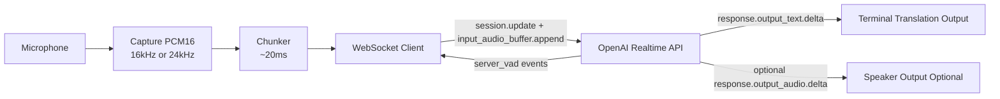
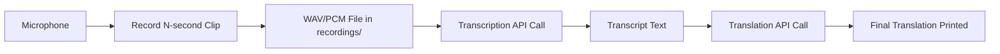

# Architecture

## Goal

Build a low-latency local interpreter demo:
- Input: live microphone speech (Vietnamese or English)
- Output: translated text in the opposite language, streamed in real time
- Transport: OpenAI Realtime API over WebSocket
- Fallback: non-realtime clip recording -> transcribe -> translate

## Components

| Component | Responsibility |
|---|---|
| `Mic Capture` | Capture PCM16 audio frames via `sounddevice` |
| `Chunker` | Split to ~20ms chunks for streaming |
| `Realtime WS Client` | Maintain WebSocket session and send/receive events |
| `Turn Detection` | Server-side VAD (`server_vad`) for conversational turns |
| `Translator Behavior` | Enforce VI->EN and EN->VI with translation-only output |
| `Terminal UI` | Print timestamped logs + translated text deltas |
| `Fallback Pipeline` | Record short clip, transcribe, then translate |

## Realtime Data Flow

## Fallback Data Flow

## Runtime Notes

- Realtime path prioritizes low latency and smooth turn-taking.
- Fallback path prioritizes reliability if realtime session is unavailable.
- Both paths share logging conventions and language-direction rules.
