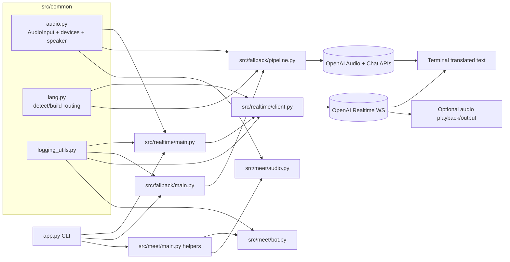

# Architecture

## Scope

This repository currently ships three runtime paths:
- `realtime`: low-latency streaming interpreter.
- `fallback`: clip-based record/transcribe/translate pipeline.
- `meet-bot`: Google Meet participant automation + meeting audio capture + realtime interpreter.

## Entry Points

- `app.py`
  - dispatches `--mode realtime`, `--mode fallback`, `--mode meet-bot`
  - handles shared flags/device listing.
- `src/realtime/main.py`
  - standalone realtime runner and input/speaker routing helpers.
- `src/fallback/main.py`
  - standalone fallback runner.
- `src/meet/main.py`
  - standalone meet-bot runner (full meet parser surface including `--sck`).

## Core Modules

| Module | Responsibility |
|---|---|
| `src/common/audio.py` | `AudioInput` abstraction, `MicInput`, `DeviceLoopbackInput`, speaker playback, device listing |
| `src/common/lang.py` | language detection heuristics, instruction builder, pair filtering |
| `src/common/logging_utils.py` | timestamped stderr logging + translation printing helper |
| `src/realtime/client.py` | Realtime WS session, VAD events, transcript handling, barge-in, streaming text/audio |
| `src/fallback/pipeline.py` | record WAV -> transcription -> chat translation |
| `src/meet/bot.py` | Playwright join/waiting-room/leave lifecycle |
| `src/meet/audio.py` | Meet audio capture/output adapters (`MeetAudioListenerInput`, `SCKAudioInput`, `MeetAudioMicOutput`) |
| `src/meet/selectors.py` | central selector map for Meet UI automation |

## Module / Service Overview



## Realtime Pipeline

1. `AudioInput` implementation starts (`MicInput` or `DeviceLoopbackInput`).
2. `RealtimeClient` sends `session.update` with translation instructions and VAD config.
3. Client streams base64 PCM16 chunks via `input_audio_buffer.append`.
4. Server emits input transcript + response deltas.
5. Client prints `[You]` transcript and `[Interp]` translated text.
6. If audio is enabled, `response.audio.delta` is decoded and played.
7. On barge-in (`speech_started` while assistant speaking), client sends `response.cancel` and restarts output player.

## Fallback Pipeline

1. Record fixed-length clip from selected input device.
2. Save WAV to `recordings/clip_<timestamp>.wav`.
3. Send to transcription model (`whisper-1` by default).
4. Send transcript to chat model (`gpt-4o-mini` by default) with interpreter system prompt.
5. Print final translation.

## Meet Mode Dataflow

```mermaid
flowchart TD
    HOST[Meeting host/participants]
    BOT[MeetBot\nPlaywright Chromium participant]
    WAIT[Waiting room/admit handling]

    HOST --> BOT
    BOT --> WAIT

    BOT --> ROUTE1[Path A in code: --sck ScreenCaptureKit]
    BOT --> ROUTE2[Path B: --meet-speaker-device loopback capture]

    ROUTE1 --> IN[SCKAudioInput]
    ROUTE2 --> IN[MeetAudioListenerInput]

    IN --> RTC[RealtimeClient]
    RTC --> OAI[(OpenAI Realtime)]
    OAI --> TXT[[Terminal [Interp] text]]

    OAI --> AUD[response.audio.delta]
    AUD --> OUT{meet mic output configured?}
    OUT -- yes --> MIC[MeetAudioMicOutput -> virtual mic device]
    MIC --> BOT
    OUT -- no --> DROP[listen-only mode]
```

## Operational Notes

- Meet mode assumes participant consent and host-side admission when needed.
- Virtual audio routing must keep capture and playback paths separate to prevent loops.
- `src/meet/main.py` currently exposes the full meet feature set (`--sck`, `--sck-app`); treat it as the canonical meet entrypoint.
