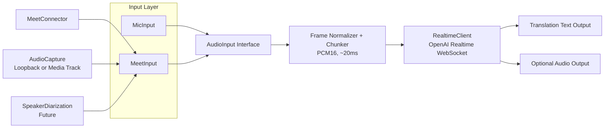
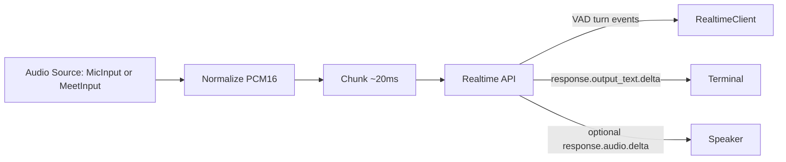
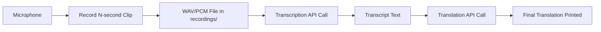

# Architecture

## Goal

Build a low-latency interpreter system that translates Vietnamese <-> English in real time and can ingest either local microphone audio (Phase 1) or Google Meet audio (Phase 2).

## Current vs Target

- Phase 1 (complete): `MicInput` -> Realtime translation pipeline.
- Phase 2 (planned): add `MeetInput` while keeping the same translation pipeline.

## Core Components

| Component | Responsibility |
|---|---|
| `AudioInput` (interface) | Common input contract for all audio sources |
| `MicInput` | Existing local microphone source |
| `MeetInput` | New meeting audio source (official media path or bot loopback path) |
| `Frame Normalizer + Chunker` | Convert to PCM16 and emit ~20ms chunks |
| `RealtimeClient` | OpenAI Realtime WS session, VAD turns, translation stream |
| `Terminal Output` | Print translated text in real time |
| `Optional Speaker Output` | Play model audio output when enabled |
| `Fallback Pipeline` | Record short clip -> transcribe -> translate |

## AudioInput Contract

Minimum methods/fields:
- `start()`
- `read_frames()` or `stream_frames()`
- `stop()`
- `metadata` with `sample_rate`, `channels`, optional `speaker_id`

## Updated System Architecture

## Realtime Data Flow (Phase 1 + Phase 2)

## Fallback Data Flow

## Notes

- Translation policy remains output-only translation text (no extra commentary).
- In meeting mode, avoid audio-loop feedback by separating capture and playback routes.
- For detailed Phase 2 design and compliance constraints, see `docs/phase2_google_meet.md`.
