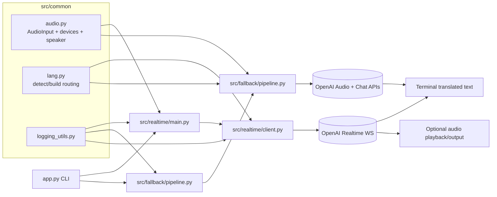

# Architecture

## Scope

This repository provides a realtime speech translation system with two runtime paths:
- `realtime`: low-latency streaming interpreter using OpenAI Realtime API.
- `fallback`: clip-based record/transcribe/translate pipeline.

## Entry Points

- `app.py`
  - dispatches `--mode realtime` and `--mode fallback`
  - handles shared flags/device listing.
- `src/realtime/main.py`
  - standalone realtime runner and input/speaker routing helpers.
- `src/fallback/pipeline.py`
  - standalone fallback runner.

## Core Modules

| Module | Responsibility |
|---|---|
| `src/common/audio.py` | `AudioInput` abstraction, `MicInput`, `DeviceLoopbackInput`, speaker playback, device listing |
| `src/common/lang.py` | language detection heuristics, instruction builder, pair filtering |
| `src/common/logging_utils.py` | timestamped stderr logging + translation printing helper |
| `src/realtime/client.py` | Realtime WS session, VAD events, transcript handling, barge-in, streaming text/audio |
| `src/fallback/pipeline.py` | record WAV -> transcription -> chat translation |

## Module / Service Overview



## Realtime Pipeline

1. `AudioInput` implementation starts (`MicInput` or `DeviceLoopbackInput`).
2. `RealtimeClient` sends `session.update` with translation instructions and VAD config.
3. Client streams base64 PCM16 chunks via `input_audio_buffer.append`.
4. Server emits input transcript + response deltas.
5. Client prints `[You]` transcript and `[Interp]` translated text.
6. If audio is enabled, `response.audio.delta` is decoded and played.
7. On barge-in (`speech_started` while assistant speaking), client sends `response.cancel` and restarts output player.

## Fallback Pipeline

1. Record fixed-length clip from selected input device.
2. Save WAV to `recordings/clip_<timestamp>.wav`.
3. Send to transcription model (`whisper-1` by default).
4. Send transcript to chat model (`gpt-4o-mini` by default) with interpreter system prompt.
5. Print final translation.

```

## Operational Notes

- Virtual audio routing must keep capture and playback paths separate to prevent loops.
- Realtime mode works with microphone or device loopback input.
- Fallback mode always persists WAV clips to `recordings/` directory.
