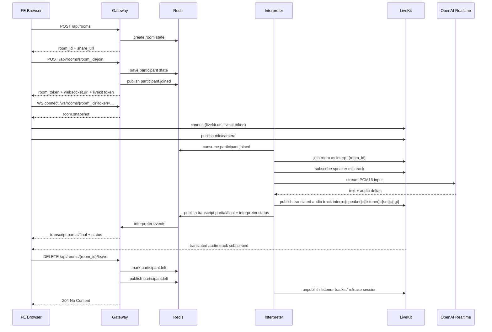

# Backend <-> Frontend API Contract

Tài liệu này là contract duy nhất FE cần biết để code độc lập với BE.

Mục tiêu của contract:

1. FE tạo room, join room, rời room không cần đọc code backend
2. FE connect Gateway WebSocket đúng format
3. FE connect LiveKit đúng token và hiểu translation track nào là của mình
4. FE hiển thị transcript, participant events, interpreter status từ payload ổn định

Base assumptions:

- REST base URL local dev: `http://localhost:8000`
- Gateway WS base URL local dev: `ws://localhost:8000`
- LiveKit WS URL local dev: `ws://localhost:7880`
- Supported languages: `vi`, `en`, `ja`

## Conventions

### IDs

| Field | Example |
| --- | --- |
| `room_id` | `rm_8f3k2v1m` |
| `participant_id` | `pt_01hs8x4e3m` |
| `session_id` | `ses_01hs8x9k4r` |
| `transcript_id` | `seg_01hs8xfw8n` |
| `event_id` | `evt_01hs8zb1a1` |

### Timestamps

Mọi timestamp là ISO-8601 UTC string.

Ví dụ:

```json
"2026-04-29T13:12:54.000Z"
```

### Common Error Envelope

Mọi REST error response dùng format này:

```json
{
  "error": {
    "code": "invalid_language",
    "message": "language must be one of vi, en, ja",
    "request_id": "req_01hs8z1b2p",
    "details": {
      "field": "language"
    }
  }
}
```

### Common WebSocket Envelope

Mọi WS message dùng format này:

```json
{
  "type": "participant.joined",
  "event_id": "evt_01hs8zb1a1",
  "room_id": "rm_8f3k2v1m",
  "sent_at": "2026-04-29T13:13:10.000Z",
  "payload": {}
}
```

## REST Endpoints

## `POST /api/rooms`

Tạo room trống.

### Request JSON Schema

```json
{}
```

### Response JSON Schema

```json
{
  "room": {
    "room_id": "string",
    "state": "created",
    "created_at": "ISO-8601 UTC string",
    "expires_at": "ISO-8601 UTC string",
    "participant_limit": 8,
    "supported_languages": ["vi", "en", "ja"]
  },
  "join": {
    "api_path": "string",
    "share_url": "string"
  }
}
```

### Example Response

```json
{
  "room": {
    "room_id": "rm_8f3k2v1m",
    "state": "created",
    "created_at": "2026-04-29T13:00:00.000Z",
    "expires_at": "2026-04-30T13:00:00.000Z",
    "participant_limit": 8,
    "supported_languages": ["vi", "en", "ja"]
  },
  "join": {
    "api_path": "/api/rooms/rm_8f3k2v1m/join",
    "share_url": "http://localhost:3000/rooms/rm_8f3k2v1m"
  }
}
```

### FE Usage

1. Call endpoint khi user bấm "Create room"
2. Redirect browser sang `share_url`
3. Gọi tiếp `POST /api/rooms/{room_id}/join`

## `GET /api/rooms/{room_id}`

Lấy snapshot room khi FE load room page hoặc reconnect.

### Response JSON Schema

```json
{
  "room": {
    "room_id": "string",
    "state": "created | active | empty",
    "created_at": "ISO-8601 UTC string",
    "expires_at": "ISO-8601 UTC string",
    "participant_limit": 8,
    "supported_languages": ["vi", "en", "ja"],
    "participant_count": 0
  },
  "participants": [
    {
      "participant_id": "string",
      "display_name": "string",
      "language": "vi | en | ja",
      "status": "joining | connected | reconnecting",
      "joined_at": "ISO-8601 UTC string"
    }
  ],
  "recent_transcripts": [
    {
      "transcript_id": "string",
      "speaker_id": "string",
      "speaker_display_name": "string",
      "src_lang": "vi | en | ja",
      "source_text": "string",
      "created_at": "ISO-8601 UTC string"
    }
  ]
}
```

### Example Response

```json
{
  "room": {
    "room_id": "rm_8f3k2v1m",
    "state": "active",
    "created_at": "2026-04-29T13:00:00.000Z",
    "expires_at": "2026-04-30T13:12:54.000Z",
    "participant_limit": 8,
    "supported_languages": ["vi", "en", "ja"],
    "participant_count": 2
  },
  "participants": [
    {
      "participant_id": "pt_01hs8x4e3m",
      "display_name": "Huy",
      "language": "vi",
      "status": "connected",
      "joined_at": "2026-04-29T13:01:14.000Z"
    },
    {
      "participant_id": "pt_01hs8y3n1z",
      "display_name": "Sato",
      "language": "ja",
      "status": "connected",
      "joined_at": "2026-04-29T13:02:01.000Z"
    }
  ],
  "recent_transcripts": []
}
```

## `POST /api/rooms/{room_id}/join`

Join room và nhận đủ credentials cho Gateway WS + LiveKit.

### Request JSON Schema

```json
{
  "display_name": "string, required, 1..40 chars",
  "language": "vi | en | ja",
  "client": {
    "sdk": "web",
    "version": "string"
  }
}
```

### Example Request

```json
{
  "display_name": "Huy",
  "language": "vi",
  "client": {
    "sdk": "web",
    "version": "0.1.0"
  }
}
```

### Response JSON Schema

```json
{
  "room": {
    "room_id": "string",
    "state": "active",
    "participant_limit": 8,
    "supported_languages": ["vi", "en", "ja"]
  },
  "participant": {
    "participant_id": "string",
    "session_id": "string",
    "display_name": "string",
    "language": "vi | en | ja"
  },
  "room_token": {
    "token": "JWT string",
    "expires_at": "ISO-8601 UTC string"
  },
  "websocket": {
    "url": "string"
  },
  "livekit": {
    "url": "string",
    "room_name": "string",
    "participant_identity": "string",
    "participant_name": "string",
    "token": "JWT string"
  },
  "snapshot": {
    "participants": [],
    "recent_transcripts": []
  }
}
```

### Example Response

```json
{
  "room": {
    "room_id": "rm_8f3k2v1m",
    "state": "active",
    "participant_limit": 8,
    "supported_languages": ["vi", "en", "ja"]
  },
  "participant": {
    "participant_id": "pt_01hs8x4e3m",
    "session_id": "ses_01hs8x9k4r",
    "display_name": "Huy",
    "language": "vi"
  },
  "room_token": {
    "token": "<gateway-room-jwt>",
    "expires_at": "2026-04-30T13:01:14.000Z"
  },
  "websocket": {
    "url": "ws://localhost:8000/ws/rooms/rm_8f3k2v1m?token=<gateway-room-jwt>"
  },
  "livekit": {
    "url": "ws://localhost:7880",
    "room_name": "rm_8f3k2v1m",
    "participant_identity": "pt_01hs8x4e3m",
    "participant_name": "Huy",
    "token": "<livekit-jwt>"
  },
  "snapshot": {
    "participants": [
      {
        "participant_id": "pt_01hs8x4e3m",
        "display_name": "Huy",
        "language": "vi",
        "status": "joining"
      }
    ],
    "recent_transcripts": []
  }
}
```

### FE Usage

1. Lưu `participant_id`, `session_id`, `language` trong memory state
2. Dùng `websocket.url` để connect Gateway WS
3. Dùng `livekit.url` và `livekit.token` để connect LiveKit
4. Không lưu `room_token.token` hoặc `livekit.token` vào localStorage

## `DELETE /api/rooms/{room_id}/leave`

Rời room một cách clean.

### Headers

```text
Authorization: Bearer <gateway-room-jwt>
```

### Response

`204 No Content`

### FE Usage

Gọi endpoint này khi:

1. user bấm leave
2. trước `window.unload` nếu có thể

Nếu request fail do tab đóng quá nhanh, Gateway WS disconnect grace sẽ cleanup.

## `GET /api/health`

### Response Example

```json
{
  "status": "ok",
  "service": "gateway",
  "time": "2026-04-29T13:12:54.000Z",
  "dependencies": {
    "redis": "ok"
  }
}
```

## WebSocket Contract

## Connect

FE connect đúng URL được trả về từ `/join`.

Ví dụ:

```text
ws://localhost:8000/ws/rooms/rm_8f3k2v1m?token=<gateway-room-jwt>
```

### Authentication Rules

1. token bắt buộc nằm trong query string
2. token room_id phải match room trên path
3. token hết hạn -> Gateway close `4401`
4. participant state không còn hợp lệ -> Gateway close `4403`

## Client -> Server Messages

## `ping`

### Schema

```json
{
  "type": "ping",
  "event_id": "string",
  "room_id": "string",
  "sent_at": "ISO-8601 UTC string",
  "payload": {
    "client_time": "ISO-8601 UTC string"
  }
}
```

### Example

```json
{
  "type": "ping",
  "event_id": "evt_01hs8ypr0j",
  "room_id": "rm_8f3k2v1m",
  "sent_at": "2026-04-29T13:12:54.000Z",
  "payload": {
    "client_time": "2026-04-29T13:12:54.000Z"
  }
}
```

## `set_language`

### Schema

```json
{
  "type": "set_language",
  "event_id": "string",
  "room_id": "string",
  "sent_at": "ISO-8601 UTC string",
  "payload": {
    "language": "vi | en | ja"
  }
}
```

### Example

```json
{
  "type": "set_language",
  "event_id": "evt_01hs8z0xcm",
  "room_id": "rm_8f3k2v1m",
  "sent_at": "2026-04-29T13:14:10.000Z",
  "payload": {
    "language": "en"
  }
}
```

### FE Usage

Gửi message này khi user đổi language selector trong room. FE phải update local UI ngay optimistic, nhưng nếu server trả `error`, FE phải rollback local state.

## Server -> Client Messages

## `room.snapshot`

### Schema

```json
{
  "type": "room.snapshot",
  "event_id": "string",
  "room_id": "string",
  "sent_at": "ISO-8601 UTC string",
  "payload": {
    "self": {
      "participant_id": "string",
      "session_id": "string",
      "display_name": "string",
      "language": "vi | en | ja"
    },
    "room": {
      "state": "created | active | empty",
      "participant_limit": 8,
      "supported_languages": ["vi", "en", "ja"]
    },
    "participants": [],
    "recent_transcripts": []
  }
}
```

### Example

```json
{
  "type": "room.snapshot",
  "event_id": "evt_01hs8za8xj",
  "room_id": "rm_8f3k2v1m",
  "sent_at": "2026-04-29T13:12:54.000Z",
  "payload": {
    "self": {
      "participant_id": "pt_01hs8x4e3m",
      "session_id": "ses_01hs8x9k4r",
      "display_name": "Huy",
      "language": "vi"
    },
    "room": {
      "state": "active",
      "participant_limit": 8,
      "supported_languages": ["vi", "en", "ja"]
    },
    "participants": [
      {
        "participant_id": "pt_01hs8x4e3m",
        "display_name": "Huy",
        "language": "vi",
        "status": "connected"
      }
    ],
    "recent_transcripts": []
  }
}
```

## `participant.joined`

### Example

```json
{
  "type": "participant.joined",
  "event_id": "evt_01hs8zb1a1",
  "room_id": "rm_8f3k2v1m",
  "sent_at": "2026-04-29T13:13:10.000Z",
  "payload": {
    "participant_id": "pt_01hs8y3n1z",
    "display_name": "Sato",
    "language": "ja",
    "status": "connected",
    "joined_at": "2026-04-29T13:13:10.000Z"
  }
}
```

## `participant.updated`

### Example

```json
{
  "type": "participant.updated",
  "event_id": "evt_01hs8zc9db",
  "room_id": "rm_8f3k2v1m",
  "sent_at": "2026-04-29T13:14:10.000Z",
  "payload": {
    "participant_id": "pt_01hs8x4e3m",
    "display_name": "Huy",
    "language": "en",
    "status": "connected"
  }
}
```

## `participant.left`

### Example

```json
{
  "type": "participant.left",
  "event_id": "evt_01hs8zd2mk",
  "room_id": "rm_8f3k2v1m",
  "sent_at": "2026-04-29T13:18:44.000Z",
  "payload": {
    "participant_id": "pt_01hs8y3n1z",
    "left_at": "2026-04-29T13:18:44.000Z"
  }
}
```

## `transcript.partial`

Đây là event FE dùng để stream text đang dịch.

### Schema

```json
{
  "type": "transcript.partial",
  "event_id": "string",
  "room_id": "string",
  "sent_at": "ISO-8601 UTC string",
  "payload": {
    "transcript_id": "string",
    "speaker": {
      "participant_id": "string",
      "display_name": "string",
      "source_language": "vi | en | ja"
    },
    "listener": {
      "participant_id": "string",
      "target_language": "vi | en | ja"
    },
    "source_text": "string",
    "translated_text": "string",
    "audio_track_name": "string | null",
    "fallback_used": false,
    "is_final": false
  }
}
```

### Example

```json
{
  "type": "transcript.partial",
  "event_id": "evt_01hs8zeh2f",
  "room_id": "rm_8f3k2v1m",
  "sent_at": "2026-04-29T13:15:31.000Z",
  "payload": {
    "transcript_id": "seg_01hs8xfw8n",
    "speaker": {
      "participant_id": "pt_01hs8x4e3m",
      "display_name": "Huy",
      "source_language": "vi"
    },
    "listener": {
      "participant_id": "pt_01hs8y3n1z",
      "target_language": "ja"
    },
    "source_text": "Chúng ta",
    "translated_text": "私たちは",
    "audio_track_name": "interp::pt_01hs8x4e3m::pt_01hs8y3n1z::vi::ja",
    "fallback_used": false,
    "is_final": false
  }
}
```

## `transcript.final`

### Example

```json
{
  "type": "transcript.final",
  "event_id": "evt_01hs8zf1by",
  "room_id": "rm_8f3k2v1m",
  "sent_at": "2026-04-29T13:15:32.000Z",
  "payload": {
    "transcript_id": "seg_01hs8xfw8n",
    "speaker": {
      "participant_id": "pt_01hs8x4e3m",
      "display_name": "Huy",
      "source_language": "vi"
    },
    "listener": {
      "participant_id": "pt_01hs8y3n1z",
      "target_language": "ja"
    },
    "source_text": "Chúng ta bắt đầu nhé.",
    "translated_text": "始めましょう。",
    "audio_track_name": "interp::pt_01hs8x4e3m::pt_01hs8y3n1z::vi::ja",
    "fallback_used": false,
    "latency_ms": 870,
    "is_final": true
  }
}
```

### FE Usage

1. Nếu `is_final == false`, update transcript row tạm
2. Nếu `is_final == true`, replace row tạm bằng row final
3. Nếu `fallback_used == true`, UI phải hiển thị badge degraded và không chờ audio track

## `interpreter.status`

### Example

```json
{
  "type": "interpreter.status",
  "event_id": "evt_01hs8zgbyn",
  "room_id": "rm_8f3k2v1m",
  "sent_at": "2026-04-29T13:15:30.000Z",
  "payload": {
    "speaker_id": "pt_01hs8x4e3m",
    "target_language": "ja",
    "status": "translating",
    "fallback_used": false,
    "message": null
  }
}
```

Valid `status`:

- `idle`
- `capturing`
- `translating`
- `playing`
- `fallback_text_only`
- `error`

## `pong`

### Example

```json
{
  "type": "pong",
  "event_id": "evt_01hs8zhh7q",
  "room_id": "rm_8f3k2v1m",
  "sent_at": "2026-04-29T13:12:54.010Z",
  "payload": {
    "client_time": "2026-04-29T13:12:54.000Z",
    "server_time": "2026-04-29T13:12:54.010Z"
  }
}
```

## `error`

### Example

```json
{
  "type": "error",
  "event_id": "evt_01hs8zj5rz",
  "room_id": "rm_8f3k2v1m",
  "sent_at": "2026-04-29T13:14:10.020Z",
  "payload": {
    "code": "invalid_language",
    "message": "language must be one of vi, en, ja"
  }
}
```

## Error Codes

| Code | REST Status | WS Behavior | FE Action |
| --- | --- | --- | --- |
| `invalid_request` | `400` | `error` event | fix payload, do not retry blindly |
| `invalid_token` | `401` | close `4401` | re-run `/join` to get fresh token |
| `token_room_mismatch` | `403` | close `4403` | hard refresh room state |
| `room_not_found` | `404` | close `4404` | show "room not found" UI |
| `participant_not_found` | `404` | close `4403` | re-run `/join` |
| `room_full` | `409` | `error` event | show room full state |
| `invalid_display_name` | `422` | n/a | validate input field |
| `invalid_language` | `422` | `error` event | rollback language selector |
| `redis_unavailable` | `503` | `error` event | show reconnecting / retry |
| `livekit_unavailable` | `503` | n/a | disable join, retry join |
| `interpreter_unavailable` | `503` | `interpreter.status=error` | keep room connected, show degraded banner |
| `internal_error` | `500` | close `1011` or `error` | retry with backoff |

## LiveKit Token Contract

FE không cần decode JWT, nhưng cần hiểu BE đảm bảo các fields sau khi generate token:

```json
{
  "identity": "pt_01hs8x4e3m",
  "name": "Huy",
  "grants": {
    "roomJoin": true,
    "room": "rm_8f3k2v1m",
    "canPublish": true,
    "canSubscribe": true,
    "canPublishData": false
  },
  "metadata": {
    "participant_id": "pt_01hs8x4e3m",
    "language": "vi",
    "kind": "human"
  }
}
```

### FE Connect Usage

Pseudo flow:

```ts
const room = new Room();
await room.connect(join.livekit.url, join.livekit.token, {
  autoSubscribe: true,
});
```

### Track Filtering Rules

FE sẽ nhận:

1. normal human camera tracks
2. normal human microphone tracks
3. interpreter audio tracks

Interpreter track nhận diện bằng:

1. remote participant identity prefix `interp::`
2. audio track name format `interp::{speaker_id}::{listener_id}::{src_lang}::{tgt_lang}`

FE chỉ play track nếu:

1. current user `participant_id == listener_id` trong track name
2. current user thực sự muốn nghe translated audio

### Example Parse

```text
track.name = interp::pt_01hs8x4e3m::pt_01hs8y3n1z::vi::ja

speaker_id = pt_01hs8x4e3m
listener_id = pt_01hs8y3n1z
src_lang = vi
tgt_lang = ja
```

## Recommended FE Join Sequence

1. `GET /api/rooms/{room_id}` khi room page load
2. user nhập `display_name`, chọn `language`
3. `POST /api/rooms/{room_id}/join`
4. connect Gateway WS
5. connect LiveKit
6. publish local mic/camera tracks
7. render transcript/status events

## Sequence Diagram



## Notes For FE Agent

1. FE phải coi Gateway WS là source of truth cho transcript + participant list.
2. FE phải coi LiveKit là source of truth cho media tracks.
3. Nếu `interpreter.status` báo `fallback_text_only`, transcript vẫn tiếp tục nhưng có thể không có audio track mới cho utterance đó.
4. FE không cần parse JWT nếu không phục vụ debug UI.
