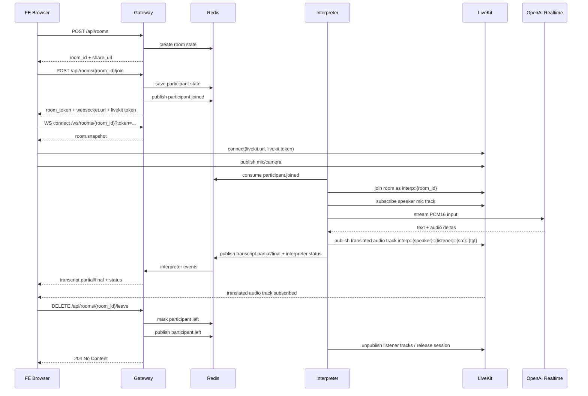

# Backend <-> Frontend API Contract

> Update note (2026-05-01): room policy changed. Meeting duration is now 30 minutes (was 24h). `expires_at` reflects this. `participant_limit` is now `null` (no backend participant cap). Joining an expired room returns `410 room_expired`. New event `room.expired` can be broadcast to connected clients.
>
> Update note (2026-05-10): room language config is now list-based. `room_languages` is the canonical room-level supported language list and may contain 1 or more distinct supported languages. `meeting_languages` remains a backward-compatible alias for existing clients; legacy `language_a` / `language_b` request or persisted fields are mapped into `room_languages`. `participant.language` remains the participant's selected language and must be one of the room languages.
>
> Update note (2026-05-01): rooms now expose explicit `brse_enabled`. Create-room can set it, snapshots/events expose it, and `brse_enabled=false` means a normal human-only meeting: no `brse_ai` virtual participant, no BRSE interpreter runtime, no BRSE transcript/audio output.
>
> Update note (2026-05-05): create-room also accepts additive `brse_mode="relay" | "silent_summary"`. `brse_enabled=true` with `relay` preserves existing BRSE audio relay behavior. `brse_enabled=true` with `silent_summary` starts BRSE as a silent listener: it subscribes to human audio and archives source transcripts for post-meeting summary, but suppresses relay audio and realtime relay transcript fan-out.
>
> Update note (2026-05-08): relay rooms now expose additive `brse_output_mode="voice_text" | "text_only"`. `voice_text` preserves existing BRSE relay voice + text behavior. `text_only` keeps BRSE runtime, source transcript, and relay text active, but suppresses BRSE audio track publication and relay audio frames. This is distinct from `brse_enabled=false` and from `brse_mode="silent_summary"`.
>
> Update note (2026-05-08): meeting summaries now return a structured meeting recap package. Canonical recap fields are `summary_text`, `key_points`, `action_items`, `decisions`, and `participant_highlights`. Backward-compatible aliases `highlights` and `participant_summary` remain in the response and mirror the canonical fields.
>
> Update note (2026-05-06): meeting summaries now support two stored types: `interim` live checkpoint summaries and `final` post-meeting summaries. `POST /api/rooms/{room_id}/summary` generates/refreshes summary; `GET /api/rooms/{room_id}/summary?type=interim|final` reads stored summary. Default GET type remains `final`.
>
> Update note (2026-04-30): new rooms now default to BRSE relay semantics. FE should expect `meeting_mode=brse_relay`, `interpreter_mode=brse_participant`, a virtual participant `brse_ai`, room-wide relay transcripts with `kind=relay`, and BRSE audio as virtual participant track metadata. Older per-listener translated-audio sections below are legacy reference and are no longer the authoritative output model for BRSE rooms.

Tài liệu này là contract duy nhất FE cần biết để code độc lập với BE.

Mục tiêu của contract:

1. FE tạo room, join room, rời room không cần đọc code backend
2. FE connect Gateway WebSocket đúng format
3. FE connect LiveKit đúng token và hiểu translation track nào là của mình
4. FE hiển thị transcript, participant events, interpreter status từ payload ổn định

Base assumptions:

- REST base URL local dev: `http://localhost:8000`
- Gateway WS base URL local dev: `ws://localhost:8000`
- LiveKit WS URL local dev: `ws://localhost:7880`
- Production public URLs: REST `https://meetqapp.com/api/...`, Gateway WS `wss://meetqapp.com/ws/...`, LiveKit WS `wss://rtc.meetqapp.com`
- Supported languages: `vi`, `en`, `ja`, `zh`, `ko`, `fr`, `es`

## Screen Share Contract Addendum

Screen share được support như capability chính thức của room runtime.

### Participant snapshot / state fields

Mọi participant object trong snapshot và participant events có thể chứa:

```json
{
  "is_screen_sharing": true,
  "screen_share": {
    "active": true,
    "source": "screen_share",
    "track_sid": "TR_xxx",
    "track_name": "screen:user-pt_abc",
    "started_at": "2026-05-01T03:01:14.000Z"
  }
}
```

Nếu participant không share màn hình:

```json
{
  "is_screen_sharing": false,
  "screen_share": null
}
```

### REST sync endpoints (idempotent)

`POST /api/rooms/{room_id}/screen-share/start`

Request (Bearer room token required):

```json
{
  "track_sid": "TR_xxx",
  "track_name": "screen:user-pt_abc",
  "source": "screen_share"
}
```

Response:

```json
{
  "participant_id": "pt_...",
  "display_name": "Huy",
  "active": true,
  "timestamp": "2026-05-01T03:01:14.000Z",
  "track_sid": "TR_xxx",
  "track_name": "screen:user-pt_abc"
}
```

`POST /api/rooms/{room_id}/screen-share/stop`

Response:

```json
{
  "participant_id": "pt_...",
  "display_name": "Huy",
  "active": false,
  "timestamp": "2026-05-01T03:03:10.000Z",
  "track_sid": null,
  "track_name": null
}
```

### WebSocket client messages

Client có thể sync screen share qua room websocket:

```json
{
  "type": "screen_share.start",
  "event_id": "evt_...",
  "room_id": "rm_...",
  "sent_at": "2026-05-01T03:01:14.000Z",
  "payload": {
    "track_sid": "TR_xxx",
    "track_name": "screen:user-pt_abc",
    "source": "screen_share"
  }
}
```

```json
{
  "type": "screen_share.stop",
  "event_id": "evt_...",
  "room_id": "rm_...",
  "sent_at": "2026-05-01T03:03:10.000Z",
  "payload": {}
}
```

### WebSocket server events

Gateway broadcast:

```json
{
  "type": "screen_share.started",
  "event_id": "evt_...",
  "room_id": "rm_...",
  "sent_at": "2026-05-01T03:01:14.000Z",
  "payload": {
    "participant_id": "pt_...",
    "display_name": "Huy",
    "track_sid": "TR_xxx",
    "track_name": "screen:user-pt_abc",
    "active": true,
    "timestamp": "2026-05-01T03:01:14.000Z",
    "source": "screen_share"
  }
}
```

```json
{
  "type": "screen_share.stopped",
  "event_id": "evt_...",
  "room_id": "rm_...",
  "sent_at": "2026-05-01T03:03:10.000Z",
  "payload": {
    "participant_id": "pt_...",
    "display_name": "Huy",
    "track_sid": "TR_xxx",
    "track_name": "screen:user-pt_abc",
    "active": false,
    "timestamp": "2026-05-01T03:03:10.000Z",
    "reason": "ws_stop",
    "source": "screen_share"
  }
}
```

## Conventions

### IDs

| Field | Example |
| --- | --- |
| `room_id` | `rm_8f3k2v1m` |
| `participant_id` | `pt_01hs8x4e3m` |
| `session_id` | `ses_01hs8x9k4r` |
| `transcript_id` | `seg_01hs8xfw8n` |
| `event_id` | `evt_01hs8zb1a1` |

### Timestamps

Mọi timestamp là ISO-8601 UTC string.

Ví dụ:

```json
"2026-04-29T13:12:54.000Z"
```

### Common Error Envelope

Mọi REST error response dùng format này:

```json
{
  "error": {
    "code": "invalid_language",
    "message": "language must be one of vi, en, ja, zh, ko, fr, es",
    "request_id": "req_01hs8z1b2p",
    "details": {
      "field": "language"
    }
  }
}
```

### Common WebSocket Envelope

Mọi WS message dùng format này:

```json
{
  "type": "participant.joined",
  "event_id": "evt_01hs8zb1a1",
  "room_id": "rm_8f3k2v1m",
  "sent_at": "2026-04-29T13:13:10.000Z",
  "payload": {}
}
```

## REST Endpoints

## `POST /api/rooms`

Tạo room trống.

### Request JSON Schema

```json
{
  "room_languages": ["vi", "ja"],
  "brse_enabled": true,
  "brse_mode": "relay",
  "brse_output_mode": "voice_text"
}
```

Rules:

1. `room_languages` là canonical và có thể có 1 hoặc nhiều phần tử.
2. Các ngôn ngữ phải distinct.
3. Chỉ nhận `vi | en | ja | zh | ko | fr | es`.
4. `meeting_languages` vẫn được nhận như legacy alias; nếu cả hai cùng có thì `room_languages` được ưu tiên.
5. Legacy `language_a` + `language_b` vẫn được map vào `room_languages` khi client cũ gửi payload dạng pair.
6. Nếu omitted, backend mặc định `room_languages=["vi", "ja"]` để giữ tương thích flow cũ.
7. `brse_enabled` optional; nếu omitted, backend mặc định `true`.
8. `brse_mode` optional; nếu omitted, backend mặc định `relay`. Chỉ có hiệu lực khi `brse_enabled=true`.
9. `brse_output_mode` optional; nếu omitted, backend mặc định `voice_text`. Chỉ tách audio/text khi `brse_enabled=true` và `brse_mode="relay"`.
10. `brse_output_mode="text_only"` nghĩa là BRSE vẫn nghe, vẫn publish source/relay text realtime khi có cross-language route, nhưng không publish BRSE audio track.

One-language rooms are valid. In that case create/join/chat/transcript/summary remain usable; translation relay degrades to source transcript / same-language assist with no cross-language relay target.

### Response JSON Schema

```json
{
  "room": {
    "room_id": "string",
    "state": "created",
    "created_at": "ISO-8601 UTC string",
    "expires_at": "ISO-8601 UTC string",
    "brse_enabled": true,
    "brse_mode": "relay",
    "brse_output_mode": "voice_text",
    "participant_limit": null,
    "supported_languages": ["vi", "en", "ja", "zh", "ko", "fr", "es"],
    "room_languages": ["vi", "ja"],
    "meeting_languages": ["vi", "ja"]
  },
  "join": {
    "api_path": "string",
    "share_url": "string"
  }
}
```

### Example Response

```json
{
  "room": {
    "room_id": "rm_8f3k2v1m",
    "state": "created",
    "created_at": "2026-04-29T13:00:00.000Z",
    "expires_at": "2026-04-29T13:30:00.000Z",
    "brse_enabled": true,
    "brse_mode": "relay",
    "brse_output_mode": "voice_text",
    "participant_limit": null,
    "supported_languages": ["vi", "en", "ja", "zh", "ko", "fr", "es"],
    "room_languages": ["vi", "ja"],
    "meeting_languages": ["vi", "ja"]
  },
  "join": {
    "api_path": "/api/rooms/rm_8f3k2v1m/join",
    "share_url": "http://localhost:3000/rooms/rm_8f3k2v1m"
  }
}
```

### FE Usage

1. Call endpoint khi user bấm "Create room"
2. Redirect browser sang `share_url`
3. Gọi tiếp `POST /api/rooms/{room_id}/join`

## `GET /api/rooms/{room_id}`

Lấy snapshot room khi FE load room page hoặc reconnect.

### Response JSON Schema

```json
{
  "room": {
    "room_id": "string",
    "state": "created | active | empty",
    "created_at": "ISO-8601 UTC string",
    "expires_at": "ISO-8601 UTC string",
    "brse_enabled": true,
    "brse_mode": "relay",
    "brse_output_mode": "voice_text",
    "participant_limit": null,
    "supported_languages": ["vi", "en", "ja", "zh", "ko", "fr", "es"],
    "room_languages": ["vi", "ja"],
    "meeting_languages": ["vi", "ja"],
    "audio_routing": {
      "model": "brse_participant_audio",
      "cross_language_remote_audio": "human_original_plus_brse",
      "canonical_remote_audio": "human_original_track",
      "same_language_policy": "human_passthrough"
    },
    "participant_count": 0
  },
  "participants": [
    {
      "participant_id": "string",
      "display_name": "string",
      "language": "vi | en | ja | zh | ko | fr | es",
      "status": "joining | connected | reconnecting",
      "joined_at": "ISO-8601 UTC string"
    }
  ],
  "recent_transcripts": [
    {
      "transcript_id": "string",
      "utterance_id": "string | null",
      "kind": "source | translated",
      "speaker_id": "string",
      "speaker_display_name": "string",
      "speaker_language": "vi | en | ja | zh | ko | fr | es",
      "src_lang": "vi | en | ja | zh | ko | fr | es",
      "text": "string",
      "source_text": "string",
      "translated_text": "string | null",
      "target_lang": "vi | en | ja | zh | ko | fr | es | null",
      "is_final": true,
      "fallback_used": false,
      "audio_track_name": "string | null",
      "speaker": {
        "participant_id": "string",
        "display_name": "string",
        "language": "vi | en | ja | zh | ko | fr | es",
        "source_language": "vi | en | ja | zh | ko | fr | es"
      },
      "listener": {
        "participant_id": "string",
        "target_language": "vi | en | ja | zh | ko | fr | es"
      },
      "created_at": "ISO-8601 UTC string"
    }
  ]
}
```

### Example Response

```json
{
  "room": {
    "room_id": "rm_8f3k2v1m",
    "state": "active",
    "created_at": "2026-04-29T13:00:00.000Z",
    "expires_at": "2026-04-29T13:30:00.000Z",
    "brse_enabled": true,
    "brse_mode": "relay",
    "brse_output_mode": "voice_text",
    "participant_limit": null,
    "supported_languages": ["vi", "en", "ja", "zh", "ko", "fr", "es"],
    "room_languages": ["vi", "ja"],
    "meeting_languages": ["vi", "ja"],
    "audio_routing": {
      "model": "brse_participant_audio",
      "cross_language_remote_audio": "human_original_plus_brse",
      "canonical_remote_audio": "human_original_track",
      "same_language_policy": "human_passthrough"
    },
    "participant_count": 2
  },
  "participants": [
    {
      "participant_id": "pt_01hs8x4e3m",
      "display_name": "Huy",
      "language": "vi",
      "status": "connected",
      "joined_at": "2026-04-29T13:01:14.000Z"
    },
    {
      "participant_id": "pt_01hs8y3n1z",
      "display_name": "Sato",
      "language": "ja",
      "status": "connected",
      "joined_at": "2026-04-29T13:02:01.000Z"
    }
  ],
  "recent_transcripts": []
}
```

## `POST /api/rooms/{room_id}/summary`

Generate hoặc refresh meeting recap package.

Query:

- `type=interim`: tạo/refresh latest live checkpoint summary từ Redis hot
  snapshot của room, gồm room metadata, participants, recent final transcripts /
  relay lines, và recent chat messages.
- `type=final`: tạo final summary sau khi room đã kết thúc/expire. Nếu final
  summary đã tồn tại cùng `summary_language`, backend trả record hiện có và
  không regenerate. Nếu requester yêu cầu language khác record hiện có,
  backend regenerate/overwrite final summary cho target language đó.
- omitted: nếu room còn active, backend tạo `interim`; nếu room đã terminal hoặc
  Redis hot state không còn nhưng Mongo archive còn, backend tạo/trả `final`.
- `language` hoặc legacy alias `summary_language`: target language cho generated
  summary content. Giá trị phải thuộc supported meeting languages
  (`vi`, `en`, `ja`, `zh`, `ko`, `fr`, `es`) và không được là `auto`.

Language resolution khi generate:

1. explicit `language` / `summary_language` query.
2. participant/requester selected language từ bearer token + current participant snapshot.
3. token language nếu không còn participant snapshot.
4. language duy nhất của active human participant nếu không ambiguous.
5. first valid room language.
6. `MEETING_SUMMARY_LANGUAGE` config default.

Response dùng cùng schema với `GET /summary`.

Error cases:

| Status | Code | Meaning |
| --- | --- | --- |
| `404` | `room_not_found` | Room không tồn tại trong Redis hoặc Mongo archive. |
| `409` | `meeting_summary_not_ready` | Client yêu cầu `type=final` khi room vẫn đang active. |
| `422` | `invalid_summary_type` | `type` không phải `interim` hoặc `final`. |
| `422` | `invalid_summary_language` | `language` / `summary_language` không thuộc supported language set. |
| `503` | `meeting_summary_unavailable` | MongoDB summary persistence không khả dụng. |

## `GET /api/rooms/{room_id}/summary`

Lấy stored meeting recap package. Default `type=final` để giữ tương thích contract cũ.

Query:

- `type=final` hoặc omitted: lấy post-meeting final summary.
- `type=interim`: lấy latest live checkpoint summary đã được generate gần nhất.

Endpoint này chỉ đọc summary đã persist trong MongoDB; nó không tự generate.

Summary có thể ở một trong các trạng thái:

- `pending`: đã request generation, model chưa hoàn tất.
- `completed`: generation thành công.
- `skipped`: room không có đủ transcript / relay / chat content để tóm tắt có grounding.
- `failed`: model hoặc persistence path lỗi; room finalization vẫn không bị ảnh hưởng.

Nếu chưa có summary record, trả `404 meeting_summary_not_found`.

### Response JSON Schema

```json
{
  "room_id": "rm_...",
  "summary_id": "sum_...",
  "summary_type": "interim | final",
  "status": "completed",
  "created_at": "ISO-8601 UTC string",
  "generated_at": "ISO-8601 UTC string | null",
  "summary_language": "en",
  "summary_text": "The meeting discussed ...",
  "key_points": ["..."],
  "decisions": ["..."],
  "action_items": ["..."],
  "participant_highlights": [
    {
      "participant_id": "pt_...",
      "display_name": "Huy",
      "summary": "..."
    }
  ],
  "highlights": ["..."],
  "participant_summary": [
    {
      "participant_id": "pt_...",
      "display_name": "Huy",
      "summary": "..."
    }
  ],
  "action_item_details": [
    {
      "text": "...",
      "owner": "string | null",
      "due": "string | null"
    }
  ],
  "duration_seconds": 900,
  "source_window": {
    "source": "redis_snapshot | mongodb_archive",
    "from": "ISO-8601 UTC string | null",
    "to": "ISO-8601 UTC string | null",
    "message_count": 14,
    "max_messages": 240
  },
  "source_stats": {
    "transcript_count": 12,
    "source_transcript_count": 6,
    "relay_count": 6,
    "translated_transcript_count": 0,
    "chat_count": 2,
    "included_message_count": 14,
    "truncated": false
  },
  "error": null
}
```

Recap field semantics:

- `summary_text`: short whole-meeting paragraph.
- `key_points`: main discussion points; not follow-up tasks.
- `action_items`: explicit next tasks only. If no clear evidence, this is `[]`.
- `decisions`: clearly agreed decisions only. If no clear evidence, this is `[]`.
- `participant_highlights`: short grounded contribution summary per participant.
- `highlights`: backward-compatible alias of `key_points`.
- `participant_summary`: backward-compatible alias of `participant_highlights`.
- `action_item_details`: additive compatibility/detail field for legacy
  object-shaped action item records; FE can ignore it when rendering the
  canonical recap.

## `POST /api/rooms/{room_id}/join`

Join room và nhận đủ credentials cho Gateway WS + LiveKit.

### Request JSON Schema

```json
{
  "display_name": "string, required, 1..40 chars",
  "language": "vi | en | ja | zh | ko | fr | es",
  "client": {
    "sdk": "web",
    "version": "string"
  }
}
```

### Example Request

```json
{
  "display_name": "Huy",
  "language": "vi",
  "client": {
    "sdk": "web",
    "version": "0.1.0"
  }
}
```

### Response JSON Schema

```json
{
  "room": {
    "room_id": "string",
    "state": "active",
    "brse_enabled": true,
    "brse_mode": "relay",
    "brse_output_mode": "voice_text",
    "participant_limit": null,
    "supported_languages": ["vi", "en", "ja", "zh", "ko", "fr", "es"],
    "room_languages": ["vi", "ja"],
    "meeting_languages": ["vi", "ja"],
    "audio_routing": {
      "model": "brse_participant_audio",
      "cross_language_remote_audio": "human_original_plus_brse",
      "canonical_remote_audio": "human_original_track",
      "same_language_policy": "human_passthrough"
    }
  },
  "participant": {
    "participant_id": "string",
    "session_id": "string",
    "display_name": "string",
    "language": "vi | en | ja | zh | ko | fr | es"
  },
  "room_token": {
    "token": "JWT string",
    "expires_at": "ISO-8601 UTC string"
  },
  "websocket": {
    "url": "string"
  },
  "livekit": {
    "url": "string",
    "room_name": "string",
    "participant_identity": "string",
    "participant_name": "string",
    "token": "JWT string"
  },
  "snapshot": {
    "participants": [],
    "recent_transcripts": []
  }
}
```

### Example Response

```json
{
  "room": {
    "room_id": "rm_8f3k2v1m",
    "state": "active",
    "brse_enabled": true,
    "brse_mode": "relay",
    "brse_output_mode": "voice_text",
    "participant_limit": null,
    "supported_languages": ["vi", "en", "ja", "zh", "ko", "fr", "es"],
    "room_languages": ["vi", "ja"],
    "meeting_languages": ["vi", "ja"],
    "audio_routing": {
      "model": "brse_participant_audio",
      "cross_language_remote_audio": "human_original_plus_brse",
      "canonical_remote_audio": "human_original_track",
      "same_language_policy": "human_passthrough"
    }
  },
  "participant": {
    "participant_id": "pt_01hs8x4e3m",
    "session_id": "ses_01hs8x9k4r",
    "display_name": "Huy",
    "language": "vi"
  },
  "room_token": {
    "token": "<gateway-room-jwt>",
    "expires_at": "2026-04-30T13:01:14.000Z"
  },
  "websocket": {
    "url": "ws://localhost:8000/ws/rooms/rm_8f3k2v1m?token=<gateway-room-jwt>"
  },
  "livekit": {
    "url": "ws://localhost:7880",
    "room_name": "rm_8f3k2v1m",
    "participant_identity": "pt_01hs8x4e3m",
    "participant_name": "Huy",
    "token": "<livekit-jwt>"
  },
  "snapshot": {
    "participants": [
      {
        "participant_id": "pt_01hs8x4e3m",
        "display_name": "Huy",
        "language": "vi",
        "status": "joining"
      }
    ],
    "recent_transcripts": []
  }
}
```

### FE Usage

1. Lưu `participant_id`, `session_id`, `language` trong memory state
2. Dùng `websocket.url` để connect Gateway WS
3. Dùng `livekit.url` và `livekit.token` để connect LiveKit
4. Không lưu `room_token.token` hoặc `livekit.token` vào localStorage

## `DELETE /api/rooms/{room_id}/leave`

Rời room một cách clean.

### Headers

```text
Authorization: Bearer <gateway-room-jwt>
```

### Response

`204 No Content`

### FE Usage

Gọi endpoint này khi:

1. user bấm leave
2. trước `window.unload` nếu có thể

Nếu request fail do tab đóng quá nhanh, Gateway WS disconnect grace sẽ cleanup.

## `POST /api/rooms/{room_id}/brse/enable`

Bật BRSE mode cho room đang chạy. Yêu cầu `Authorization: Bearer <gateway-room-jwt>`.

Permission rule hiện tại: backend chưa có host model trong room state, nên mọi active human participant có room token hợp lệ được phép toggle; stale-session, disconnected participant, và virtual participant bị reject.

Response là room summary đã cập nhật:

```json
{
  "room_id": "rm_8f3k2v1m",
  "state": "active",
  "brse_enabled": true,
  "brse_mode": "relay",
  "brse_output_mode": "voice_text",
  "participant_limit": null,
  "supported_languages": ["vi", "en", "ja", "zh", "ko", "fr", "es"],
  "room_languages": ["vi", "ja"],
  "meeting_languages": ["vi", "ja"],
  "meeting_mode": "brse_relay",
  "interpreter_mode": "brse_participant",
  "audio_routing": {}
}
```

Side effects:

1. Gateway updates room state and broadcasts `room.brse_updated`.
2. Gateway materializes `brse_ai` with `participant.joined`.
3. Interpreter daemon spawns BRSE runtime for the room.

## `POST /api/rooms/{room_id}/brse/disable`

Tắt BRSE mode cho room đang chạy. Yêu cầu `Authorization: Bearer <gateway-room-jwt>`.

Response giống enable nhưng `brse_enabled=false`.

Side effects:

1. Gateway updates room state and broadcasts `room.brse_updated`.
2. Gateway removes BRSE virtual participant from snapshot and broadcasts `participant.left` for `brse_ai`.
3. Gateway clears recent BRSE interpreter transcripts from room snapshot state.
4. Interpreter daemon stops the room manager, disconnecting the BRSE LiveKit participant and shutting down output routers.

## `GET /api/health`

### Response Example

```json
{
  "status": "ok",
  "service": "gateway",
  "time": "2026-04-29T13:12:54.000Z",
  "dependencies": {
    "redis": "ok"
  }
}
```

## WebSocket Contract

## Connect

FE connect đúng URL được trả về từ `/join`.

Ví dụ:

```text
ws://localhost:8000/ws/rooms/rm_8f3k2v1m?token=<gateway-room-jwt>
```

### Authentication Rules

1. token bắt buộc nằm trong query string
2. token room_id phải match room trên path
3. token hết hạn -> Gateway close `4401`
4. participant state không còn hợp lệ -> Gateway close `4403`

## Client -> Server Messages

## `ping`

### Schema

```json
{
  "type": "ping",
  "event_id": "string",
  "room_id": "string",
  "sent_at": "ISO-8601 UTC string",
  "payload": {
    "client_time": "ISO-8601 UTC string"
  }
}
```

### Example

```json
{
  "type": "ping",
  "event_id": "evt_01hs8ypr0j",
  "room_id": "rm_8f3k2v1m",
  "sent_at": "2026-04-29T13:12:54.000Z",
  "payload": {
    "client_time": "2026-04-29T13:12:54.000Z"
  }
}
```

## `set_language`

### Schema

```json
{
  "type": "set_language",
  "event_id": "string",
  "room_id": "string",
  "sent_at": "ISO-8601 UTC string",
  "payload": {
    "language": "vi | en | ja | zh | ko | fr | es"
  }
}
```

### Example

```json
{
  "type": "set_language",
  "event_id": "evt_01hs8z0xcm",
  "room_id": "rm_8f3k2v1m",
  "sent_at": "2026-04-29T13:14:10.000Z",
  "payload": {
    "language": "en"
  }
}
```

### FE Usage

Gửi message này khi user đổi language selector trong room. FE phải update local UI ngay optimistic, nhưng nếu server trả `error`, FE phải rollback local state.

Validation:

- `payload.language` phải thuộc `room.room_languages` của room hiện tại (không dùng global supported set). `meeting_languages` chỉ là alias legacy.

## `room.brse.enable`

WS equivalent của REST enable endpoint.

```json
{
  "type": "room.brse.enable",
  "event_id": "evt_...",
  "room_id": "rm_...",
  "sent_at": "2026-05-01T08:40:00.000Z",
  "payload": {}
}
```

## `room.brse.disable`

WS equivalent của REST disable endpoint.

```json
{
  "type": "room.brse.disable",
  "event_id": "evt_...",
  "room_id": "rm_...",
  "sent_at": "2026-05-01T08:40:00.000Z",
  "payload": {}
}
```

Validation:

- Room token/session phải còn active.
- Hiện chưa có host model trong backend room state; mọi active human participant trong room được phép toggle.

## Server -> Client Messages

## `room.snapshot`

`recent_transcripts` trong `room.snapshot` là personalized theo participant đang connect:

1. luôn gồm các item `kind = "source"` để FE biết speaker nào vừa nói gì
2. chỉ gồm các item `kind = "translated"` nếu transcript đó dành cho chính participant hiện tại
3. `transcript_id` ổn định giữa `partial -> final` cho cùng stream transcript
4. `utterance_id` dùng để correlate source transcript và translated transcript của cùng một lượt nói

### Schema

```json
{
  "type": "room.snapshot",
  "event_id": "string",
  "room_id": "string",
  "sent_at": "ISO-8601 UTC string",
  "payload": {
    "self": {
      "participant_id": "string",
      "session_id": "string",
      "display_name": "string",
      "language": "vi | en | ja | zh | ko | fr | es"
    },
    "room": {
      "state": "created | active | empty",
      "brse_enabled": true,
      "brse_mode": "relay",
      "brse_output_mode": "voice_text",
      "participant_limit": null,
      "supported_languages": ["vi", "en", "ja", "zh", "ko", "fr", "es"],
      "room_languages": ["vi", "ja"],
      "meeting_languages": ["vi", "ja"],
      "audio_routing": {
        "model": "brse_participant_audio",
        "cross_language_remote_audio": "human_original_plus_brse",
        "canonical_remote_audio": "human_original_track",
        "same_language_policy": "human_passthrough"
      }
    },
    "participants": [],
    "recent_transcripts": []
  }
}
```

### Example

```json
{
  "type": "room.snapshot",
  "event_id": "evt_01hs8za8xj",
  "room_id": "rm_8f3k2v1m",
  "sent_at": "2026-04-29T13:12:54.000Z",
  "payload": {
    "self": {
      "participant_id": "pt_01hs8x4e3m",
      "session_id": "ses_01hs8x9k4r",
      "display_name": "Huy",
      "language": "vi"
    },
    "room": {
      "state": "active",
      "brse_enabled": true,
      "brse_mode": "relay",
      "brse_output_mode": "voice_text",
      "participant_limit": null,
      "supported_languages": ["vi", "en", "ja", "zh", "ko", "fr", "es"],
      "room_languages": ["vi", "ja"],
      "meeting_languages": ["vi", "ja"],
      "audio_routing": {
        "model": "brse_participant_audio",
        "cross_language_remote_audio": "human_original_plus_brse",
        "canonical_remote_audio": "human_original_track",
        "same_language_policy": "human_passthrough"
      }
    },
    "participants": [
      {
        "participant_id": "pt_01hs8x4e3m",
        "display_name": "Huy",
        "language": "vi",
        "status": "connected"
      }
    ],
    "recent_transcripts": []
  }
}
```

## `room.brse_updated`

Gateway broadcast khi room đổi BRSE mode.

```json
{
  "type": "room.brse_updated",
  "event_id": "evt_...",
  "room_id": "rm_8f3k2v1m",
  "sent_at": "2026-05-01T08:40:00.000Z",
  "payload": {
    "room_id": "rm_8f3k2v1m",
    "brse_enabled": false,
    "brse_mode": "relay",
    "brse_output_mode": "voice_text",
    "timestamp": "2026-05-01T08:40:00.000Z",
    "changed_by": "pt_01hs8x4e3m",
    "reason": "ws_disable"
  }
}
```

FE should treat `payload.brse_enabled` plus the next room snapshot/participant events as source of truth. When false, remove BRSE UI/runtime state and ignore stale BRSE audio/transcript references.

## `participant.joined`

### Example

```json
{
  "type": "participant.joined",
  "event_id": "evt_01hs8zb1a1",
  "room_id": "rm_8f3k2v1m",
  "sent_at": "2026-04-29T13:13:10.000Z",
  "payload": {
    "participant_id": "pt_01hs8y3n1z",
    "display_name": "Sato",
    "language": "ja",
    "status": "connected",
    "joined_at": "2026-04-29T13:13:10.000Z"
  }
}
```

## `participant.updated`

### Example

```json
{
  "type": "participant.updated",
  "event_id": "evt_01hs8zc9db",
  "room_id": "rm_8f3k2v1m",
  "sent_at": "2026-04-29T13:14:10.000Z",
  "payload": {
    "participant_id": "pt_01hs8x4e3m",
    "display_name": "Huy",
    "language": "en",
    "status": "connected"
  }
}
```

## `participant.left`

### Example

```json
{
  "type": "participant.left",
  "event_id": "evt_01hs8zd2mk",
  "room_id": "rm_8f3k2v1m",
  "sent_at": "2026-04-29T13:18:44.000Z",
  "payload": {
    "participant_id": "pt_01hs8y3n1z",
    "left_at": "2026-04-29T13:18:44.000Z"
  }
}
```

## `transcript.partial`

Đây là event FE dùng để stream transcript realtime theo speaker.

FE có thể render trực tiếp speaker panel từ các field:

1. `speaker.display_name`
2. `text`
3. `kind`
4. `src_lang`
5. `tgt_lang`
6. `transcript_id`
7. `is_final`
8. `created_at`

`text` và `kind` là field authoritative cho FE mới.  
Để giữ backward compatibility tối đa, source transcript vẫn mang thêm `listener`, `tgt_lang`, và `translated_text` mirror theo ngôn ngữ gốc.

### Schema

```json
{
  "type": "transcript.partial",
  "event_id": "string",
  "room_id": "string",
  "sent_at": "ISO-8601 UTC string",
  "payload": {
    "transcript_id": "string",
    "utterance_id": "string",
    "kind": "source | translated",
    "speaker": {
      "participant_id": "string",
      "display_name": "string",
      "language": "vi | en | ja | zh | ko | fr | es",
      "source_language": "vi | en | ja | zh | ko | fr | es"
    },
    "listener": {
      "participant_id": "string",
      "target_language": "vi | en | ja | zh | ko | fr | es"
    },
    "text": "string",
    "src_lang": "vi | en | ja | zh | ko | fr | es",
    "tgt_lang": "vi | en | ja | zh | ko | fr | es | null",
    "source_text": "string",
    "translated_text": "string | null",
    "audio_track_name": "string | null",
    "audio_output": {
      "model": "translated_audio_first",
      "mode": "interpreter_track",
      "canonical": true,
      "track_available": true,
      "track_name": "string | null",
      "speaker_id": "string",
      "listener_id": "string",
      "source_language": "vi | en | ja | zh | ko | fr | es",
      "target_language": "vi | en | ja | zh | ko | fr | es",
      "same_language_policy": "human_passthrough"
    },
    "fallback_used": false,
    "is_final": false,
    "created_at": "ISO-8601 UTC string"
  }
}
```

### Source Example

```json
{
  "type": "transcript.partial",
  "event_id": "evt_01hs8zeh2f",
  "room_id": "rm_8f3k2v1m",
  "sent_at": "2026-04-29T13:15:31.000Z",
  "payload": {
    "transcript_id": "seg_01hs8xfw8n::source",
    "utterance_id": "seg_01hs8xfw8n",
    "kind": "source",
    "speaker": {
      "participant_id": "pt_01hs8x4e3m",
      "display_name": "Huy",
      "language": "vi",
      "source_language": "vi"
    },
    "listener": {
      "participant_id": "pt_01hs8x4e3m",
      "target_language": "vi"
    },
    "text": "xin chào...",
    "src_lang": "vi",
    "tgt_lang": "vi",
    "source_text": "xin chào...",
    "translated_text": "xin chào...",
    "audio_track_name": null,
    "fallback_used": false,
    "is_final": false,
    "created_at": "2026-04-29T13:15:31.000Z"
  }
}
```

### Translated Example

```json
{
  "type": "transcript.partial",
  "event_id": "evt_01hs8zeh2f",
  "room_id": "rm_8f3k2v1m",
  "sent_at": "2026-04-29T13:15:31.000Z",
  "payload": {
    "transcript_id": "seg_01hs8xfw8n::translated::ja",
    "utterance_id": "seg_01hs8xfw8n",
    "kind": "translated",
    "speaker": {
      "participant_id": "pt_01hs8x4e3m",
      "display_name": "Huy",
      "language": "vi",
      "source_language": "vi"
    },
    "listener": {
      "participant_id": "pt_01hs8y3n1z",
      "target_language": "ja"
    },
    "text": "こんにちは...",
    "src_lang": "vi",
    "tgt_lang": "ja",
    "source_text": "xin chào...",
    "translated_text": "こんにちは...",
    "audio_track_name": "interp::pt_01hs8x4e3m::pt_01hs8y3n1z::vi::ja",
    "fallback_used": false,
    "is_final": false,
    "created_at": "2026-04-29T13:15:31.000Z"
  }
}
```

## `transcript.final`

### Example

```json
{
  "type": "transcript.final",
  "event_id": "evt_01hs8zf1by",
  "room_id": "rm_8f3k2v1m",
  "sent_at": "2026-04-29T13:15:32.000Z",
  "payload": {
    "transcript_id": "seg_01hs8xfw8n::translated::ja",
    "utterance_id": "seg_01hs8xfw8n",
    "kind": "translated",
    "speaker": {
      "participant_id": "pt_01hs8x4e3m",
      "display_name": "Huy",
      "language": "vi",
      "source_language": "vi"
    },
    "listener": {
      "participant_id": "pt_01hs8y3n1z",
      "target_language": "ja"
    },
    "text": "始めましょう。",
    "src_lang": "vi",
    "tgt_lang": "ja",
    "source_text": "Chúng ta bắt đầu nhé.",
    "translated_text": "始めましょう。",
    "audio_track_name": "interp::pt_01hs8x4e3m::pt_01hs8y3n1z::vi::ja",
    "fallback_used": false,
    "latency_ms": 870,
    "is_final": true,
    "created_at": "2026-04-29T13:15:31.000Z"
  }
}
```

### FE Usage

1. Key transcript row bằng `transcript_id`
2. Nếu `is_final == false`, update transcript row tạm với `text`
3. Nếu `is_final == true`, replace row tạm bằng row final cùng `transcript_id`
4. Dùng `kind = "source"` để render lời gốc theo speaker
5. Dùng `kind = "translated"` để render lời dịch cho listener hiện tại
6. Nếu `fallback_used == true`, UI phải hiển thị badge degraded và không chờ audio track
7. Với listener khác ngôn ngữ, `audio_track_name` và `audio_output.track_name` là canonical translated audio path mà FE nên ưu tiên phát
8. Với BRSE relay text-only, `kind="relay"` vẫn được publish nhưng
   `audio_track_name=null` và `audio_output.output_suppressed=true` với
   `audio_output.suppressed_reason="brse_text_only_output_mode"`.

## `interpreter.status`

### Example

```json
{
  "type": "interpreter.status",
  "event_id": "evt_01hs8zgbyn",
  "room_id": "rm_8f3k2v1m",
  "sent_at": "2026-04-29T13:15:30.000Z",
  "payload": {
    "speaker_id": "pt_01hs8x4e3m",
    "source_language": "vi",
    "target_language": "ja",
    "status": "translating",
    "fallback_used": false,
    "message": null,
    "audio_track_name": "interp::pt_01hs8x4e3m::pt_01hs8y3n1z::vi::ja",
    "listener_ids": ["pt_01hs8y3n1z"],
    "audio_output": {
      "model": "translated_audio_first",
      "mode": "interpreter_track",
      "canonical": true,
      "speaker_id": "pt_01hs8x4e3m",
      "source_language": "vi",
      "target_language": "ja",
      "audio_track_name": "interp::pt_01hs8x4e3m::pt_01hs8y3n1z::vi::ja",
      "listener_ids": ["pt_01hs8y3n1z"],
      "tracks": [
        {
          "listener_id": "pt_01hs8y3n1z",
          "track_name": "interp::pt_01hs8x4e3m::pt_01hs8y3n1z::vi::ja",
          "track_sid": "TR_abc123",
          "source_language": "vi",
          "target_language": "ja",
          "track_available": true,
          "authoritative": true,
          "mode": "interpreter_track"
        }
      ],
      "same_language_policy": "human_passthrough"
    }
  }
}
```

Valid `status`:

- `idle`
- `capturing`
- `translating`
- `playing`
- `fallback_text_only`
- `blocked_due_to_overlap`
- `error`

Optional overlap metadata can appear on `interpreter.status`, `transcript.partial`, and `transcript.final`:

```json
{
  "relay_focus": {
    "policy": "single_primary_speaker_serialized",
    "active_speaker_id": "pt_primary",
    "speaker_state": "speaking | cooling_down | blocked_due_to_overlap | listening | idle",
    "is_active_relay_speaker": true,
    "blocked_speaker_ids": ["pt_overlap"],
    "suppressed_speaker_count": 1,
    "cooldown_ms": 420
  },
  "overlap": {
    "detected": true,
    "speaker_blocked": false,
    "primary_speaker_id": "pt_primary",
    "blocked_speaker_ids": ["pt_overlap"],
    "suppressed_speaker_count": 1,
    "overlap_window_ms": 310
  }
}
```

## `pong`

### Example

```json
{
  "type": "pong",
  "event_id": "evt_01hs8zhh7q",
  "room_id": "rm_8f3k2v1m",
  "sent_at": "2026-04-29T13:12:54.010Z",
  "payload": {
    "client_time": "2026-04-29T13:12:54.000Z",
    "server_time": "2026-04-29T13:12:54.010Z"
  }
}
```

## `error`

### Example

```json
{
  "type": "error",
  "event_id": "evt_01hs8zj5rz",
  "room_id": "rm_8f3k2v1m",
  "sent_at": "2026-04-29T13:14:10.020Z",
  "payload": {
    "code": "invalid_language",
    "message": "language must be one of vi, en, ja, zh, ko, fr, es"
  }
}
```

## Error Codes

| Code | REST Status | WS Behavior | FE Action |
| --- | --- | --- | --- |
| `invalid_request` | `400` | `error` event | fix payload, do not retry blindly |
| `invalid_token` | `401` | close `4401` | re-run `/join` to get fresh token |
| `token_room_mismatch` | `403` | close `4403` | hard refresh room state |
| `room_not_found` | `404` | close `4404` | show "room not found" UI |
| `participant_not_found` | `404` | close `4403` | re-run `/join` |
| `room_full` | `409` | `error` event | show room full state |
| `invalid_display_name` | `422` | n/a | validate input field |
| `invalid_language` | `422` | `error` event | rollback language selector |
| `redis_unavailable` | `503` | `error` event | show reconnecting / retry |
| `livekit_unavailable` | `503` | n/a | disable join, retry join |
| `interpreter_unavailable` | `503` | `interpreter.status=error` | keep room connected, show degraded banner |
| `internal_error` | `500` | close `1011` or `error` | retry with backoff |

## LiveKit Token Contract

FE không cần decode JWT, nhưng cần hiểu BE đảm bảo các fields sau khi generate token:

```json
{
  "identity": "pt_01hs8x4e3m",
  "name": "Huy",
  "grants": {
    "roomJoin": true,
    "room": "rm_8f3k2v1m",
    "canPublish": true,
    "canSubscribe": true,
    "canPublishData": false
  },
  "metadata": {
    "participant_id": "pt_01hs8x4e3m",
    "language": "vi",
    "kind": "human"
  }
}
```

### FE Connect Usage

Pseudo flow:

```ts
const room = new Room();
await room.connect(join.livekit.url, join.livekit.token, {
  autoSubscribe: true,
});
```

### Track Filtering Rules

FE sẽ nhận:

1. normal human camera tracks
2. normal human microphone tracks
3. interpreter audio tracks

Interpreter track nhận diện bằng:

1. remote participant identity prefix `interp::`
2. audio track name format `interp::{speaker_id}::{listener_id}::{src_lang}::{tgt_lang}`

FE chỉ play track nếu:

1. current user `participant_id == listener_id` trong track name
2. current user thực sự muốn nghe translated audio

### Example Parse

```text
track.name = interp::pt_01hs8x4e3m::pt_01hs8y3n1z::vi::ja

speaker_id = pt_01hs8x4e3m
listener_id = pt_01hs8y3n1z
src_lang = vi
tgt_lang = ja
```

## Recommended FE Join Sequence

1. `GET /api/rooms/{room_id}` khi room page load
2. user nhập `display_name`, chọn `language`
3. `POST /api/rooms/{room_id}/join`
4. connect Gateway WS
5. connect LiveKit
6. publish local mic/camera tracks
7. render transcript/status events

## Sequence Diagram



## Notes For FE Agent

1. FE phải coi Gateway WS là source of truth cho transcript + participant list.
2. FE phải coi LiveKit là source of truth cho media tracks.
3. Nếu `interpreter.status` báo `fallback_text_only`, transcript vẫn tiếp tục nhưng có thể không có audio track mới cho utterance đó.
4. FE không cần parse JWT nếu không phục vụ debug UI.
