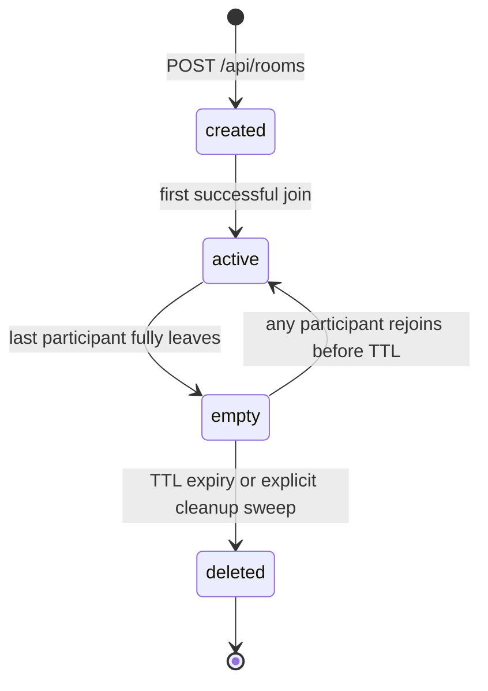

# Gateway Service Design

> Update note (2026-05-03): Gateway remains the HTTP/WS transport and room ingress boundary, and its canonical module path is now `server.service.gateway`. AI/model-facing code lives under `server.brain`; backend application/orchestration code lives under `server.service`. See `docs/backend/FILE_STRUCTURE.md` for the current layout.
>
> Update note (2026-05-10): `RoomState.room_languages` is now the canonical room-level language configuration. It is a 1+ item distinct list from `SUPPORTED_LANGUAGES`; `meeting_languages` is kept as a persisted/API alias for existing clients and old room snapshots. `ParticipantState.language` is separate and represents the participant-selected language.
>
> Update note (2026-05-01): Gateway room state now has explicit `brse_enabled`. Create-room can set it, REST/WS snapshots expose it, and live toggle uses `room.brse_updated` plus BRSE participant join/left events. `brse_enabled=false` is normal human-only meeting mode with no BRSE runtime or virtual participant.
>
> Update note (2026-04-30): Gateway runtime now exposes BRSE relay mode by default. Snapshot and websocket payloads may include room-level BRSE mode fields, a virtual participant `brse_ai`, and room-wide relay transcript events. Legacy per-listener routing details below remain as historical design context only.

Gateway là service FastAPI chịu trách nhiệm:

1. Tạo và quản lý room state trong Redis.
2. Cấp room JWT cho WebSocket Gateway.
3. Cấp LiveKit access token cho browser participants.
4. Fan-out participant events, transcript events, interpreter status tới FE qua WebSocket.
5. Publish control events sang Interpreter Service qua Redis pub/sub.

## Screen Share Runtime Notes

Gateway support screen share như capability chính thức ở room layer.

1. Participant state có field explicit:
  - `is_screen_sharing: bool`
  - `screen_share: { active, source, track_sid, track_name, started_at } | null`
2. Snapshot luôn trả về screen-share state hiện tại để FE render ngay sau load/reconnect.
3. Screen share signaling được sync qua cả:
  - WS client messages: `screen_share.start`, `screen_share.stop`
  - REST endpoints: `POST /api/rooms/{room_id}/screen-share/start|stop`
4. Gateway broadcast dedicated events:
  - `screen_share.started`
  - `screen_share.stopped`
  song song với `participant.updated` để tương thích flow participant state hiện có.
5. Cleanup chống stale:
  - participant leave/disconnect/stale-timeout sẽ clear screen-share state trước khi participant lifecycle hoàn tất.
  - media disconnect event path cũng ép stop screen share để tránh trạng thái share treo.

Ràng buộc thiết kế:

- Python 3.12+, `asyncio`
- Không dùng SQL database
- Room state lưu Redis với TTL = meeting duration + 5 phút grace (mặc định 35 phút)
- AI/model-facing code lives under `BE/server/brain/`; backend application/orchestration code, including Gateway, lives under `BE/server/service/`; Gateway code is under `BE/server/service/gateway/`
- Gateway và Interpreter giao tiếp qua **Redis pub/sub + Redis state**, không dùng shared memory, không dùng internal HTTP

## Process Model

Gateway chạy một process FastAPI với 4 thành phần nội bộ:

1. REST layer
2. WebSocket layer
3. Redis-backed room store
4. Redis event consumer nhận events từ Interpreter

```text
Browser REST/WS
    |
    v
FastAPI routes/ws
    |
    +--> RoomService ------> Redis keys (state, transcripts, TTL)
    |
    +--> WebSocketHub -----> in-memory sockets per room
    |
    +--> Redis pub/sub <---- Interpreter Service events
```

## Dependencies To Add

Các package cần có trong `BE/requirements.txt` để build Gateway:

| Package | Why |
| --- | --- |
| `fastapi` | REST + WebSocket server framework. |
| `uvicorn[standard]` | ASGI server cho FastAPI và local dev reload. |
| `redis[hiredis]` | `redis.asyncio` cho state + pub/sub; `hiredis` giảm parse overhead. |
| `python-jose[cryptography]` | Sign/verify room JWT. |
| `pydantic-settings` | Quản lý config qua env vars. |
| `livekit-api` | Sinh LiveKit access token cho browser participants. |
| `orjson` | Serialize JSON nhanh cho REST/WS payload lớn và nhiều event. |

Ghi chú về LiveKit Python SDK: repo `livekit-server-sdk-python` cũ đã deprecated; Gateway chỉ cần phần token/server API, vì vậy package thực tế nên dùng là `livekit-api`.

## Required Environment Variables

```text
OPENAI_API_KEY=...
REDIS_URL=redis://redis:6379/0
ROOM_JWT_SECRET=replace-me
ROOM_JWT_ALG=HS256
ROOM_TOKEN_TTL_SECONDS=86400
ROOM_MEETING_DURATION_SECONDS=1800
ROOM_EMPTY_GRACE_SECONDS=30
ROOM_MAX_PARTICIPANTS=0
LIVEKIT_API_KEY=devkey
LIVEKIT_API_SECRET=secret
LIVEKIT_WS_URL_PUBLIC=ws://localhost:7880
LIVEKIT_WS_URL_INTERNAL=ws://livekit:7880
PUBLIC_APP_URL=http://localhost:3000
PUBLIC_GATEWAY_URL=http://localhost:8000
PUBLIC_GATEWAY_WS_URL=
SUPPORTED_LANGUAGES=vi,en,ja,zh,ko,fr,es
RECENT_TRANSCRIPT_LIMIT=200
REDIS_CHANNEL_GATEWAY_CONTROL=brseai:v1:gateway:control
REDIS_CHANNEL_INTERPRETER_EVENTS=brseai:v1:interpreter:events
```

`LIVEKIT_WS_URL_PUBLIC` phải là URL browser truy cập được.

`LIVEKIT_WS_URL_INTERNAL` dành riêng cho Interpreter Service trong Docker network.

Production `meetqapp.com` values:

```text
LIVEKIT_WS_URL_PUBLIC=wss://rtc.meetqapp.com
LIVEKIT_WS_URL_INTERNAL=ws://livekit:7880
PUBLIC_APP_URL=https://meetqapp.com
PUBLIC_GATEWAY_URL=https://meetqapp.com
PUBLIC_GATEWAY_WS_URL=wss://meetqapp.com
```

## Identifiers

Gateway chuẩn hóa ID format để FE và log dễ đọc:

| Entity | Format Example |
| --- | --- |
| room_id | `rm_8f3k2v1m` |
| participant_id | `pt_01hs8x4e3m` |
| session_id | `ses_01hs8x9k4r` |
| event_id | `evt_01hs8xb17f` |
| transcript_id | `seg_01hs8xfw8n` |
| room_token jti | `rtk_01hs8xh5fk` |

Implementation nên dùng random opaque slug hoặc ULID; không expose integer sequence.

## Room JWT

Gateway phát hành room JWT cho WebSocket Gateway và leave API.

### Claims

```json
{
  "iss": "brseai-gateway",
  "aud": "brseai-room",
  "sub": "pt_01hs8x4e3m",
  "room_id": "rm_8f3k2v1m",
  "participant_id": "pt_01hs8x4e3m",
  "session_id": "ses_01hs8x9k4r",
  "display_name": "Huy",
  "lang": "vi",
  "role": "participant",
  "jti": "rtk_01hs8xh5fk",
  "iat": 1777440600,
  "exp": 1777527000
}
```

### Validation Rules

1. Signature hợp lệ với `ROOM_JWT_SECRET`.
2. `aud == "brseai-room"`.
3. `room_id` claim phải match URL room id.
4. `participant_id` phải còn tồn tại trong Redis room state và chưa `left`.
5. `session_id` phải match participant session mới nhất trong Redis.

## Redis State Model

Gateway dùng Redis làm source of truth cho room và participant metadata.

### Redis Keys

| Key | Type | Value |
| --- | --- | --- |
| `brseai:v1:room:{room_id}:meta` | string(JSON) | `RoomState` |
| `brseai:v1:room:{room_id}:participants` | hash | `participant_id -> ParticipantState JSON` |
| `brseai:v1:room:{room_id}:transcripts` | list | JSON serialized `TranscriptMessage` newest-first |
| `brseai:v1:room:{room_id}:seq` | string(int) | Monotonic event/transcript sequence |
| `brseai:v1:room:{room_id}:locks:cleanup` | string | Optional short-lived cleanup lock |

Gateway refresh TTL (meeting duration + 5 phút cleanup grace) trên `meta`, `participants`, `transcripts`, `seq` mỗi khi:

- room được tạo
- participant join
- participant update language
- participant leave
- transcript mới được persist
- interpreter status cập nhật

Khi room chuyển sang `empty`, TTL vẫn được refresh thêm cleanup grace tính từ thời điểm room rỗng lần cuối.

### Logical Models

```python
from typing import Literal, TypedDict


class ParticipantState(TypedDict):
    participant_id: str
    session_id: str
    display_name: str
    language: Literal["vi", "en", "ja", "zh", "ko", "fr", "es"]
    livekit_identity: str
    ws_connected: bool
    media_connected: bool
    status: Literal["joining", "connected", "reconnecting", "left"]
    joined_at: str
    last_seen_at: str
    left_at: str | None


class RoomState(TypedDict):
    room_id: str
    state: Literal["created", "active", "empty", "deleted"]
    created_at: str
    activated_at: str | None
    emptied_at: str | None
    expires_at: str
    brse_enabled: bool
    participant_limit: int | None  # None = no backend participant cap
    supported_languages: list[str]
    room_languages: list[str]     # 1+ distinct, subset of supported_languages
    meeting_languages: list[str]  # legacy alias mirroring room_languages
    audio_routing: dict[str, str]
    participant_count: int
    transcript_count: int
    last_event_at: str


class TranscriptState(TypedDict):
    transcript_id: str
    utterance_id: str
    kind: Literal["source", "translated"]
    room_id: str
    speaker_id: str
    speaker_display_name: str
    speaker_language: Literal["vi", "en", "ja", "zh", "ko", "fr", "es"]
    listener_id: str | None
    src_lang: Literal["vi", "en", "ja", "zh", "ko", "fr", "es"]
    tgt_lang: Literal["vi", "en", "ja", "zh", "ko", "fr", "es"] | None
    text: str
    source_text: str
    translated_text: str | None
    audio_track_name: str | None
    audio_output: dict[str, object] | None
    is_final: bool
    fallback_used: bool
    created_at: str
```

### Example Room Snapshot

```json
{
  "room": {
    "room_id": "rm_8f3k2v1m",
    "state": "active",
    "created_at": "2026-04-29T13:00:00Z",
    "activated_at": "2026-04-29T13:01:14Z",
    "emptied_at": null,
    "expires_at": "2026-04-29T13:30:00Z",
    "participant_limit": null,
    "supported_languages": ["vi", "en", "ja", "zh", "ko", "fr", "es"],
    "room_languages": ["vi", "ja"],
    "meeting_languages": ["vi", "ja"],
    "participant_count": 2,
    "transcript_count": 14,
    "last_event_at": "2026-04-29T13:12:54Z"
  },
  "participants": [
    {
      "participant_id": "pt_01hs8x4e3m",
      "session_id": "ses_01hs8x9k4r",
      "display_name": "Huy",
      "language": "vi",
      "livekit_identity": "pt_01hs8x4e3m",
      "ws_connected": true,
      "media_connected": true,
      "status": "connected",
      "joined_at": "2026-04-29T13:01:14Z",
      "last_seen_at": "2026-04-29T13:12:54Z",
      "left_at": null
    },
    {
      "participant_id": "pt_01hs8y3n1z",
      "session_id": "ses_01hs8y8hdb",
      "display_name": "Sato",
      "language": "ja",
      "livekit_identity": "pt_01hs8y3n1z",
      "ws_connected": true,
      "media_connected": true,
      "status": "connected",
      "joined_at": "2026-04-29T13:02:01Z",
      "last_seen_at": "2026-04-29T13:12:51Z",
      "left_at": null
    }
  ]
}
```

## Room Lifecycle



### Transition Rules

1. `created`
   Room meta tồn tại, `participant_count == 0`.

2. `active`
   Có ít nhất 1 participant chưa `left`.

3. `empty`
   Tất cả participant đã `left` hoặc reconnect grace period đã hết.

4. `deleted`
   Redis keys của room bị xóa hoặc expire; API trả `404 room_not_found`.

### Participant Leave Semantics

Participant chỉ bị coi là `left` khi một trong các điều kiện sau xảy ra:

1. FE gọi `DELETE /api/rooms/{room_id}/leave`.
2. Gateway WS disconnect và không reconnect trong `ROOM_EMPTY_GRACE_SECONDS`.
3. Interpreter gửi event `participant.media_disconnected` và participant cũng không còn WS trong grace window.

Điều này tránh UI flicker khi browser refresh.

## REST API

Common response headers:

```text
Content-Type: application/json
X-Request-ID: <server generated or forwarded request id>
```

Common error envelope:

```json
{
  "error": {
    "code": "room_expired",
    "message": "Room meeting duration has expired. Please create a new room.",
    "request_id": "req_01hs8z1b2p",
    "details": {
      "room_id": "rm_8f3k2v1m"
    }
  }
}
```

### `POST /api/rooms`

Tạo room trống. Không auto-join host.

#### Request Body

```json
{
  "room_languages": ["vi", "ja"],
  "brse_enabled": true
}
```

Validation:

1. `room_languages` là canonical và phải có ít nhất 1 phần tử.
2. Các ngôn ngữ trong list phải khác nhau.
3. Mỗi ngôn ngữ phải thuộc `supported_languages` (`vi|en|ja|zh|ko|fr|es`).
4. `meeting_languages` vẫn được nhận như alias legacy; `language_a` / `language_b` cũng được map khi gặp request hoặc snapshot cũ.
5. Nếu omitted, backend hiện default `room_languages=["vi", "ja"]` để giữ tương thích create-room flow cũ.
6. Nếu `brse_enabled` omitted, backend default `true` để giữ tương thích BRSE-first flow hiện tại.

Room một ngôn ngữ là hợp lệ. Gateway vẫn cho create/join/chat/summary/transcript bình thường; BRSE relay runtime sẽ degrade thành source transcript / same-language assist thay vì ép target "ngôn ngữ còn lại".

#### Success Response `201 Created`

```json
{
  "room": {
    "room_id": "rm_8f3k2v1m",
    "state": "created",
    "created_at": "2026-04-29T13:00:00Z",
    "expires_at": "2026-04-30T13:00:00Z",
    "brse_enabled": true,
    "participant_limit": null,
    "supported_languages": ["vi", "en", "ja", "zh", "ko", "fr", "es"],
    "room_languages": ["vi", "ja"],
    "meeting_languages": ["vi", "ja"]
  },
  "join": {
    "api_path": "/api/rooms/rm_8f3k2v1m/join",
    "share_url": "http://localhost:3000/rooms/rm_8f3k2v1m"
  }
}
```

#### Error Cases

| Status | Code | Meaning |
| --- | --- | --- |
| `503` | `redis_unavailable` | Redis create/write thất bại. |
| `500` | `internal_error` | Unexpected exception. |

### `GET /api/rooms/{room_id}`

Lấy public room snapshot để FE hydrate khi load room page hoặc reconnect.

#### Request

Không cần auth cho MVP. Room id đủ khó đoán và không có room listing công khai.

#### Success Response `200 OK`

```json
{
  "room": {
    "room_id": "rm_8f3k2v1m",
    "state": "active",
    "created_at": "2026-04-29T13:00:00Z",
    "expires_at": "2026-04-30T13:12:54Z",
    "participant_limit": null,
    "supported_languages": ["vi", "en", "ja", "zh", "ko", "fr", "es"],
    "room_languages": ["vi", "ja"],
    "meeting_languages": ["vi", "ja"],
    "participant_count": 2
  },
  "participants": [
    {
      "participant_id": "pt_01hs8x4e3m",
      "display_name": "Huy",
      "language": "vi",
      "status": "connected",
      "joined_at": "2026-04-29T13:01:14Z"
    },
    {
      "participant_id": "pt_01hs8y3n1z",
      "display_name": "Sato",
      "language": "ja",
      "status": "connected",
      "joined_at": "2026-04-29T13:02:01Z"
    }
  ],
  "recent_transcripts": [
    {
      "transcript_id": "seg_01hs8xfw8n::source",
      "utterance_id": "seg_01hs8xfw8n",
      "kind": "source",
      "speaker_id": "pt_01hs8x4e3m",
      "speaker_display_name": "Huy",
      "speaker_language": "vi",
      "src_lang": "vi",
      "text": "Chúng ta bắt đầu nhé.",
      "source_text": "Chúng ta bắt đầu nhé.",
      "is_final": true,
      "created_at": "2026-04-29T13:11:01Z"
    }
  ]
}
```

#### Error Cases

| Status | Code | Meaning |
| --- | --- | --- |
| `404` | `room_not_found` | Room đã bị xóa hoặc chưa từng tồn tại. |
| `503` | `redis_unavailable` | Không đọc được state. |

### `POST /api/rooms/{room_id}/join`

Sinh participant session, room JWT, LiveKit token, và snapshot ban đầu.

#### Request Body

```json
{
  "display_name": "Huy",
  "language": "vi",
  "client": {
    "sdk": "web",
    "version": "0.1.0"
  }
}
```

#### Validation

1. `display_name` trimmed length `1..40`
2. `language` phải thuộc đúng `room.room_languages` của room
3. room phải tồn tại và chưa `deleted`
4. room phải chưa expired (meeting duration 30 phút)
5. nếu `ROOM_MAX_PARTICIPANTS > 0`: `participant_count < ROOM_MAX_PARTICIPANTS`

#### Success Response `200 OK`

```json
{
  "room": {
    "room_id": "rm_8f3k2v1m",
    "state": "active",
    "participant_limit": null,
    "supported_languages": ["vi", "en", "ja", "zh", "ko", "fr", "es"],
    "room_languages": ["vi", "ja"],
    "meeting_languages": ["vi", "ja"]
  },
  "participant": {
    "participant_id": "pt_01hs8x4e3m",
    "session_id": "ses_01hs8x9k4r",
    "display_name": "Huy",
    "language": "vi"
  },
  "room_token": {
    "token": "<gateway-room-jwt>",
    "expires_at": "2026-04-30T13:01:14Z"
  },
  "websocket": {
    "url": "ws://localhost:8000/ws/rooms/rm_8f3k2v1m?token=<gateway-room-jwt>"
  },
  "livekit": {
    "url": "ws://localhost:7880",
    "room_name": "rm_8f3k2v1m",
    "participant_identity": "pt_01hs8x4e3m",
    "participant_name": "Huy",
    "token": "<livekit-jwt>"
  },
  "snapshot": {
    "participants": [
      {
        "participant_id": "pt_01hs8x4e3m",
        "display_name": "Huy",
        "language": "vi",
        "status": "joining"
      }
    ],
    "recent_transcripts": []
  }
}
```

#### Error Cases

| Status | Code | Meaning |
| --- | --- | --- |
| `404` | `room_not_found` | Room không tồn tại. |
| `410` | `room_expired` | Room meeting duration đã hết (30 phút). |
| `409` | `room_full` | Room đã đủ participants (chỉ khi ROOM_MAX_PARTICIPANTS > 0). |
| `422` | `invalid_display_name` | Tên rỗng hoặc quá dài. |
| `422` | `invalid_language` | Language không thuộc room `room_languages`. |
| `503` | `redis_unavailable` | Không lưu được participant state. |
| `503` | `livekit_unavailable` | Không generate được LiveKit token. |

### `DELETE /api/rooms/{room_id}/leave`

Participant rời room một cách clean. FE phải gọi endpoint này trước khi đóng tab nếu có thể.

#### Headers

```text
Authorization: Bearer <gateway-room-jwt>
```

#### Success Response `204 No Content`

Không có body.

#### Side Effects

1. Participant state -> `left`
2. Redis TTL refresh
3. Publish control event `participant.left` sang Interpreter
4. WebSocketHub close socket hiện tại nếu còn mở

#### Error Cases

| Status | Code | Meaning |
| --- | --- | --- |
| `401` | `invalid_token` | Room token invalid/expired. |
| `403` | `token_room_mismatch` | Token room_id không khớp path room_id. |
| `404` | `participant_not_found` | Participant không còn trong state. |
| `404` | `room_not_found` | Room không còn tồn tại. |

### `GET /api/health`

Health endpoint dành cho load balancer và smoke tests.

#### Success Response `200 OK`

```json
{
  "status": "ok",
  "service": "gateway",
  "time": "2026-04-29T13:12:54Z",
  "dependencies": {
    "redis": "ok"
  }
}
```

#### Error Cases

| Status | Code | Meaning |
| --- | --- | --- |
| `503` | `redis_unavailable` | Redis ping fail; process còn sống nhưng chưa ready. |

## WebSocket `/ws/rooms/{room_id}`

### Connection URL

```text
wss://host/ws/rooms/{room_id}?token=<gateway-room-jwt>
```

### Authentication

Gateway phải verify room JWT trước khi `accept()`. Nếu fail, đóng socket ngay:

| Close Code | Meaning |
| --- | --- |
| `4401` | invalid or expired token |
| `4403` | room/token mismatch hoặc participant không hợp lệ |
| `4404` | room không tồn tại |
| `4409` | participant session bị superseded bởi join mới hơn |

### Runtime Connection Rules

1. Một participant chỉ có một WS active tại một thời điểm.
2. Nếu participant reconnect với cùng `session_id`, connection mới thay thế connection cũ.
3. Sau khi accept, Gateway gửi ngay `room.snapshot`.
4. Gateway maintain task nhận Redis interpreter events và task nhận client messages.
5. Khi socket đóng, Gateway set `ws_connected=false` và chờ reconnect grace period trước khi emit `participant.left`.

## Common WS Envelope

Mọi WS message đều theo envelope này:

```json
{
  "type": "participant.joined",
  "event_id": "evt_01hs8xb17f",
  "room_id": "rm_8f3k2v1m",
  "sent_at": "2026-04-29T13:12:54.000Z",
  "payload": {}
}
```

## Client -> Server Messages

### `ping`

#### Purpose

Heartbeat application-level. FE gửi mỗi 15 giây nếu không có traffic khác.

#### Message

```json
{
  "type": "ping",
  "event_id": "evt_01hs8ypr0j",
  "room_id": "rm_8f3k2v1m",
  "sent_at": "2026-04-29T13:12:54.000Z",
  "payload": {
    "client_time": "2026-04-29T13:12:54.000Z"
  }
}
```

#### Server Behavior

- update `last_seen_at`
- reply `pong`

### `set_language`

#### Purpose

Cho phép participant đổi ngôn ngữ nghe/nói trong room. Đây là tín hiệu authoritative cho Interpreter routing.

#### Message

```json
{
  "type": "set_language",
  "event_id": "evt_01hs8z0xcm",
  "room_id": "rm_8f3k2v1m",
  "sent_at": "2026-04-29T13:14:10.000Z",
  "payload": {
    "language": "en"
  }
}
```

#### Validation

- `language` phải thuộc `room.room_languages`; `meeting_languages` chỉ là alias legacy. Mọi room language config phải là subset của `vi|en|ja|zh|ko|fr|es`.
- participant phải chưa `left`

#### Side Effects

1. Update Redis participant state
2. Publish `participant.updated` sang Redis control channel
3. Broadcast `participant.updated` tới tất cả room clients

### Invalid Client Message Handling

Nếu parse thất bại hoặc payload invalid, Gateway gửi `error` event nhưng không close socket ngay. Sau 3 invalid messages trong 30 giây, Gateway close `4400`.

### `room.brse.enable` / `room.brse.disable`

Client có thể toggle BRSE mode qua room websocket với room token/session hiện tại:

```json
{
  "type": "room.brse.disable",
  "event_id": "evt_01hs8zbrse",
  "room_id": "rm_8f3k2v1m",
  "sent_at": "2026-05-01T08:40:00.000Z",
  "payload": {}
}
```

Backend branch hiện chưa có host model trong room state; permission rule tạm thời là mọi active human participant có valid room token/session được phép toggle. Khi host model được bổ sung, path này phải đổi sang host-only.

## Server -> Client Messages

### `room.snapshot`

Gửi ngay sau connect thành công.

`recent_transcripts` trong snapshot này đã được personalize theo participant:

1. luôn có source transcript gần nhất của speaker
2. chỉ có translated transcript nếu transcript đó dành cho participant hiện tại
3. `utterance_id` correlate source/translated cho cùng lượt nói
4. `transcript_id` ổn định giữa partial và final của cùng stream

```json
{
  "type": "room.snapshot",
  "event_id": "evt_01hs8za8xj",
  "room_id": "rm_8f3k2v1m",
  "sent_at": "2026-04-29T13:12:54.000Z",
  "payload": {
    "self": {
      "participant_id": "pt_01hs8x4e3m",
      "session_id": "ses_01hs8x9k4r",
      "display_name": "Huy",
      "language": "vi"
    },
    "room": {
      "state": "active",
      "participant_limit": null,
      "supported_languages": ["vi", "en", "ja", "zh", "ko", "fr", "es"]
    },
    "participants": [
      {
        "participant_id": "pt_01hs8x4e3m",
        "display_name": "Huy",
        "language": "vi",
        "status": "connected"
      },
      {
        "participant_id": "pt_01hs8y3n1z",
        "display_name": "Sato",
        "language": "ja",
        "status": "connected"
      }
    ],
    "recent_transcripts": []
  }
}
```

### `room.brse_updated`

Broadcast khi BRSE mode đổi:

```json
{
  "type": "room.brse_updated",
  "event_id": "evt_01hs8zbrse",
  "room_id": "rm_8f3k2v1m",
  "sent_at": "2026-05-01T08:40:00.000Z",
  "payload": {
    "room_id": "rm_8f3k2v1m",
    "brse_enabled": false,
    "timestamp": "2026-05-01T08:40:00.000Z",
    "changed_by": "pt_01hs8x4e3m",
    "reason": "ws_disable"
  }
}
```

When disabled, Gateway removes `brse_ai` from snapshot state, clears recent BRSE interpreter transcripts, and emits `participant.left` for `brse_ai`. Interpreter daemon consumes the same event and terminates the room runtime.

### `participant.joined`

```json
{
  "type": "participant.joined",
  "event_id": "evt_01hs8zb1a1",
  "room_id": "rm_8f3k2v1m",
  "sent_at": "2026-04-29T13:13:10.000Z",
  "payload": {
    "participant_id": "pt_01hs8y3n1z",
    "display_name": "Sato",
    "language": "ja",
    "status": "connected",
    "joined_at": "2026-04-29T13:13:10.000Z"
  }
}
```

### `participant.updated`

Dùng cho language change hoặc reconnect state change.

```json
{
  "type": "participant.updated",
  "event_id": "evt_01hs8zc9db",
  "room_id": "rm_8f3k2v1m",
  "sent_at": "2026-04-29T13:14:10.000Z",
  "payload": {
    "participant_id": "pt_01hs8x4e3m",
    "display_name": "Huy",
    "language": "en",
    "status": "connected"
  }
}
```

### `participant.left`

```json
{
  "type": "participant.left",
  "event_id": "evt_01hs8zd2mk",
  "room_id": "rm_8f3k2v1m",
  "sent_at": "2026-04-29T13:18:44.000Z",
  "payload": {
    "participant_id": "pt_01hs8y3n1z",
    "left_at": "2026-04-29T13:18:44.000Z"
  }
}
```

### `transcript.partial`

Gateway dùng 2 luồng transcript:

1. `kind = "source"`: broadcast cả room để FE biết ai đang nói gì theo realtime
2. `kind = "translated"`: fan-out cá nhân hóa theo listener để FE có thể hiển thị lời dịch phù hợp với ngôn ngữ hiện tại

FE có thể render trực tiếp bằng:

1. `speaker.display_name`
2. `text`
3. `kind`
4. `src_lang`
5. `tgt_lang`
6. `transcript_id`
7. `is_final`
8. `created_at`

`text` và `kind` là authoritative fields cho FE mới.  
Source transcript vẫn mang thêm các field legacy (`listener`, `tgt_lang`, `translated_text`) mirror theo ngôn ngữ gốc để giảm rủi ro break FE cũ.

```json
{
  "type": "transcript.partial",
  "event_id": "evt_01hs8zeh2f",
  "room_id": "rm_8f3k2v1m",
  "sent_at": "2026-04-29T13:15:31.000Z",
  "payload": {
    "transcript_id": "seg_01hs8xfw8n::translated::ja",
    "utterance_id": "seg_01hs8xfw8n",
    "kind": "translated",
    "speaker": {
      "participant_id": "pt_01hs8x4e3m",
      "display_name": "Huy",
      "language": "vi",
      "source_language": "vi"
    },
    "listener": {
      "participant_id": "pt_01hs8y3n1z",
      "target_language": "ja"
    },
    "text": "私たちは",
    "src_lang": "vi",
    "tgt_lang": "ja",
    "source_text": "Chúng ta",
    "translated_text": "私たちは",
    "audio_track_name": "interp::pt_01hs8x4e3m::pt_01hs8y3n1z::vi::ja",
    "audio_output": {
      "model": "translated_audio_first",
      "mode": "interpreter_track",
      "canonical": true
    },
    "fallback_used": false,
    "is_final": false,
    "created_at": "2026-04-29T13:15:31.000Z"
  }
}
```

### `transcript.final`

```json
{
  "type": "transcript.final",
  "event_id": "evt_01hs8zf1by",
  "room_id": "rm_8f3k2v1m",
  "sent_at": "2026-04-29T13:15:32.000Z",
  "payload": {
    "transcript_id": "seg_01hs8xfw8n::source",
    "utterance_id": "seg_01hs8xfw8n",
    "kind": "source",
    "speaker": {
      "participant_id": "pt_01hs8x4e3m",
      "display_name": "Huy",
      "language": "vi",
      "source_language": "vi"
    },
    "listener": {
      "participant_id": "pt_01hs8x4e3m",
      "target_language": "vi"
    },
    "text": "Chúng ta bắt đầu nhé.",
    "src_lang": "vi",
    "tgt_lang": "vi",
    "source_text": "Chúng ta bắt đầu nhé.",
    "translated_text": "Chúng ta bắt đầu nhé.",
    "audio_track_name": null,
    "audio_output": null,
    "fallback_used": false,
    "is_final": true,
    "created_at": "2026-04-29T13:15:31.000Z"
  }
}
```

### `interpreter.status`

```json
{
  "type": "interpreter.status",
  "event_id": "evt_01hs8zgbyn",
  "room_id": "rm_8f3k2v1m",
  "sent_at": "2026-04-29T13:15:30.000Z",
  "payload": {
    "speaker_id": "pt_01hs8x4e3m",
    "source_language": "vi",
    "target_language": "ja",
    "status": "translating",
    "fallback_used": false,
    "message": null,
    "audio_track_name": "interp::pt_01hs8x4e3m::pt_01hs8y3n1z::vi::ja",
    "listener_ids": ["pt_01hs8y3n1z"],
    "audio_output": {
      "model": "translated_audio_first",
      "mode": "interpreter_track",
      "canonical": true
    }
  }
}
```

Valid `status` values:

- `idle`
- `capturing`
- `translating`
- `playing`
- `fallback_text_only`
- `error`

### `pong`

```json
{
  "type": "pong",
  "event_id": "evt_01hs8zhh7q",
  "room_id": "rm_8f3k2v1m",
  "sent_at": "2026-04-29T13:12:54.010Z",
  "payload": {
    "client_time": "2026-04-29T13:12:54.000Z",
    "server_time": "2026-04-29T13:12:54.010Z"
  }
}
```

### `error`

Runtime validation error hoặc downstream failure không đủ nghiêm trọng để đóng socket.

```json
{
  "type": "error",
  "event_id": "evt_01hs8zj5rz",
  "room_id": "rm_8f3k2v1m",
  "sent_at": "2026-04-29T13:14:10.020Z",
  "payload": {
    "code": "invalid_language",
    "message": "language must be one of vi, en, ja, zh, ko, fr, es"
  }
}
```

## WebSocket Lifecycle

### Connect

1. Parse `room_id` + query `token`
2. Verify JWT + Redis participant state
3. Replace previous socket for same participant if present
4. `accept()`
5. Mark `ws_connected=true`
6. Send `room.snapshot`
7. Start 3 tasks:
   - receive client messages
   - send queued room events
   - heartbeat/watchdog

### Heartbeat

- Client gửi `ping` mỗi 15s
- Gateway trả `pong`
- Nếu 45s không thấy heartbeat và không có outbound traffic thành công, Gateway close socket và start reconnect grace timer

### Disconnect

1. Remove socket from `WebSocketHub`
2. Mark `ws_connected=false`, `status=reconnecting`
3. If `media_connected` cũng false, schedule grace cleanup
4. Nếu grace hết mà participant vẫn offline, mark `left`, broadcast `participant.left`, publish Redis control event

## Gateway <-> Interpreter Communication

### Chosen Mechanism

**Redis pub/sub + Redis state** là lựa chọn duy nhất dùng trong thiết kế này.

### Why This Choice

1. Đã bắt buộc dùng Redis cho room state nên không cần thêm dependency giao tiếp mới.
2. Gateway và Interpreter có thể scale độc lập, không cần shared memory.
3. Transcript/status là event ephemeral phù hợp với pub/sub.
4. Nếu pub/sub message bị miss trong restart ngắn, service vẫn rebuild được state từ Redis keys.

### Channels

| Channel | Direction | Payload Owner |
| --- | --- | --- |
| `brseai:v1:gateway:control` | Gateway -> Interpreter | Gateway |
| `brseai:v1:interpreter:events` | Interpreter -> Gateway | Interpreter |

### Common Event Envelope

```json
{
  "event_id": "evt_01hs8zkhsy",
  "type": "participant.joined",
  "room_id": "rm_8f3k2v1m",
  "sent_at": "2026-04-29T13:01:14.000Z",
  "payload": {}
}
```

### Gateway -> Interpreter Events

| Type | When | Payload |
| --- | --- | --- |
| `room.created` | sau `POST /api/rooms` | room meta cơ bản |
| `room.brse_updated` | sau REST/WS BRSE toggle | room id, `brse_enabled`, timestamp |
| `participant.joined` | sau `POST /join` | participant id, display name, language, livekit identity |
| `participant.updated` | sau `set_language` | participant id, new language |
| `participant.left` | sau `leave` hoặc grace timeout | participant id, left_at |
| `room.deleted` | cleanup TTL/sweeper | room_id only |

### Interpreter -> Gateway Events

| Type | When | Payload |
| --- | --- | --- |
| `participant.media_connected` | LiveKit participant active | participant id |
| `participant.media_disconnected` | LiveKit participant left room | participant id |
| `transcript.partial` | source speech delta or translated delta available | source = room-broadcast, translated = listener-personalized |
| `transcript.final` | source speech final or translated final available | stable `transcript_id`, `utterance_id`, speaker attribution, optional latency |
| `interpreter.status` | state change per speaker/target | speaker id, target lang, status |
| `interpreter.error` | unrecoverable room/session error | room-level or session-level error payload |

## Error Codes

Gateway dùng chung set mã lỗi cho REST và WS.

| Code | HTTP | WS | Meaning |
| --- | --- | --- | --- |
| `invalid_request` | `400` | `error` | malformed payload hoặc missing field |
| `invalid_token` | `401` | `4401` | token sai signature hoặc hết hạn |
| `token_room_mismatch` | `403` | `4403` | token room_id không khớp path |
| `room_not_found` | `404` | `4404` | room không tồn tại |
| `participant_not_found` | `404` | `4403` | participant state không tồn tại |
| `room_full` | `409` | `error` | room đạt giới hạn 8 người |
| `invalid_display_name` | `422` | `error` | tên không hợp lệ |
| `invalid_language` | `422` | `error` | language không hợp lệ |
| `redis_unavailable` | `503` | `error` | Redis error |
| `livekit_unavailable` | `503` | `error` | LiveKit token generation hoặc downstream service error |
| `interpreter_unavailable` | `503` | `error` | không có interpreter events trong grace/attach window |
| `internal_error` | `500` | `1011` | unexpected server exception |

## Implementation Notes

1. `GET /api/rooms/{room_id}` không cần auth ở MVP, nhưng payload không được chứa token hay internal metadata.
2. Gateway persist transcript **final** vào Redis list; `partial` chỉ fan-out realtime, không lưu lâu dài.
3. `orjson` chỉ dùng cho serialization boundary; internal models vẫn là Pydantic/TypedDict rõ ràng.
4. Gateway không gọi trực tiếp OpenAI và không kết nối trực tiếp tới LiveKit room; việc media processing hoàn toàn thuộc Interpreter.
