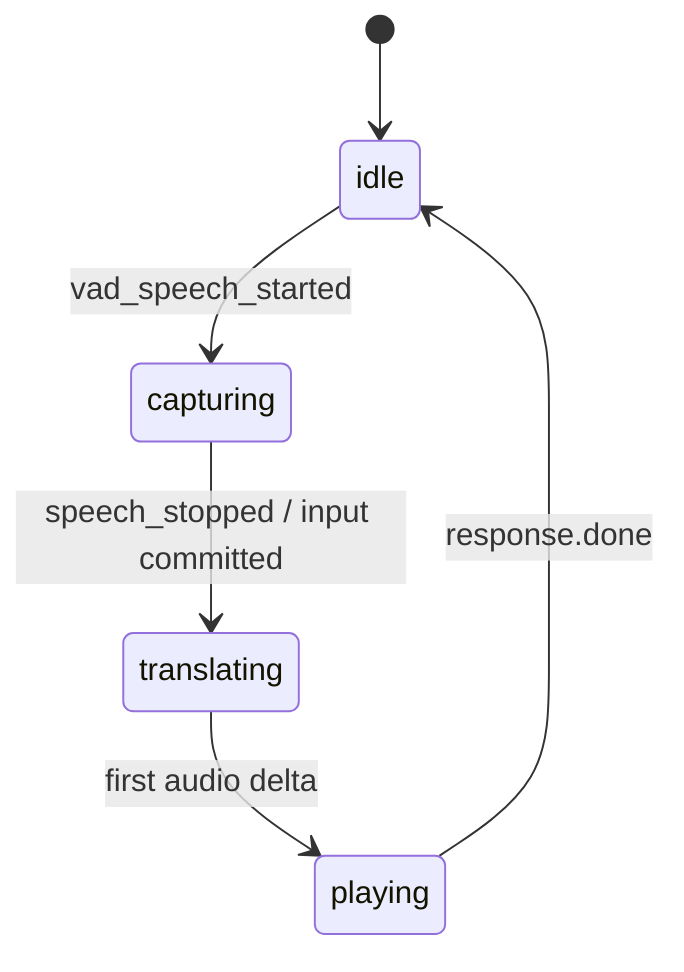
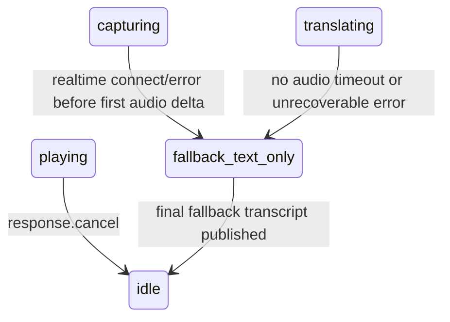

# Interpreter Service Design

> Update note (2026-05-01): interpreter runtime is gated by room `brse_enabled`. When false, the daemon does not spawn a room runtime, does not join LiveKit as `BRSE AI`, and ignores stale interpreter output for that room. Live toggle uses `room.brse_updated`: OFF terminates the manager and disconnects BRSE runtime; ON spawns a fresh manager from the current room snapshot.
>
> Update note (2026-04-30): active interpreter runtime now uses BRSE participant semantics instead of per-listener translated tracks. The interpreter joins as virtual participant `BRSE AI`, subscribes to human mic audio, and publishes canonical BRSE relay audio/text back to the room. Legacy per-listener sections below remain as background context only.

Interpreter Service là bridge giữa LiveKit SFU và OpenAI Realtime API.

Nó chịu trách nhiệm:

1. Join từng LiveKit room như một programmatic participant.
2. Subscribe microphone audio track của human participants.
3. Reuse core engine hiện có trong `BE/src/realtime/client.py` mà không sửa file gốc.
4. Publish translated audio trở lại LiveKit thành track riêng cho từng listener.
5. Gửi transcript và interpreter status về Gateway qua Redis pub/sub.
6. Degrade sang fallback Whisper + GPT nếu realtime path lỗi.

Ràng buộc cứng:

- Không sửa file nào trong `BE/src/common/`, `BE/src/realtime/`, `BE/src/fallback/`
- Tất cả orchestration ở `BE/server/interpreter/`
- Async-first, Python 3.12+, `asyncio`
- Không persist audio stream xuống disk trong platform mode
- LiveKit room access qua maintained Python SDK packages `livekit` và `livekit-api`

## Process Model

Một process Interpreter duy nhất quản lý nhiều room đồng thời.

```text
Redis control channel
        |
        v
InterpreterService
        |
        +--> RoomRuntime(room_id)
                 |
                 +--> LiveKit room connection (programmatic participant)
                 +--> one AudioStream subscription per speaker mic track
                 +--> RealtimeClientPool
                        |
                        +--> InterpretationSession(room, speaker, src, tgt)
                               |
                               +--> LiveKitAudioInput
                               +--> InterpreterRealtimeClient
                               +--> OutputRouter
                               +--> FallbackTranslator
```

## Dependencies To Add

| Package | Why |
| --- | --- |
| `livekit` | RTC participant SDK để subscribe/publish raw audio trong room. |
| `livekit-api` | Sinh internal interpreter token hoặc gọi room service APIs khi cần. |
| `redis[hiredis]` | Nhận control events từ Gateway, publish transcript/status ngược lại. |
| `pydantic-settings` | Shared environment config. |
| `orjson` | Serialize event envelopes nhanh. |

Interpreter dùng tiếp các deps đã có:

- `openai`
- `websockets`
- `numpy`
- `python-dotenv`

## Required Environment Variables

```text
OPENAI_API_KEY=...
REDIS_URL=redis://redis:6379/0
LIVEKIT_API_KEY=devkey
LIVEKIT_API_SECRET=secret
LIVEKIT_WS_URL_INTERNAL=ws://livekit:7880
INTERPRETER_IDENTITY_PREFIX=interp
INTERPRETER_CONNECT_TIMEOUT_SECONDS=10
REALTIME_OUTPUT_SAMPLE_RATE=24000
REALTIME_INPUT_SAMPLE_RATE=16000
REALTIME_FRAME_MS=20
SESSION_IDLE_TTL_SECONDS=60
SESSION_MAX_NO_AUDIO_SECONDS=2
FALLBACK_UTTERANCE_MAX_SECONDS=15
REDIS_CHANNEL_GATEWAY_CONTROL=brseai:v1:gateway:control
REDIS_CHANNEL_INTERPRETER_EVENTS=brseai:v1:interpreter:events
```

## Room-Level Topology

Interpreter không kết nối trực tiếp tới browser. Mỗi room active có đúng một `RoomRuntime`.

### Interpreter Participant

Mỗi `RoomRuntime` join LiveKit room với identity:

```text
interp::{room_id}
```

Ví dụ:

```text
interp::rm_8f3k2v1m
```

Participant này:

- `can_subscribe=true`
- `can_publish=true`
- `can_publish_data=false`
- tên hiển thị có thể là `Interpreter`

FE phải filter participant này khỏi video grid bằng prefix `interp::`.

### Track Naming Contract

Translated audio track name luôn theo format:

```text
interp::{speaker_id}::{listener_id}::{src_lang}::{tgt_lang}
```

Ví dụ:

```text
interp::pt_01hs8x4e3m::pt_01hs8y3n1z::vi::ja
```

FE dùng `track.name` để nhận diện audio dịch dành cho mình.

## Control Flow With Gateway

Interpreter subscribe một global Redis channel:

```text
brseai:v1:gateway:control
```

Các event phải hiểu:

- `room.created`
- `room.brse_updated`
- `participant.joined`
- `participant.updated`
- `participant.left`
- `room.deleted`

Interpreter publish kết quả sang:

```text
brseai:v1:interpreter:events
```

Event gửi ngược:

- `participant.media_connected`
- `participant.media_disconnected`
- `transcript.partial`
- `transcript.final`
- `interpreter.status`
- `interpreter.error`

## LiveKit RoomRuntime

`RoomRuntime` là owner của toàn bộ media resource trong một room.

### Responsibilities

1. Connect/close LiveKit room.
2. Track current participant metadata từ Gateway control events.
3. Subscribe microphone publications của remote human participants.
4. Create or release `InterpretationSession` theo ngôn ngữ hiện tại của room.
5. Forward participant media connect/disconnect status về Gateway.

### Internal State

```python
class RoomRuntime:
    room_id: str
    participants: dict[str, ParticipantState]
    room: rtc.Room
    speaker_tracks: dict[str, rtc.RemoteAudioTrack]
    pool: RealtimeClientPool
    started_at: str
```

### Subscribe Strategy

Interpreter connect với `auto_subscribe=False`.

Khi có `track_published` hoặc khi scan initial remote participants:

1. Bỏ qua participant có identity prefix `interp::`
2. Bỏ qua video tracks
3. Chỉ `set_subscribed(True)` cho microphone audio tracks
4. Lưu `RemoteAudioTrack` vào `speaker_tracks[speaker_id]`
5. Gửi `participant.media_connected`

Khi participant disconnect hoặc unpublish mic:

1. release toàn bộ sessions của speaker đó
2. `OutputRouter.clear_queue()` cho các listener track liên quan
3. unpublish translation tracks nếu không còn listener
4. gửi `participant.media_disconnected`

## `LiveKitAudioInput` Adapter

`BE/src/common/audio.py` yêu cầu một `AudioInput` sync interface:

```python
class AudioInput(abc.ABC):
    @property
    def metadata(self) -> AudioMetadata: ...
    def start(self) -> None: ...
    def stop(self) -> None: ...
    def stream_frames(self) -> Iterator[bytes]: ...
```

LiveKit Python SDK lại phát audio theo async iterator `rtc.AudioStream`.

### Design Goal

`LiveKitAudioInput` bridge async `rtc.AudioStream` thành blocking PCM16 iterator mà `RealtimeClient` hiện có chấp nhận được, không sửa `src/realtime/client.py`.

### Construction

Interpreter tạo stream như sau:

```python
audio_stream = rtc.AudioStream.from_track(
    track=remote_audio_track,
    sample_rate=16000,
    num_channels=1,
    frame_size_ms=20,
)
audio_input = LiveKitAudioInput(
    loop=asyncio.get_running_loop(),
    stream=audio_stream,
    speaker_id=speaker_id,
)
```

LiveKit tự resample từ incoming WebRTC audio xuống 16kHz mono.

### Class Shape

```python
import asyncio
import queue
from typing import Iterator

from livekit import rtc
from src.common.audio import AudioInput, AudioMetadata


class LiveKitAudioInput(AudioInput):
    def __init__(
        self,
        *,
        loop: asyncio.AbstractEventLoop,
        stream: rtc.AudioStream,
        speaker_id: str,
        sample_rate: int = 16000,
        channels: int = 1,
    ) -> None: ...

    @property
    def metadata(self) -> AudioMetadata: ...

    def start(self) -> None: ...
    def stop(self) -> None: ...
    def stream_frames(self) -> Iterator[bytes]: ...
```

### Internal Mechanics

1. `start()` không tự đọc frame trực tiếp.
2. `start()` schedule một async task `_pump_stream()` trên main event loop bằng `asyncio.run_coroutine_threadsafe(...)`.
3. `_pump_stream()` iterate `async for frame_event in stream`.
4. Mỗi frame được convert thành raw PCM16 bytes và đẩy vào `queue.Queue[bytes | None]`.
5. `stream_frames()` là blocking iterator đọc `queue.Queue`, trả về bytes 20ms một lần.
6. `stop()` cancel pump task, close `AudioStream`, push sentinel `None`.

### Frame Format

- Sample rate: `16000`
- Channels: `1`
- Sample width: `int16`
- Chunk size: `20 ms`
- Bytes/chunk: `16000 * 0.02 * 2 = 640 bytes`

### Example Metadata

```json
{
  "sample_rate": 16000,
  "channels": 1,
  "speaker_id": "pt_01hs8x4e3m"
}
```

### Edge Cases

1. Nếu LiveKit SDK version không hỗ trợ `frame_size_ms`, adapter phải rechunk thủ công bằng `bytearray` buffer để vẫn xuất đều `640` bytes/chunk.
2. Nếu track mute hoặc participant disconnect, `_pump_stream()` kết thúc cleanly và push sentinel.
3. Nếu queue đầy, drop oldest chunk thay vì block event loop; realtime latency quan trọng hơn lossless capture.

## Reusing `RealtimeClient` Without Editing `BE/src/`

`src/realtime/client.py` hiện:

- in translation text ra stdout
- push audio delta vào `SpeakerPlayer`
- có helper internals `_run_with_retry`, `_handle_event`, `_handle_input_transcript`

Interpreter cần callback-based integration, không dùng stdout và không dùng speaker playback. Vì không được sửa file gốc, cần một wrapper/subclass mới:

```python
class InterpreterRealtimeClient(RealtimeClient):
    ...
```

### Responsibilities of `InterpreterRealtimeClient`

1. Force `enable_speaker=False`
2. Reuse `_run_with_retry()` trong cùng event loop, không gọi `run()`
3. Override event handling để:
   - không print translation text
   - không instantiate `SpeakerPlayer`
   - emit callbacks khi có:
     - `speech_started`
     - source transcript complete
     - translation partial/final
     - audio delta
     - response done
     - error

### Callback Interface

```python
from typing import Protocol


class SessionCallbacks(Protocol):
    async def on_status(self, status: str) -> None: ...
    async def on_source_transcript(self, text: str) -> None: ...
    async def on_translation_partial(self, text: str) -> None: ...
    async def on_translation_final(self, text: str) -> None: ...
    async def on_audio_chunk(self, pcm24k: bytes) -> None: ...
    async def on_audio_done(self) -> None: ...
    async def on_error(self, code: str, message: str) -> None: ...
```

### Required Overrides

| Event | InterpreterRealtimeClient action |
| --- | --- |
| `conversation.item.input_audio_transcription.completed` | capture source transcript, emit callback, do not auto-detect lang |
| `response.text.delta` | accumulate and emit `transcript.partial` |
| `response.text.done` | emit `transcript.final` |
| `response.audio.delta` | decode base64 -> bytes -> `OutputRouter` |
| `response.audio.done` | flush `OutputRouter` remainder |
| `response.created` | session state -> `translating` |
| `response.done` | session state -> `idle` |
| `error` | route to fallback logic or terminate session |

### Why Not Use `RealtimeClient.run()`

`run()` gọi `asyncio.run()` và phù hợp CLI. Trong Interpreter process đang có event loop riêng, vì vậy chỉ dùng:

```python
client._running = True
task = asyncio.create_task(client._run_with_retry())
```

Đây là cách tránh spawn thêm event loop thread.

## `RealtimeClientPool`

Pool key phải đúng theo yêu cầu:

```python
from dataclasses import dataclass
from typing import Literal


@dataclass(frozen=True)
class PoolKey:
    room_id: str
    speaker_id: str
    src_lang: Literal["vi", "en", "ja", "zh", "ko", "fr", "es"]
    tgt_lang: Literal["vi", "en", "ja", "zh", "ko", "fr", "es"]
```

### Why Listener Is Not In The Key

Nếu 2 listener cùng nghe cùng target language, một `RealtimeClient` duy nhất là đủ.

Ví dụ:

```text
Room participants:
  A = vi
  B = ja
  C = ja

A speaks
  Pool key: (room=A-room, speaker=A, src=vi, tgt=ja)
  One RealtimeClient
  Two output tracks:
    interp::A::B::vi::ja
    interp::A::C::vi::ja
```

### Pool Entry

```python
class PoolEntry:
    key: PoolKey
    session: InterpretationSession
    listeners: set[str]
    task: asyncio.Task[None]
    created_at: str
    last_used_at: str
```

### Pool Operations

#### `acquire(room_id, speaker_id, src_lang, tgt_lang, listener_id, remote_track)`

Input:

- room id
- speaker participant id
- source language của speaker
- target language của listener
- listener participant id
- current LiveKit remote mic track của speaker

Output:

- `InterpretationSession`

Behavior:

1. Lookup `PoolKey`
2. Nếu chưa tồn tại, create `InterpretationSession`
3. Register `listener_id` với `OutputRouter`
4. Start session task nếu chưa chạy
5. Return session

#### `release_listener(key, listener_id)`

Behavior:

1. Remove listener khỏi `listeners`
2. Unpublish listener-specific track nếu session vẫn còn listener khác
3. Nếu `listeners` rỗng, cancel session sau `SESSION_IDLE_TTL_SECONDS`

#### `evict_speaker(room_id, speaker_id)`

Trigger:

- speaker left room
- speaker mic unpublished
- speaker đổi language
- room deleted

Behavior:

- cancel tất cả entries có cùng `(room_id, speaker_id)`

#### `evict_room(room_id)`

Trigger:

- room deleted
- LiveKit room connection lost unrecoverably

Behavior:

- cancel mọi session trong room

### Reuse Rules

Pool entry được reuse nếu và chỉ nếu:

1. `room_id` không đổi
2. `speaker_id` không đổi
3. `src_lang` không đổi
4. `tgt_lang` không đổi
5. remote mic track của speaker vẫn active

### Teardown Rules

Pool entry bị teardown khi:

1. không còn listener
2. speaker left
3. speaker language changed
4. repeated auth / invalid API key error từ OpenAI
5. room runtime shutdown

## `InterpretationSession`

Một session tương ứng một `(room_id, speaker_id, src_lang, tgt_lang)`.

### Responsibilities

1. Own `LiveKitAudioInput`
2. Own `InterpreterRealtimeClient`
3. Own `OutputRouter`
4. Buffer source utterance cho fallback
5. Publish status / transcript events sang `EventSink`

### Session Fields

```python
class InterpretationSession:
    key: PoolKey
    audio_input: LiveKitAudioInput
    client: InterpreterRealtimeClient
    output_router: OutputRouter
    fallback_translator: FallbackTranslator
    event_sink: EventSink
    listeners: set[str]
    state: str
    current_source_text: str
    current_translation_text: str
    utterance_buffer: bytearray
    first_audio_delta_at: float | None
```

## Audio Output Routing

OpenAI Realtime trả về audio delta:

- PCM16
- mono
- `24000 Hz`
- chunk sizes không cố định

LiveKit `AudioSource.capture_frame()` lại cần `AudioFrame` có `samples_per_channel` xác định.

### `OutputRouter` Design

`OutputRouter` nhận audio delta của một session và fan-out tới nhiều listener track.

### Listener Track

Với mỗi listener đăng ký vào session, `OutputRouter` tạo:

1. `rtc.AudioSource(24000, 1, queue_size_ms=1500)`
2. `rtc.LocalAudioTrack.create_audio_track(track_name, source)`
3. publish track qua `room.local_participant.publish_track(...)`

Track name:

```text
interp::{speaker_id}::{listener_id}::{src_lang}::{tgt_lang}
```

### Track Permissions

Sau khi publish track, `OutputRouter` phải cập nhật subscription permissions để chỉ đúng listener được subscribe track đó.

Conceptual permission payload:

```python
rtc.ParticipantTrackPermission(
    participant_identity="pt_01hs8y3n1z",
    allow_all=False,
    allowed_track_sids=["TR_xxx_listener_specific_track"]
)
```

`set_track_subscription_permissions(all_participants_allowed=False, participant_permissions=[...])` phải được gọi lại mỗi khi:

- thêm listener track mới
- xóa listener track
- republish track sau reconnect

### Rechunking Algorithm

Frame size chuẩn cho publish:

- sample rate `24000`
- frame duration `20ms`
- samples per channel `480`
- bytes per frame `960`

Algorithm:

1. append `pcm24k` bytes vào `bytearray`
2. while `len(buffer) >= 960`
3. slice `960` bytes
4. build `rtc.AudioFrame(data=chunk, sample_rate=24000, num_channels=1, samples_per_channel=480)`
5. `await audio_source.capture_frame(frame)` cho mọi listener source

### Flush Behavior On `response.audio.done`

Nếu buffer còn dư `< 960` bytes:

1. pad zero tới bội số `960`
2. publish frame cuối
3. clear buffer

### Cancel / Barge-In Behavior

Khi speaker bắt đầu nói lại trong lúc audio cũ còn queue:

1. session gửi `response.cancel` tới OpenAI path
2. `OutputRouter` gọi `audio_source.clear_queue()` cho mọi listener track
3. clear internal PCM buffer
4. session state quay lại `capturing`

### Why Publish Per Listener Track

Yêu cầu product là audio dịch phải đi vào track riêng cho từng người nghe. Cách này cho phép:

1. FE chỉ play audio track có `listener_id == self`
2. listener đổi language không ảnh hưởng người khác
3. dễ mute/teardown theo participant

## Fallback Logic

Fallback của platform **không** ghi WAV ra disk. Nó dùng in-memory utterance buffer để tránh lưu audio nhạy cảm.

### Why New Fallback Wrapper Is Needed

`src/fallback/pipeline.py` hiện tại:

- assume mic capture local
- save WAV vào `recordings/`
- return text cho CLI

Platform không thể dùng trực tiếp flow đó. Vì không được sửa file gốc, Interpreter tạo file mới `server/interpreter/fallback_translator.py` tái sử dụng:

- `build_instructions()` từ `src/common.lang`
- cùng model choice `whisper-1` + `gpt-4o-mini`
- nhưng convert PCM -> WAV bytes in-memory

### Trigger Conditions

Fallback được trigger cho **current utterance** nếu:

1. OpenAI realtime websocket không connect được sau `2` attempts
2. nhận event `error` không recoverable
3. từ `speech_stopped` tới `first response.audio.delta` vượt `SESSION_MAX_NO_AUDIO_SECONDS`
4. session disconnect trước khi có audio delta đầu tiên

### Non-Trigger Conditions

Không trigger fallback nếu:

1. đã có ít nhất một `response.audio.delta` cho utterance hiện tại
2. listener rời room giữa chừng
3. speaker tự cancel/begin new speech trước khi utterance hoàn tất

Lý do: không trộn một nửa audio realtime với một nửa fallback text cho cùng utterance.

### Fallback Flow

1. `InterpretationSession` luôn append source PCM16 16kHz vào `utterance_buffer` trong lúc `capturing`
2. Khi trigger fallback:
   - freeze buffer của utterance hiện tại
   - cancel realtime generation cho utterance đó
   - build WAV bytes in-memory
   - gọi OpenAI transcription `whisper-1`
   - gọi Chat Completions `gpt-4o-mini` để dịch sang `tgt_lang`
3. Publish `transcript.final` với:
   - `fallback_used=true`
   - `audio_track_name=null`
4. Publish `interpreter.status = fallback_text_only`
5. Song song spawn reconnect cho realtime session để utterance kế tiếp quay lại realtime path

### Fallback Output Contract

Ví dụ event:

```json
{
  "type": "transcript.final",
  "payload": {
    "transcript_id": "seg_01hs90a2de",
    "speaker": {
      "participant_id": "pt_01hs8x4e3m",
      "display_name": "Huy",
      "source_language": "vi"
    },
    "listener": {
      "participant_id": "pt_01hs8y3n1z",
      "target_language": "ja"
    },
    "source_text": "Chúng ta bắt đầu nhé.",
    "translated_text": "始めましょう。",
    "audio_track_name": null,
    "fallback_used": true,
    "latency_ms": 2140,
    "is_final": true
  }
}
```

### Seamless-Switch Definition For MVP

Trong MVP, "seamless switch" nghĩa là:

1. room không disconnect
2. transcript dịch vẫn tiếp tục ra cho FE
3. utterance kế tiếp cố gắng quay lại realtime audio path

Nó **không** đảm bảo text fallback sẽ có TTS audio, vì fallback core hiện chỉ có Whisper + GPT.

## Concurrency Model

Interpreter dùng một event loop `asyncio` duy nhất.

### Top-Level Tasks

1. Redis control consumer task
2. Một `RoomRuntime` task group cho mỗi room active
3. Một session task cho mỗi `(room, speaker, src, tgt)` active
4. Một publish coroutine per listener track do `OutputRouter` điều phối

### Important Note About Threads

Application-level orchestration không tạo thread riêng.

Tuy nhiên có hai thread-adjacent realities phải chấp nhận vì engine hiện hữu:

1. `RealtimeClient` gọi `AudioInput.start()` và iterate `stream_frames()` theo sync contract.
2. `LiveKitAudioInput.start()` vì vậy phải schedule async pump bằng `run_coroutine_threadsafe(...)` để bridge sang queue blocking.

Đây là chi phí integration bắt buộc do không được sửa `src/realtime/client.py`.

### `SpeakerPlayer` Thread Safety

Interpreter path **không dùng `SpeakerPlayer`**.

Rules:

1. `InterpreterRealtimeClient` luôn force `enable_speaker=False`
2. audio delta đi thẳng vào `OutputRouter`
3. nếu code nào cố set `enable_speaker=True` trong interpreter path, coi là config error và fail fast

Kết quả: không có shared-state issue với `SpeakerPlayer` trong service này.

### Shared Mutable State Rules

| State | Owner | Protection |
| --- | --- | --- |
| room participant map | `RoomRuntime` | mutate chỉ trong event loop |
| pool entries | `RealtimeClientPool` | mutate chỉ trong event loop |
| listener track registry | `OutputRouter` | mutate chỉ trong event loop |
| audio input queue | `LiveKitAudioInput` | `queue.Queue` bridge giữa sync iterator và async pump |
| utterance buffer | `InterpretationSession` | mutate chỉ trong event loop callbacks |

### Backpressure Strategy

1. `LiveKitAudioInput` drop oldest input chunk nếu internal queue đầy.
2. `OutputRouter.capture_frame()` là awaitable và naturally throttles publish speed.
3. Nếu một listener track repeatedly fail publish, drop listener track đó nhưng giữ session cho listeners còn lại.

## Interpretation Session State Machine

Happy path state machine:



Failure side paths:



### State Semantics

| State | Meaning |
| --- | --- |
| `idle` | session exists nhưng chưa có speech activity |
| `capturing` | đang stream source PCM sang OpenAI và buffer utterance cho fallback |
| `translating` | source utterance đã commit, chờ text/audio response |
| `playing` | đã nhận audio delta và đang publish sang listener tracks |
| `fallback_text_only` | realtime failed, current utterance đang chạy Whisper+GPT text fallback |

### Status Events To Gateway

Interpreter phải gửi `interpreter.status` mỗi khi state đổi:

```json
{
  "type": "interpreter.status",
  "room_id": "rm_8f3k2v1m",
  "payload": {
    "speaker_id": "pt_01hs8x4e3m",
    "target_language": "ja",
    "status": "capturing",
    "fallback_used": false,
    "message": null
  }
}
```

## Session Creation Logic

Với một speaker `S`, RoomRuntime tính distinct target languages từ current participant map:

```text
targets = {participant.language for participant in room if participant.id != S}
targets = targets - {speaker.language}
```

Ví dụ:

```text
A = vi
B = ja
C = en
D = ja

A speaks
  distinct targets = {ja, en}
  create/reuse:
    (room, A, vi, ja)
    (room, A, vi, en)
```

Mỗi session sau đó tự fan-out tới đúng listeners của target language đó.

## Listener Registration Logic

Khi participant join hoặc đổi language:

1. recompute routing cho mọi speaker đang có mic track active
2. nếu participant là listener mới cho session existing, chỉ cần `register_listener(listener_id)`
3. nếu target language mới chưa có session, `acquire()` pool entry mới
4. nếu participant đổi language làm session cũ không còn listener, schedule teardown

## Reconnect And Recovery

### LiveKit Room Reconnect

Nếu LiveKit room connection của `RoomRuntime` bị drop:

1. publish `interpreter.error` room-level
2. attempt reconnect với exponential backoff `1s, 2s, 4s, 8s`
3. rebuild speaker track subscriptions từ current remote participants
4. rebuild sessions lazily theo participants còn active trong Redis

### OpenAI Realtime Reconnect

`InterpreterRealtimeClient` reuse retry logic từ base `RealtimeClient`.

If reconnect succeeds before next utterance:

- session tiếp tục dùng lại pool entry

If reconnect fails:

- current utterance fallback text-only
- pool entry stays alive thêm `SESSION_IDLE_TTL_SECONDS` chờ recovery

## Security And Privacy Constraints

1. Không ghi audio participant ra `recordings/` trong platform mode.
2. Transcript gửi về Gateway không được log nguyên văn ở production logs.
3. `FallbackTranslator` phải dùng in-memory `BytesIO`, không tạo temp file.
4. Interpreter process chỉ cần outbound tới LiveKit internal URL, Redis, và `api.openai.com`.

## Implementation Notes

1. `meeting_mode` của `RealtimeClient` trong platform luôn là `locked`, vì participant đã chọn language trước khi join.
2. `src_lang` của session lấy từ participant language hiện tại, không dùng heuristic detect trong platform path.
3. Room-level `meeting_languages` (exact pair) là context chính cho routing. `tgt_lang` được tính theo "ngôn ngữ còn lại" trong pair.
4. Nếu speaker language không thuộc room pair thì không tạo relay route và publish lỗi runtime rõ ràng.
5. `OutputRouter` phải tolerate multiple listeners cùng target language mà không duplicate OpenAI sessions.
