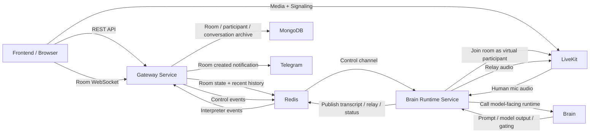
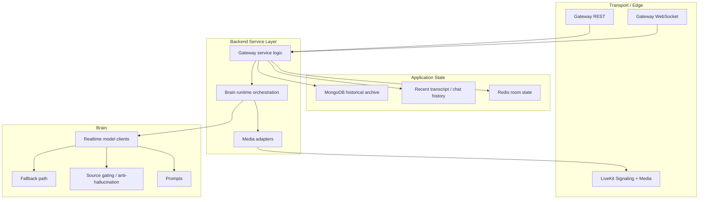
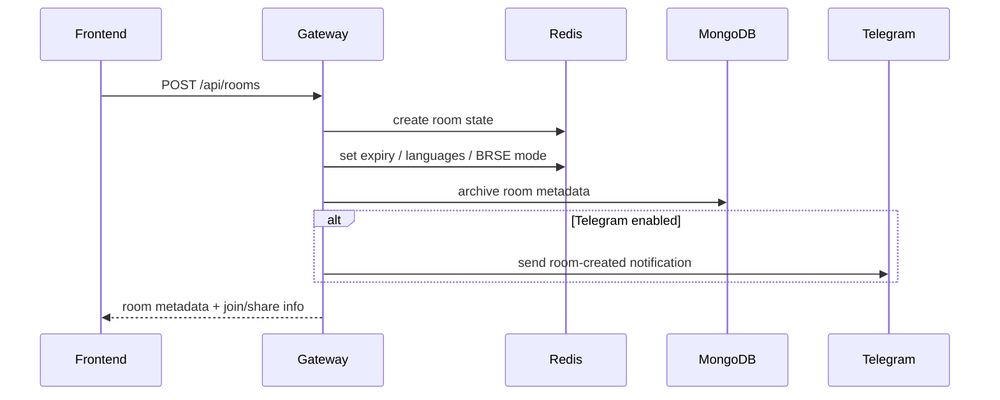
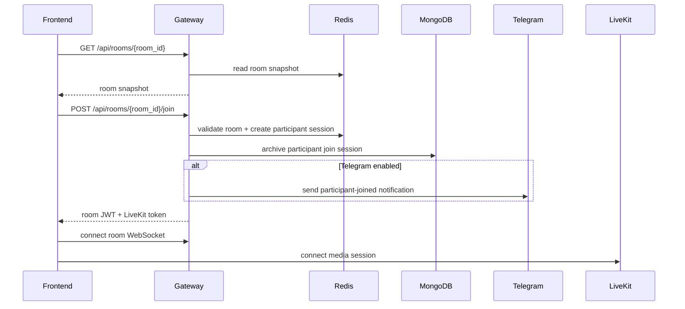
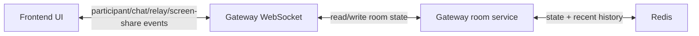
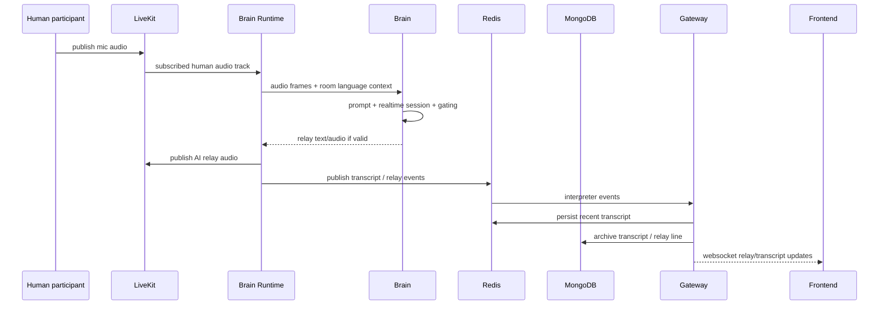
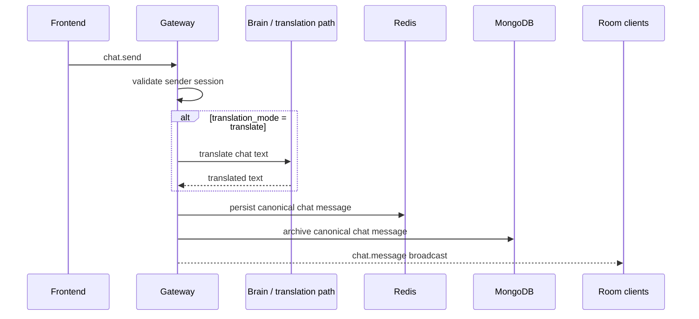
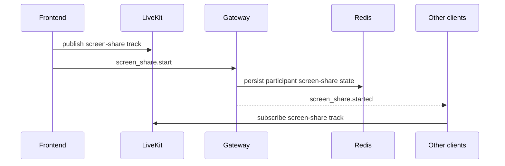
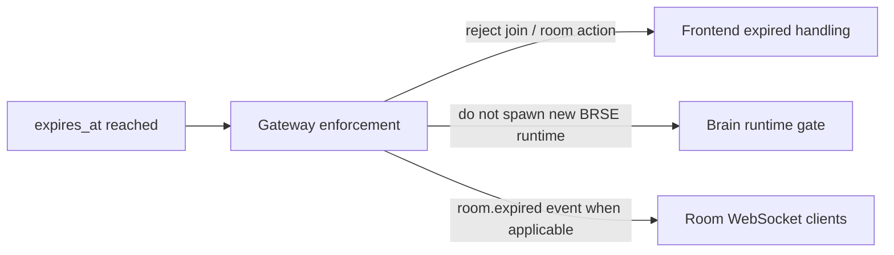
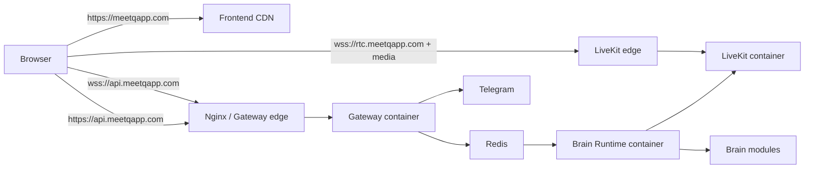

# Backend Architecture Overview

Tài liệu này dùng để nhìn lại toàn bộ backend ở mức hệ thống:

- backend gồm những khối nào
- mỗi khối chịu trách nhiệm gì
- dữ liệu đi qua hệ thống theo flow nào
- các feature chính gắn với room, chat, relay, screen share, và expiry vận hành ra sao

Tài liệu này cố ý giữ ở mức kiến trúc và luồng xử lý. Không đi sâu vào giải thích code line-by-line.

## 1. Mục tiêu hệ thống

Backend của MeetQ phục vụ một meeting room realtime có các capability chính:

- tạo room và join room
- room websocket để đồng bộ state realtime
- phát hành token LiveKit cho browser participant
- BRSE / AI relay participant để nghe và relay nội dung đa ngôn ngữ
- transcript / relay history
- chat room với tùy chọn dịch hoặc không dịch
- screen share
- room expiry 30 phút
- MongoDB historical persistence cho room / participant / conversation archive
- Telegram notification khi tạo room
- Telegram notification khi user join room

Ở mức tổng thể, backend được thiết kế thành các khối tách rõ giữa:

- AI/model-facing logic
- backend application/service orchestration
- media runtime
- external integrations

## 2. Bức tranh tổng thể

```text
Browser / FE
    |
    +--> REST API (Gateway)
    |
    +--> Room WebSocket (Gateway)
    |
    +--> LiveKit signaling/media

Gateway Service
    |
    +--> Redis room state
    +--> Redis pub/sub control/events
    +--> MongoDB historical archive
    +--> LiveKit token issuing
    +--> Brain Runtime control
    +--> Telegram integration

Brain Runtime Service
    |
    +--> LiveKit room participant runtime
    +--> Audio input / output routing
    +--> Brain realtime clients
    +--> Transcript / relay event publishing

Brain
    |
    +--> prompts
    +--> realtime AI clients
    +--> source gating / anti-hallucination policy
    +--> fallback translation path
```

### System Diagram



### Responsibility Map



## 3. Các domain chính

### 3.1 `server.service.gateway`

Đây là entry boundary của toàn bộ web platform.

Gateway chịu trách nhiệm:

- phục vụ REST API
- phục vụ room WebSocket
- xác thực room token / participant session
- tạo room, join room, leave room
- phát hành LiveKit browser token
- lưu và đọc room state trong Redis
- nhận event từ brain runtime rồi fan-out lại cho FE
- điều phối chat, screen share, test sessions

Nói ngắn gọn:

- browser nói chuyện với Gateway
- Gateway là source of truth ở lớp application state

### 3.2 `server.service.brain_runtime`

Đây là orchestration layer cho BRSE runtime.

Khối này chịu trách nhiệm:

- lắng nghe control events từ Gateway qua Redis
- spawn / stop room-level brain managers
- gate runtime theo `brse_enabled`
- điều phối room-level AI lifecycle
- publish transcript / relay / status events ngược về Gateway

Nó không phải phần “AI reasoning” thuần túy; nó là lớp dịch vụ điều phối AI trong từng room.

### 3.3 `server.service.media`

Đây là lớp adapter media.

Nó chịu trách nhiệm:

- kết nối LiveKit như participant lập trình
- subscribe audio từ human participants
- bridge audio stream vào brain
- route audio output của brain trở lại LiveKit

Nói đơn giản:

- đây là cầu nối giữa room media và AI runtime

### 3.4 `server.brain`

Đây là phần AI-facing thực sự.

`brain` chứa:

- prompt / instruction builders
- realtime model client wrappers
- session configuration cho model
- source transcript policy / anti-hallucination gating
- fallback model path

Nguyên tắc:

- phần nào trực tiếp gọi model hoặc điều khiển model session thì nằm ở `brain`
- phần nào là backend orchestration thì không nằm ở `brain`

### 3.5 `server.integrations`

Hiện tại tích hợp nổi bật là Telegram notifier và MongoDB client wiring.

Tích hợp chịu trách nhiệm:

- gửi notification ra Telegram channel khi room được tạo
- gửi notification ra Telegram channel khi user join room
- tạo / đóng MongoDB client dùng bởi persistence repository

### 3.6 `server.shared`

Đây là nơi chứa helper generic dùng chung.

Ví dụ:

- audio abstractions
- logging utilities

## 4. Redis đóng vai trò gì

Redis là state backbone của hệ thống.

Redis được dùng cho:

- room metadata
- participant state
- transcript / relay history gần đây
- chat history gần đây
- event sequencing
- pub/sub giữa Gateway và Brain Runtime

Ý nghĩa kiến trúc:

- Gateway và Brain Runtime không cần shared memory
- mỗi process vẫn phối hợp được qua Redis
- room state có TTL gắn với vòng đời meeting

### 4.1 MongoDB historical archive

MongoDB là lớp persistence / historical storage, không thay Redis trong hot path.

Gateway ghi side effect vào MongoDB để lưu:

- `rooms`: metadata room, languages, BRSE mode, lifecycle timestamps, duration, participant totals.
- `room_participants`: participant summaries và session join/leave history.
- `room_messages`: chat messages, source transcripts, translated transcripts, và BRSE relay lines.

Nếu MongoDB timeout hoặc lỗi tạm thời:

- create / join / chat / transcript runtime vẫn tiếp tục theo Redis
- lỗi được log
- historical archive có thể thiếu record tương ứng và cần operational follow-up

## 5. LiveKit đóng vai trò gì

LiveKit là media plane của hệ thống.

LiveKit chịu trách nhiệm:

- audio/video transport
- screen share transport
- room-level media signaling
- participant track management

Browser participants kết nối trực tiếp tới LiveKit để:

- publish mic / camera / screen share
- subscribe media tracks

Brain Runtime cũng vào LiveKit như một participant ảo để:

- nghe human audio
- phát relay audio / AI output trở lại room

## 6. Flow dữ liệu chính

### 6.1 Tạo room

Flow:

1. FE gọi `POST /api/rooms`
2. Gateway tạo room state trong Redis
3. Gateway gán meeting languages, expiry, BRSE mode, participant policy
4. Gateway ghi room metadata sang MongoDB archive theo side effect
5. Gateway trả room metadata + join/share info cho FE
6. Gateway có thể gửi Telegram notification nếu bật config

Kết quả:

- room tồn tại về mặt application state
- nhưng chưa có participant media cho tới khi user join



### 6.2 Join room

Flow:

1. FE gọi `GET /api/rooms/{room_id}` để lấy snapshot
2. FE gọi `POST /api/rooms/{room_id}/join`
3. Gateway:
   - validate room còn hiệu lực
   - tạo participant/session state
   - phát room JWT cho websocket
   - phát LiveKit access token cho browser
   - ghi participant join history sang MongoDB
   - gửi Telegram join notification nếu bật config
4. FE connect:
   - Gateway WebSocket
   - LiveKit

Kết quả:

- user có mặt trong room state
- user có media session
- FE bắt đầu nhận realtime room events



### 6.3 Room WebSocket

Gateway WebSocket là channel cho room state sync, không phải media transport.

Nó được dùng cho:

- participant joined / updated / left
- transcript partial / final
- relay events
- chat message
- screen share started / stopped
- BRSE state updates
- room expired / room mode updates

Ý nghĩa:

- FE dùng websocket này để đồng bộ UI meeting
- media vẫn đi qua LiveKit, không đi qua Gateway WS



### 6.4 BRSE / AI relay flow

Khi room bật BRSE:

1. Gateway publish control event sang Redis
2. Brain Runtime nhận event và spawn room manager
3. Room manager connect LiveKit như participant ảo
4. Runtime subscribe human mic audio
5. Audio được đưa vào brain realtime client
6. Brain:
   - build prompt
   - áp session config
   - áp source gating / anti-hallucination policy
   - sinh relay text/audio khi hợp lệ
7. Runtime publish:
   - relay audio trở lại LiveKit
   - transcript / relay events sang Gateway qua Redis
8. Gateway persist recent transcript vào Redis
9. Gateway ghi transcript / relay line sang MongoDB archive
10. Gateway fan-out event tới FE

Điểm quan trọng:

- AI không nói trực tiếp với browser
- AI đi qua Brain Runtime + LiveKit + Gateway event pipeline



### 6.5 Chat flow

Chat là room-level text messaging, tách khỏi audio relay.

Flow:

1. FE gửi `chat.send` qua websocket
2. Gateway validate sender session
3. Gateway tạo canonical chat message
4. Nếu message dùng `translate` mode:
   - Gateway gọi chat translation path
   - attach translation result vào chính message đó
5. Gateway persist message vào recent chat history
6. Gateway ghi canonical chat message sang MongoDB archive
7. Gateway broadcast `chat.message` cho cả room

Kết quả:

- FE luôn nhận được message gốc
- nếu có translation thì translation gắn cùng canonical message



### 6.6 Screen share flow

Flow:

1. Browser publish screen-share track lên LiveKit
2. FE đồng thời sync screen-share state về Gateway
3. Gateway persist participant screen-share metadata
4. Gateway broadcast screen-share state cho room
5. FE render shared screen như main stage

Vai trò tách biệt:

- media của screen share đi qua LiveKit
- room-level state “ai đang share” đi qua Gateway



### 6.7 Room expiry flow

Room hiện có policy 30 phút.

Flow:

1. Room được tạo với `expires_at`
2. Gateway dùng expiry này khi xử lý room actions
3. Join vào room hết hạn sẽ bị reject
4. Runtime brain không spawn mới cho room expired
5. FE dùng `expires_at` và các expired signals để tự rời room

Ý nghĩa:

- expiry là policy ở lớp room/application
- không chỉ là timer hiển thị ở frontend



## 7. Source of truth nằm ở đâu

Tùy loại dữ liệu, source of truth khác nhau:

### Room / participant / chat / transcript snapshot

Source of truth:

- Gateway + Redis

### Historical room / conversation archive

Source of truth:

- MongoDB (`rooms`, `room_participants`, `room_messages`)

Runtime rule:

- Archive data is not used to make active room decisions; Redis remains hot state.

### Media tracks

Source of truth:

- LiveKit

### AI prompt / model session behavior

Source of truth:

- `server.brain`

### Room-level AI runtime lifecycle

Source of truth:

- `server.service.brain_runtime`

## 8. Tại sao hệ thống tách `brain` và `service`

Mục đích chính là giữ ranh giới rõ:

- `brain` chỉ lo phần AI/model-facing
- `service` lo application orchestration và runtime lifecycle

Lợi ích:

- dễ reason về hệ thống hơn
- AI logic không bị lẫn với transport logic
- dễ thay đổi model behavior mà không làm bẩn Gateway
- dễ thay đổi room/service orchestration mà không đụng prompt path

## 9. Những flow quan trọng nhất để debug

Khi debug hệ thống, nên nghĩ theo các pipeline sau:

### Room lifecycle pipeline

`REST create/join/leave -> Redis room state -> WS fanout -> FE UI`

### AI relay pipeline

`LiveKit human audio -> media adapter -> brain realtime client -> relay gating -> LiveKit AI output + Gateway transcript events`

### Chat pipeline

`FE chat.send -> Gateway validation -> optional translation -> Redis recent_messages -> chat.message broadcast`

### Screen share pipeline

`Browser screen track -> LiveKit -> Gateway screen-share metadata -> FE stage render`

### Expiry pipeline

`room expires_at -> Gateway enforcement -> runtime gate -> FE exit behavior`

## 10. Production topology

Hiện tại production được nghĩ theo mô hình tách rõ:

- FE public app: `meetqapp.com`
- Gateway API / WS: `api.meetqapp.com`
- LiveKit signaling/media entry: `rtc.meetqapp.com`

Nginx đứng phía trước backend để:

- route domain
- reverse proxy API/WS
- terminate TLS

Browser sẽ:

- gọi REST / WS vào Gateway domain
- kết nối media vào LiveKit domain



## 11. Đọc tài liệu nào khi cần đào sâu

README này chỉ là bản đồ tổng quan.

Khi cần đi sâu, xem tiếp:

- [FILE_STRUCTURE.md](./FILE_STRUCTURE.md)
  - để hiểu tree backend hiện tại
- [GATEWAY_DESIGN.md](./GATEWAY_DESIGN.md)
  - để hiểu lớp Gateway, room state, room WS, screen share, auth
- [INTERPRETER_DESIGN.md](./INTERPRETER_DESIGN.md)
  - để hiểu BRSE / AI runtime / media bridge
- [API_CONTRACT.md](./API_CONTRACT.md)
  - để hiểu contract BE <-> FE
- [DEPLOY_PRODUCTION.md](./DEPLOY_PRODUCTION.md)
  - để hiểu deploy topology
- [IMPLEMENTATION_STATE.md](./IMPLEMENTATION_STATE.md)
  - để xem các thay đổi gần đây và trạng thái hiện tại

## 12. Tóm tắt ngắn

Nếu cần nhớ hệ thống bằng một câu:

> Gateway giữ room state và sync UI, LiveKit chở media, Brain Runtime điều phối AI trong room, còn Brain là nơi thật sự nói chuyện với model.
