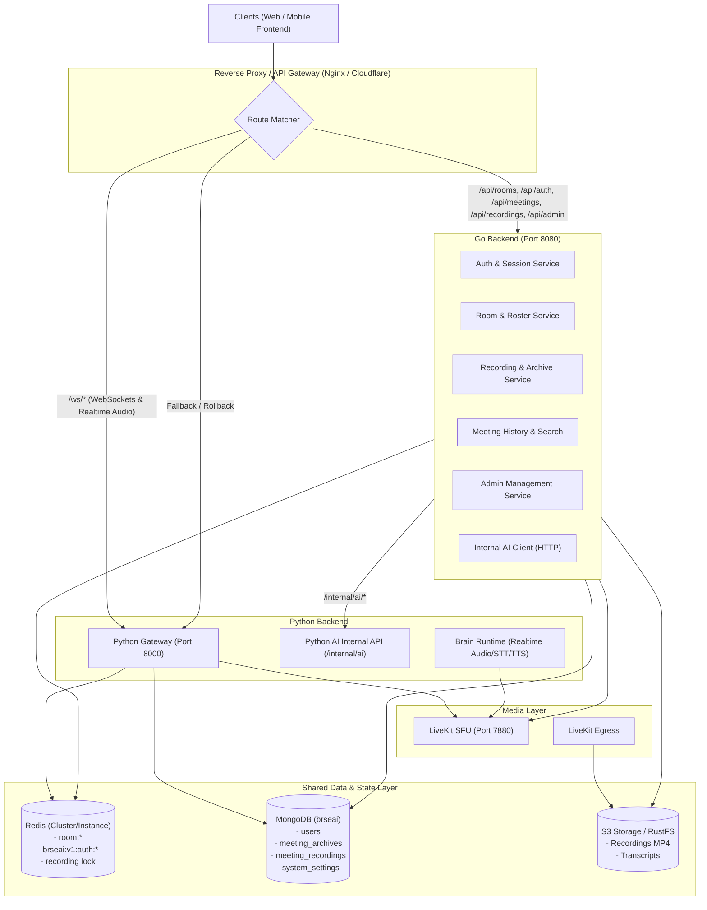

# Hướng Dẫn Kiến Trúc & Migration Backend MeetQ (Python FastAPI -> Golang)

Tài liệu này trình bày chi tiết về quá trình di chuyển (migration) hệ thống backend MeetQ từ Python sang Golang theo mô hình **Strangler Fig / Hybrid Architecture**, đảm bảo an toàn tuyệt đối cho hệ thống production đang vận hành, khả năng cutover từng phần và rollback tức thời.

---

## 1. Mục Tiêu & Nguyên Tắc Cốt Lõi

1. **Không can thiệp vào AI Pipeline:**
   - Toàn bộ các tác vụ xử lý âm thanh thời gian thực (Audio Ingestion, Crosstalk Isolation, STT, Realtime Translation, TTS, LLM Agent Prompting) được duy trì ổn định trên Python (`BE/server/service/brain_runtime`).
2. **Reimplement 100% NON-AI Domain sang Go:**
   - Go backend chịu trách nhiệm toàn bộ các tác vụ có tần suất cao, yêu cầu tối ưu throughput, concurrency và memory footprint: Authentication, User Profiles, Room Lifecycle & State Management, Permissions & Moderation, Room Recording Management, Meeting History, Search và Admin Dashboard.
3. **Chung Database & State Layer:**
   - Cả hai backend Go và Python cùng kết nối vào một MongoDB Cluster (`brseai`) và Redis Cluster chung.
   - Không thực hiện bất kỳ migration phá vỡ cấu trúc dữ liệu nào (không drop table, không rename column/field, không thay đổi data type).
4. **Parity Tuyệt Đối (Contract-First):**
   - Go backend bảo toàn 100% API contract của Python: HTTP Path, Query Parameters, Headers, Status Code, Error JSON Shape và Session Cookies.

---

## 2. Kiến Trúc Strangler Fig / Hybrid Topology



---

## 3. Quản Lý Session & Khả Năng Tương Thích Auth

### 3.1. User Session Cookie
- **Cookie Name:** `meetq_session`
- **Redis Key Template:** `brseai:v1:auth:user:{session_id}`
- **TTL:** 14 ngày (1,209,600 giây).
- **Session Data Shape (JSON):**
  ```json
  {
    "id": "user_id_string",
    "email": "user@example.com",
    "name": "Full Name",
    "avatar_url": "https://...",
    "created_at": "2026-10-05T12:00:00Z"
  }
  ```
- **Khả năng tương thích 2 chiều:**
  - Người dùng đăng nhập bằng Google trên Go backend (`POST /api/auth/google`) sinh ra session cookie mà Python backend đọc và giải mã bình thường.
  - Ngược lại, cookie do Python backend tạo ra được Go backend trích xuất, xác thực và duy trì hợp lệ.

### 3.2. Password Hashing (Admin & Room Passwords)
Hệ thống hỗ trợ cơ chế verify đa thuật toán trong Go (`backend-go/internal/auth/passwords.go`):
1. **Argon2id:** Định dạng mặc định mới của Go và Python Passlib (`$argon2id$v=19$...`).
2. **Scrypt:** Định dạng legacy Python (`scrypt:...`).
3. **Bcrypt:** Chuẩn `$2a$`, `$2b$`.

---

## 4. Quản Lý Quyền Hạn & Điều Phối Phòng (Room Roles)

Hệ thống phân cấp nghiêm ngặt 3 vai trò:
- **`HOST`**:
  - Người tạo phòng hoặc được chỉ định làm chủ phòng.
  - Có toàn quyền: Khoá/mở phòng (`/lock`, `/unlock`), đổi mật khẩu (`PATCH /password`), chỉ định hoặc thu hồi Co-host, bật/tắt ghi âm, mute/kick người tham gia.
- **`CO_HOST`**:
  - Được host cấp quyền trợ lý phòng họp.
  - Có quyền: Điều khiển AI (`/brse`, `/relay-mode`), bật/tắt ghi âm, mute/kick participant.
  - Không thể: Đổi mật khẩu phòng, chuyển quyền chủ phòng của Host.
- **`PARTICIPANT`**:
  - Người tham dự bình thường.
  - Chỉ có quyền bật tắt mic/cam của chính mình, gửi chat, gửi yêu cầu phản hồi.

---

## 5. Ghi Âm & Lưu Trữ Đám Mây (LiveKit Egress & S3)

1. **Khởi tạo recording:**
   - Client gửi `POST /api/rooms/{room_id}/recordings/start`.
   - Go backend kiểm tra quyền `HOST` hoặc `CO_HOST`.
   - Sử dụng Redis distributed lock (TTL 10s) chống race condition gọi đúp.
   - Gửi lệnh `RoomCompositeEgress` sang LiveKit SFU với S3 upload destination trực tiếp (`meetq-archive-local` hoặc production bucket).
   - Lưu trạng thái vào MongoDB `meeting_recordings`.
2. **Truy cập bản ghi (Playback & Download):**
   - Sinh presigned URL bảo mật từ AWS S3 SDK for Go v2:
     - `GET /api/recordings/{id}/playback`: Content-Type `video/mp4`, TTL 3600s.
     - `GET /api/recordings/{id}/download`: TTL 3600s kèm header `Content-Disposition: attachment; filename="meeting-{id}.mp4"`.

---

## 6. Tìm Kiếm Cuộc Họp & Xử Lý Đa Ngôn Ngữ (CJK / Tiếng Việt)

Module `backend-go/internal/meetings/search.go` tái hiện chính xác thuật toán tìm kiếm của Python:
- **Chuẩn hoá Unicode NFC:** Đảm bảo tiếng Việt có dấu tổ hợp và dựng sẵn đều cho ra cùng kết quả.
- **CJK Tokenization:** Tự động bắt cặp từ và không bị phụ thuộc vào khoảng trắng tiếng Nhật/tiếng Trung.
- **Tương thích Regex:** Sinh match offsets và highlight snippets tương ứng 100% với giao diện frontend `HighlightedText.tsx`.

---

## 7. Cầu Nối Nội Bộ Python AI (Internal AI RPC)

Khi Go backend cần xử lý các tác vụ AI phức tạp (ví dụ: tạo tóm tắt thông minh cho cuộc họp sau khi kết thúc), Go gọi tới Python AI service qua HTTP nội bộ:

- **Base URL:** `http://gateway:8000` (nội bộ mạng Docker hoặc VPC).
- **Header xác thực:** `X-AI-Internal-Token: <PYTHON_AI_SERVICE_TOKEN>`
- **Header tương quan:** `X-Request-ID: <uuid>` (được forward xuyên suốt từ client -> Go -> Python).
- **Timeout & Retry:** Timeout riêng cho tác vụ summary (120 giây) với context cancellation an toàn.

---

## 8. Kế Hoạch Chuyển Đổi (Cutover) & Rollback Tức Thời

### 8.1. Cấu hình Nginx Reverse Proxy (Strangler Fig Routing)

```nginx
upstream go_backend {
    server 127.0.0.1:8080;
    keepalive 32;
}

upstream python_backend {
    server 127.0.0.1:8000;
    keepalive 32;
}

server {
    listen 80;
    server_name meetq.example.com;

    # 1. Các endpoint NON-AI chuyển sang Go Backend
    location /api/auth/ {
        proxy_pass http://go_backend;
        include proxy_params;
    }

    location /api/rooms {
        proxy_pass http://go_backend;
        include proxy_params;
    }

    location /api/meetings {
        proxy_pass http://go_backend;
        include proxy_params;
    }

    location /api/recordings {
        proxy_pass http://go_backend;
        include proxy_params;
    }

    location /api/admin/ {
        proxy_pass http://go_backend;
        include proxy_params;
    }

    # 2. WebSocket & Realtime giữ nguyên tại Python Backend
    location /ws/ {
        proxy_pass http://python_backend;
        proxy_http_version 1.1;
        proxy_set_header Upgrade $http_upgrade;
        proxy_set_header Connection "Upgrade";
        include proxy_params;
    }

    # 3. Fallback cho toàn bộ các endpoint khác
    location / {
        proxy_pass http://python_backend;
        include proxy_params;
    }
}
```

### 8.2. Kế hoạch Rollback tức thời (Zero Downtime)
Nếu phát hiện bất kỳ vấn đề bất thường nào trên Go backend:
1. Đổi upstream của các route `/api/*` trong Nginx về lại `http://python_backend`.
2. Reload Nginx (`nginx -s reload`) mất < 0.1 giây.
3. Không cần can thiệp vào database hoặc xoá session của người dùng, vì Redis session và MongoDB hoàn toàn tương thích 2 chiều.

---

## 9. Kiểm Tra & Xác Minh (Verification Commands)

### 9.1. Kiểm tra Go Backend
```bash
# Định dạng và lint mã nguồn Go
cd backend-go
go fmt ./...
go vet ./...

# Chạy toàn bộ unit và integration test của Go
go test -v -race ./...
```

### 9.2. Kiểm tra Python Backend (Đảm bảo không bị ảnh hưởng)
```bash
cd BE
.venv/bin/python -m pytest -q tests/test_gateway_api.py tests/test_admin_api.py tests/test_meeting_history.py tests/test_room_roles.py
```

### 9.3. Chạy kiểm thử môi trường Docker Compose
```bash
# Khởi động cụm dịch vụ bao gồm cả go-backend và gateway
docker compose up -d --build go-backend gateway

# Kiểm tra sức khoẻ của Go backend
curl -i http://localhost:8080/health
curl -i http://localhost:8080/readiness
curl -i http://localhost:8080/api/config
```
