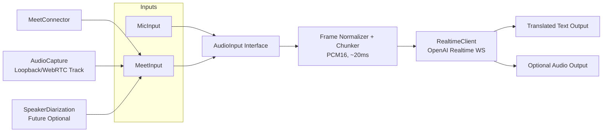
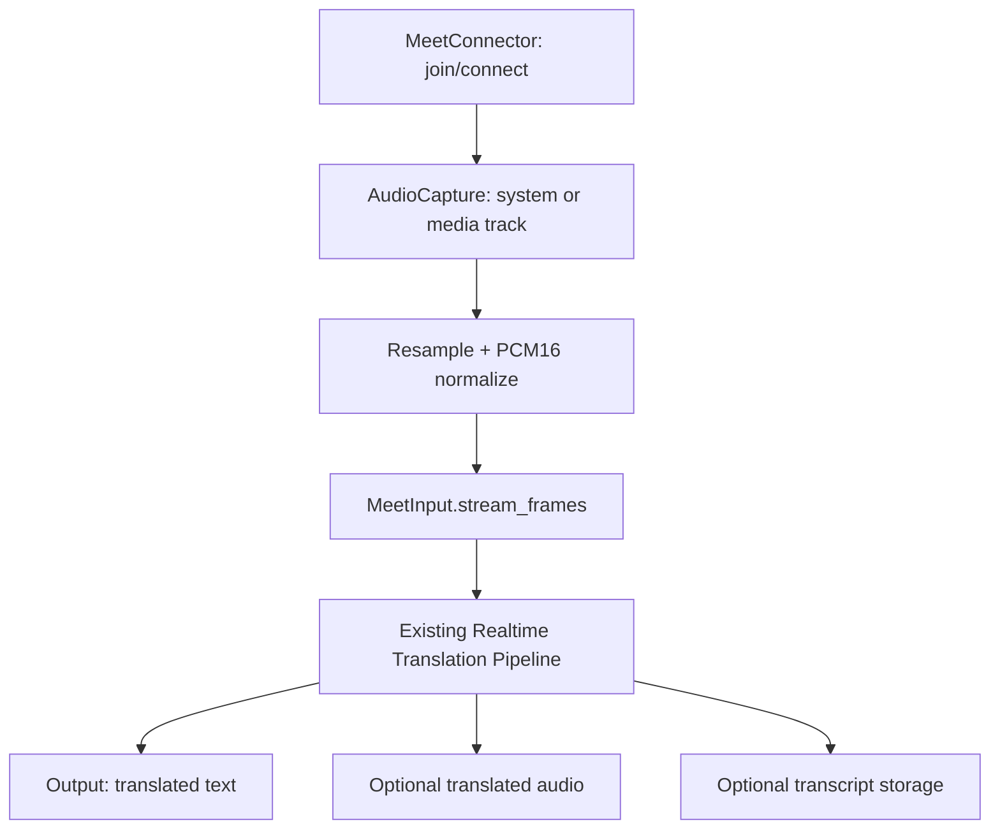
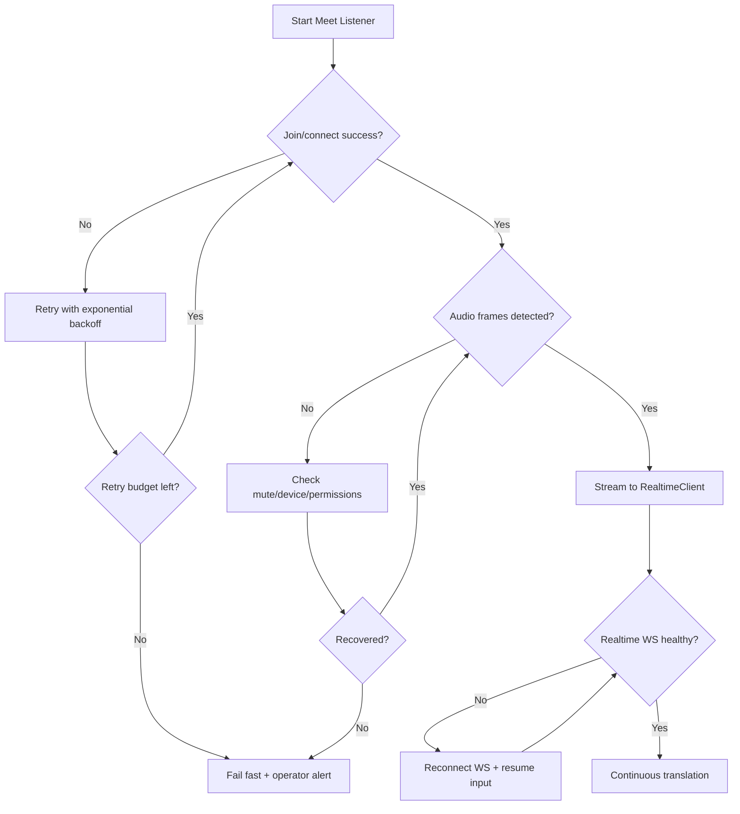

# Phase 2: Google Meet Listener

## Status

Planned. Design approved for implementation planning; no production deployment yet.

## Goal

Enable the existing realtime interpreter pipeline to listen to Google Meet meeting audio and produce translated text output with low latency.

## Scope

- Add a new meeting audio input path (`MeetInput`) that plugs into the existing `RealtimeClient` pipeline.
- Preserve existing `MicInput` path.
- Keep output-first focus on translated text.
- Optional translated audio output remains non-goal for initial Phase 2 rollout.

## Non-Goals (Phase 2)

- Guaranteed speaker-accurate diarization.
- Production-grade Google Meet write-back/injection.
- Fully automated legal/compliance workflow.

## Assumptions And Constraints

- Phase 1 (local mic realtime interpreter) is complete and stable.
- Google Meet official media capabilities may depend on allowlist access, Workspace edition, admin policy, and regional/legal constraints.
- Audio send/injection into Meet is treated as uncertain and possibly unsupported for our access level unless explicitly confirmed during Path A discovery.
- Default design assumption for Phase 2 is receive/listen only.

## Implementation Paths

## Path A: Official / Compliant (Google Meet Media API Concept)

### Summary

Use an official Google Meet media integration model when available and approved for the organization.

### Availability Note

This path is availability-dependent. Access and exact capabilities may not be universally open. Treat all media capabilities as subject to Google approval and tenant policy.

### High-Level Integration Model

- Enterprise app registration and identity configuration.
- Workspace admin enablement and policy approval.
- Meeting participant consent and organizational controls.
- Media ingestion path (receive audio) into `MeetInput`.

### What We Can And Cannot Assume

| Capability | Current assumption for planning |
|---|---|
| Receive meeting audio | Potentially available if access is granted and admin policy allows |
| Send/inject translated audio back into Meet | Uncertain; do not assume supported unless explicitly confirmed |
| Production usage without policy/legal review | Not allowed |

### Prerequisites (High-Level)

- Workspace admin sponsorship.
- Security and privacy review.
- Documented participant notification policy.
- Organizational approval for transcript retention policy.
- Access request to Google program/channel for Meet media capabilities.

### Access Request Workflow (High-Level)

1. Prepare use-case brief (live interpretation, languages, data flow).
2. Prepare compliance package (consent UX, data retention, incident response).
3. Submit through Google Cloud/Workspace support or partner channel.
4. Validate allowed capabilities in a staging tenant before implementation commitments.

## Path B: Pragmatic MVP / Bot Participant

### Summary

Run a bot participant in a controlled browser session and capture meeting output audio at the system level (loopback/virtual audio device), then feed audio into existing realtime translation pipeline.

### Technical Model

- Bot joins as a visible participant.
- Browser audio output is routed to a virtual audio device.
- `AudioCapture` reads loopback/system output frames.
- Frames are normalized to PCM16 and forwarded to `MeetInput`.
- `MeetInput` streams frames into the existing `RealtimeClient`.

### Risks

- Fragile automation surface (browser UI changes, device routing drift).
- Potential Terms of Service and policy concerns depending on deployment context.
- High maintenance burden for headless/browser orchestration.
- Harder to guarantee speaker attribution.

### Safe Usage Note

Use Path B only for internal prototyping in controlled environments with explicit participant consent. Do not deploy in production without legal and compliance review.

## Architecture Changes

## New Abstraction: AudioInput

`AudioInput` becomes the common contract consumed by `RealtimeClient`.

### Minimal Interface

- `start()`
- `read_frames()` or `stream_frames()`
- `stop()`
- `metadata`

`metadata` fields:
- `sample_rate`
- `channels`
- `speaker_id` (optional)

### Implementations

- `MicInput` (existing): local microphone capture.
- `MeetInput` (new): meeting audio capture path from Path A or Path B.

## Phase 2 System Architecture

## Phase 2 Dataflow

## Failure / Retry Flow

## Component Responsibilities

| Component | Responsibility |
|---|---|
| `MeetConnector` | Join/connect lifecycle, auth/session bootstrap, meeting state |
| `AudioCapture` | Pull audio from system loopback or official media track |
| `MeetInput` | Convert capture output into `AudioInput` stream contract |
| `SpeakerDiarization` (optional future) | Tag likely speaker segments for improved output labeling |
| Existing translation pipeline | Realtime VAD + translation only output |
| Output layer | Stream translated text; optional translated audio |
| Storage (optional) | Save transcript/events under explicit retention policy |

## Operational Considerations

## Latency Budget And Buffering

Target end-to-end text latency: 800ms to 1800ms under normal network conditions.

| Stage | Budget target |
|---|---|
| Audio capture frame accumulation | 20ms to 60ms |
| Resample/normalize + queue | 10ms to 40ms |
| Network + model first token | 300ms to 900ms |
| Terminal rendering | <50ms |

Buffering strategy:
- Fixed-size frame queue with backpressure metrics.
- Drop-oldest policy when queue is saturated (favor recency for live interpretation).
- Emit warnings when queue depth exceeds threshold.

## Echo / Feedback Avoidance

- Do not route assistant output audio into the same capture device used for `MeetInput`.
- Use separate output device or disable translated audio playback in meeting mode.
- Add audio route checks at startup and warn on suspicious loopback configurations.

## Multi-Speaker Handling And Diarization Roadmap

Phase 2 baseline:
- Treat meeting audio as a mixed stream.
- No guaranteed speaker labels.

Roadmap:
1. Add segment-level speaker change heuristics.
2. Integrate optional diarization component.
3. Expose speaker tags in output when confidence is above threshold.

## Failure Modes And Handling

| Failure mode | Detection signal | Handling |
|---|---|---|
| Meeting join failure | Connector timeout/error codes | Retry with bounded exponential backoff, then fail fast |
| Bot in meeting but no audio | Silence over threshold | Prompt operator to verify mute/audio route |
| Device permission denied | OS/device exception | Emit actionable error and stop cleanly |
| Realtime WS disconnect | Socket closed/error events | Reconnect WS and continue reading frames with bounded queue |
| Capture drift/high latency | Queue depth and timestamp lag | Drop stale frames, log warning, request operator action |

## Privacy, Consent, And Compliance

- Notify participants when interpretation capture is active.
- Obtain required organizational consent before capture/transcription.
- Define retention: default no persistent raw audio; transcript storage optional and explicit.
- Redact sensitive content in logs.
- Restrict transcript access and define deletion windows.

## Storage Policy (Phase 2)

Default:
- Raw meeting audio: not persisted.
- Translation output text: console only unless explicitly enabled.

If transcript storage is enabled:
- Store under controlled location with access controls.
- Include retention duration and deletion schedule.
- Record consent context per session.

## Rollout Plan

1. Complete Path A discovery and capability validation with admin/legal stakeholders.
2. Build Path B prototype for internal testing only.
3. Choose primary implementation path based on compliance and maintainability outcomes.
4. Run controlled pilot with monitoring and incident runbook.

## Implementation Checklist

- [ ] `AudioInput` contract documented and agreed.
- [ ] `MeetInput` lifecycle design reviewed (`start`, `stream/read`, `stop`).
- [ ] Meeting join/connect state machine defined.
- [ ] Audio route and echo prevention checklist documented.
- [ ] Failure/retry policy implemented in runbook.
- [ ] Consent and participant notification language approved.
- [ ] Retention and transcript storage policy approved.
- [ ] Legal review completed before any production exposure.

## Acceptance Criteria (Phase 2 Planning Complete)

- [ ] Architecture supports both `MicInput` and `MeetInput` via shared interface.
- [ ] Both Path A and Path B are documented with explicit constraints and risks.
- [ ] Audio injection capability is not asserted as available unless confirmed.
- [ ] Operational runbook covers join failure, no-audio, permissions, reconnect, and latency degradation.
- [ ] Privacy/compliance requirements are documented and testable.
