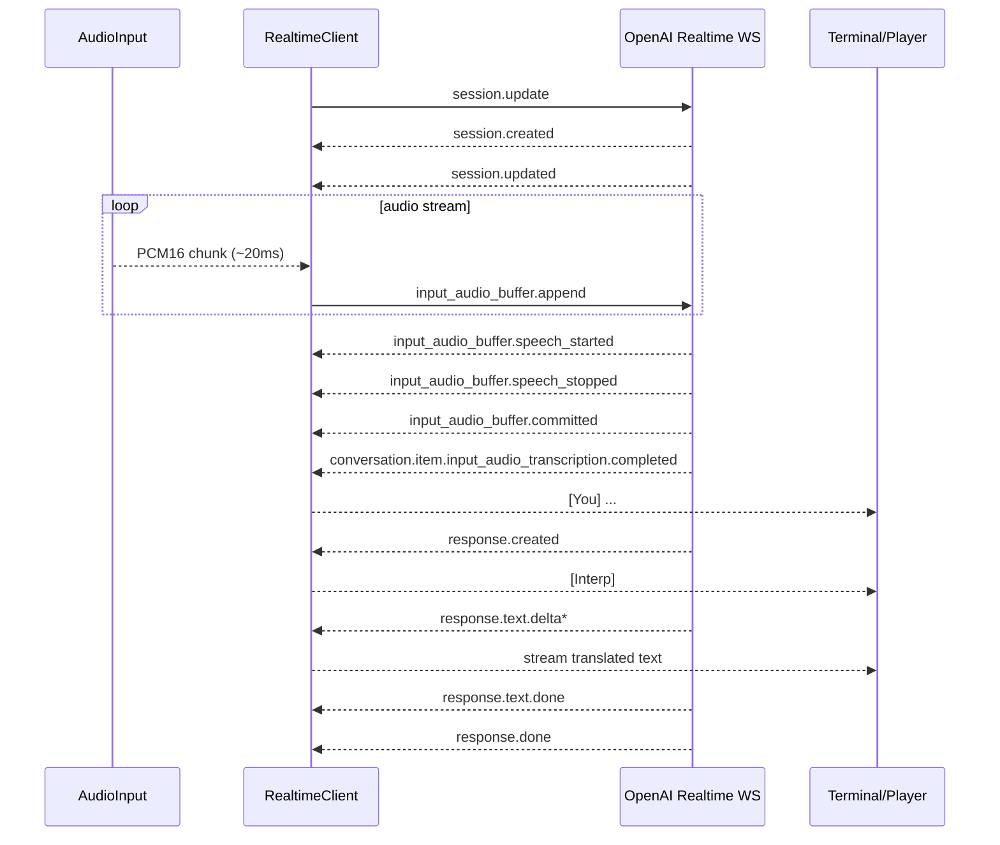

# Realtime Protocol

This file documents the WebSocket event contract as currently implemented in `src/realtime/client.py`.

## Session Configuration Sent by Client

On connect, client sends `session.update` with:
- `modalities`: `['text', 'audio']` when speaker/output is enabled, otherwise `['text']`
- `input_audio_format`: `pcm16`
- `input_audio_transcription.model`: `whisper-1`
- `turn_detection`: `server_vad` (`threshold=0.5`, `prefix_padding_ms=300`, `silence_duration_ms=700`)
- `temperature`: `0.8`
- translation instructions generated by `src/common/lang.py`

When language routing changes (for `--src auto` and allowed pair), client sends another `session.update` with updated instructions.

## Minimal Realtime Sequence

## Server Events Currently Handled

| Server event | Client behavior |
|---|---|
| `session.created` | logs session id |
| `session.updated` | logs config-applied line |
| `input_audio_buffer.speech_started` | logs `vad_speech_started`; triggers barge-in cancel if assistant currently speaking |
| `input_audio_buffer.speech_stopped` | logs `vad_speech_stopped` |
| `input_audio_buffer.committed` | debug log |
| `conversation.item.input_audio_transcription.delta` | prints streaming `[You]` delta in debug mode |
| `conversation.item.input_audio_transcription.completed` | prints final `[You] transcript`; may trigger language routing update |
| `response.created` | marks assistant speaking and prints `[Interp]` prefix |
| `response.text.delta` | streams translated text to stdout |
| `response.text.done` | newline + final text log |
| `response.audio.delta` | decodes base64 PCM16 and pushes to output player when enabled |
| `response.audio.done` | flushes player tail (50ms pad) |
| `response.audio_transcript.delta` | debug log |
| `response.audio_transcript.done` | debug log |
| `response.done` | marks assistant not speaking |
| `error` | logs error; aborts on auth-related codes |

Also recognized (debug lifecycle only):
- `response.output_item.added`
- `response.content_part.added`
- `conversation.item.created`
- `rate_limits.updated`
- `response.output_item.done`
- `response.content_part.done`

## Client Events Sent

| Client event | Purpose |
|---|---|
| `session.update` | session behavior + instructions |
| `input_audio_buffer.append` | continuous audio chunk stream |
| `response.cancel` | barge-in interruption of active assistant response |

## Barge-In / Cancel Logic

Condition:
- New `input_audio_buffer.speech_started` arrives while `_assistant_speaking` is `True`.

Actions:
1. Log `barge_in`.
2. Restart player (`stop` + `start`) to cut currently playing output immediately.
3. Send `{"type": "response.cancel"}`.
4. Clear assistant speaking state.

Expected follow-up from server:
- `response.done` for canceled response.

## Audio Format in Current Client

| Direction | Format | Sample rate | Notes |
|---|---|---|---|
| Input to WS | PCM16 mono | from active `AudioInput` (`16000` default) | base64-encoded per chunk |
| Output from WS | PCM16 mono | `24000` | only when session includes audio modality |

## Language Routing Behavior Relevant to Protocol

- `--meeting-mode locked`:
  - explicit `--src` + `--tgt`: routing locked immediately.
  - auto source: lock after first confident detection.
- `--meeting-mode auto`: routing can update mid-session.
- `--pairs` can block routing updates if detected pair is disallowed.

## References

- https://platform.openai.com/docs/guides/realtime-websocket
- https://platform.openai.com/docs/api-reference/realtime-client-events
- https://platform.openai.com/docs/api-reference/realtime-server-events
