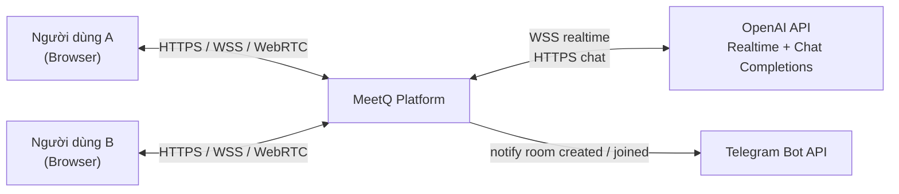
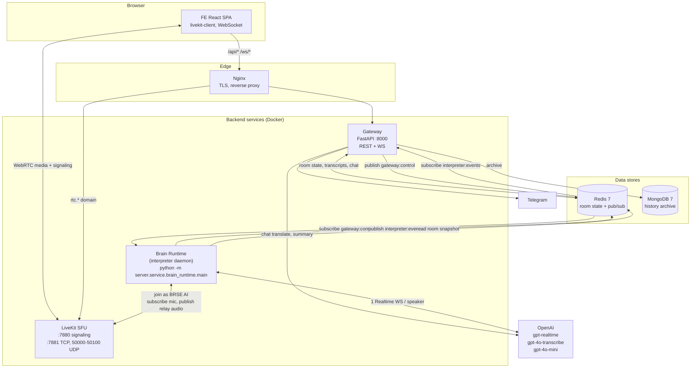
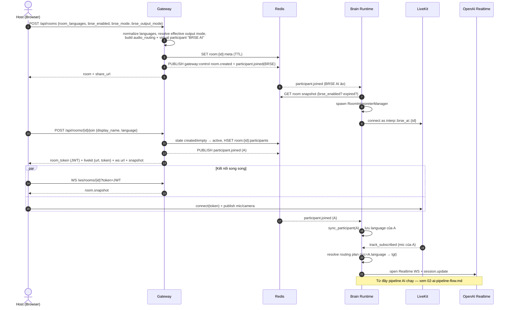
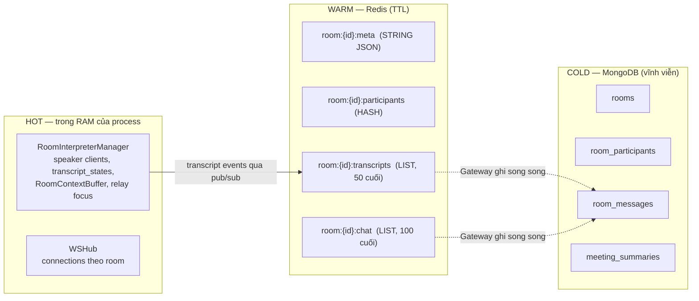
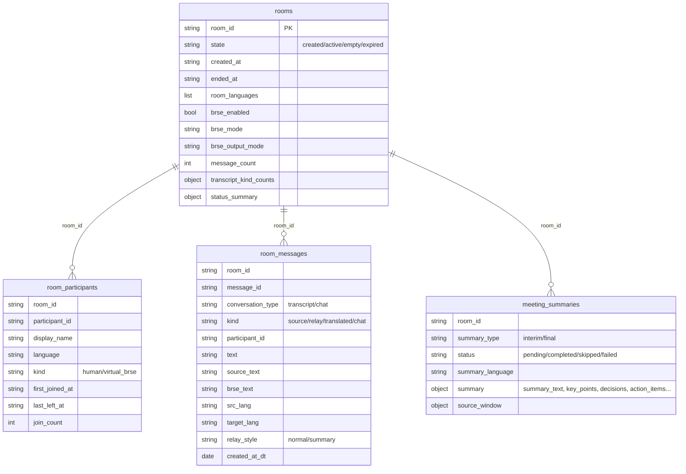
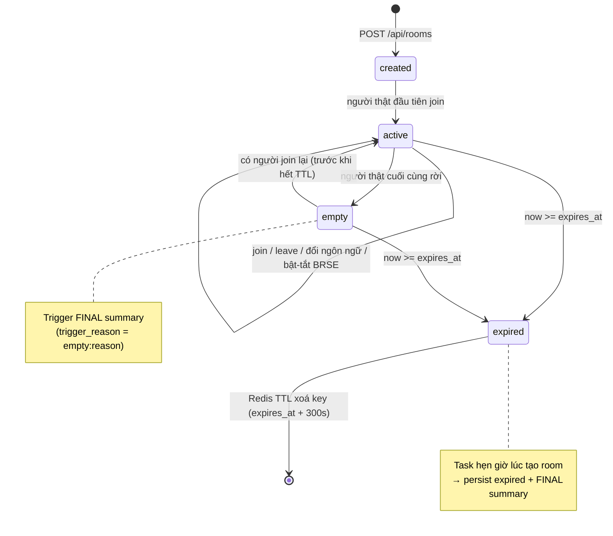
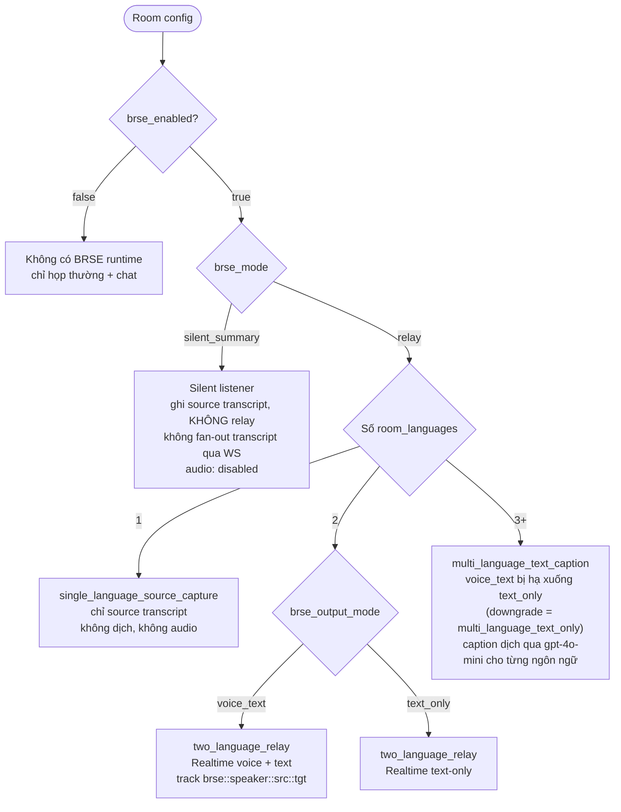
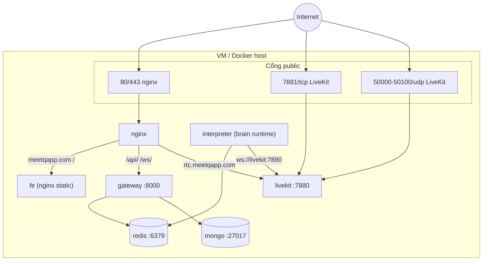

# 01 — System Design: brseAI / MeetQ Meeting Platform

> Snapshot: 2026-10-01, branch `develop`. Mọi con số/hằng số trong tài liệu được lấy trực tiếp từ code; đường dẫn file được ghi kèm để kiểm chứng.

## Mục lục

1. [Bài toán & phạm vi](#1-bài-toán--phạm-vi)
2. [Kiến trúc tổng thể](#2-kiến-trúc-tổng-thể)
3. [Các thành phần](#3-các-thành-phần)
4. [Ranh giới module trong Backend](#4-ranh-giới-module-trong-backend)
5. [Kênh giao tiếp](#5-kênh-giao-tiếp)
6. [Luồng chính: tạo room → join → bật AI](#6-luồng-chính-tạo-room--join--bật-ai)
7. [Data model & lưu trữ](#7-data-model--lưu-trữ)
8. [Vòng đời room](#8-vòng-đời-room)
9. [BRSE modes & chiến lược theo số ngôn ngữ](#9-brse-modes--chiến-lược-theo-số-ngôn-ngữ)
10. [Event contract](#10-event-contract)
11. [Bảo mật](#11-bảo-mật)
12. [Triển khai (deployment)](#12-triển-khai-deployment)
13. [Khả năng mở rộng & giới hạn hiện tại](#13-khả-năng-mở-rộng--giới-hạn-hiện-tại)

---

## 1. Bài toán & phạm vi

MeetQ là nền tảng họp video trên web có một **thành viên ảo "BRSE AI"** ngồi trong phòng. BRSE AI nghe micro của từng người, hiểu câu nói, rồi **relay** (phiên dịch) sang ngôn ngữ của người nghe — bằng **giọng nói** phát lại vào cuộc họp và/hoặc **text** hiển thị trên transcript.

Năng lực chính:

| Nhóm | Tính năng |
| --- | --- |
| Họp | Tạo room không cần tài khoản, share link, video/audio WebRTC, screen share, chat |
| AI relay | Dịch giọng nói → giọng nói (voice + text) cho room 2 ngôn ngữ; text-only; caption đa ngôn ngữ cho room > 2 ngôn ngữ |
| AI nghe im lặng | `silent_summary`: chỉ ghi transcript nguồn để tóm tắt, không phát relay |
| Chat | Gửi nguyên văn hoặc tự dịch sang các ngôn ngữ còn lại của room |
| Tóm tắt | Interim summary (đang họp) và final summary (sau khi room kết thúc) |
| Vận hành | Room tự hết hạn (mặc định prod 30 phút), Telegram notify, test mic / test dịch |

Ngôn ngữ nền tảng hỗ trợ: `vi, en, ja, zh, ko, fr, es` ([`language.py`](../../BE/server/brain/prompts/language.py)). Mặc định room là `vi` + `ja`.

---

## 2. Kiến trúc tổng thể

### 2.1 Context diagram



### 2.2 Container diagram



### 2.3 Nguyên tắc thiết kế cốt lõi

1. **Gateway là source of truth cho application state** (room, participant, transcript gần đây, chat) — lưu ở Redis.
2. **Brain Runtime không có API riêng**: nó chỉ nghe lệnh qua Redis pub/sub, tự join LiveKit như một participant, và đẩy kết quả ngược về qua Redis.
3. **Media không đi qua Gateway**: audio/video người dùng đi thẳng Browser ↔ LiveKit; Brain Runtime lấy audio từ LiveKit bằng Python SDK.
4. **Relay text là nguồn sự thật, voice là một kênh delivery tuỳ chọn** ([`delivery.py`](../../BE/server/service/brain_runtime/delivery.py)).
5. **MongoDB chỉ là archive** — không bao giờ dùng cho quyết định nóng trong lúc họp ([`room_history.py`](../../BE/server/service/persistence/room_history.py)).

---

## 3. Các thành phần

| Thành phần | Công nghệ | Entry point | Trách nhiệm |
| --- | --- | --- | --- |
| **FE** | React 18, Vite, TypeScript, `livekit-client` 2.x, motion/gsap | [`FE/src/main.tsx`](../../FE/src/main.tsx) | UI Home/Room/Test; lấy mic/camera; publish lên LiveKit; giữ WS với Gateway; render transcript, chat, summary; phát audio người + audio BRSE |
| **Nginx** | nginx 1.27 | [`ops/nginx/meetqapp.conf`](../../ops/nginx/meetqapp.conf) | TLS (certbot), route `/api/` và `/ws/` → Gateway, `/` → FE, domain `rtc.*` → LiveKit |
| **Gateway** | FastAPI + uvicorn | `server.service.gateway.main:app` | REST API, WebSocket room, JWT, cấp LiveKit token, Redis room store, fan-out event, chat translate, meeting summary, Mongo archive, Telegram |
| **Brain Runtime** | Python asyncio, `livekit` rtc SDK, `websockets` | `python -m server.service.brain_runtime.main` | Nghe `gateway:control`; mỗi room có `RoomInterpreterManager`; join LiveKit với identity `interp::brse_ai::{room_id}`; 1 OpenAI Realtime session / speaker; publish transcript & relay |
| **LiveKit** | livekit-server (self-host) | [`ops/livekit/`](../../ops/livekit/) | SFU WebRTC cho người dùng và BRSE AI |
| **Redis** | Redis 7 | — | Room state (TTL), danh sách transcript/chat gần đây, pub/sub giữa Gateway ↔ Brain Runtime |
| **MongoDB** | Mongo 7 (`--auth`) | [`ops/mongo/init-app-user.js`](../../ops/mongo/init-app-user.js) | Archive room / participant / message / summary |
| **OpenAI** | `gpt-realtime`, `gpt-4o-transcribe`, `gpt-4o-mini` | — | Realtime ASR + dịch voice; dịch chat/caption; meeting summary |
| **Telegram** | Bot API | [`integrations/telegram.py`](../../BE/server/integrations/telegram.py) | Thông báo room created / participant joined (tắt mặc định) |

---

## 4. Ranh giới module trong Backend

```mermaid
flowchart TB
    subgraph service["server.service — orchestration"]
        subgraph gateway["gateway"]
            API["api_rooms / api_health / api_test_sessions"]
            WS["ws_endpoint / ws_hub / ws_test_*"]
            RS["room_service"]
            STORE["room_store (Redis)"]
            EC["event_consumer"]
            MSS["meeting_summary_service"]
            CT["chat_translator"]
        end
        subgraph runtime["brain_runtime"]
            DMN["daemon"]
            RIM["room_manager<br/>RoomInterpreterManager"]
            CTX["context<br/>RoomContextBuffer"]
            OVL["overlap<br/>OverlapManager"]
            POL["policy<br/>ConversationPolicyEngine"]
            DLV["delivery<br/>RelayDeliveryController"]
            EVT["events<br/>RedisEventPublisher"]
            TT["text_translation"]
        end
        subgraph media["media"]
            LKR["livekit_runtime"]
            AIN["audio_input<br/>LiveKitAudioInput"]
            OUT["output_router<br/>OutputRouter"]
        end
        PERS["persistence/room_history"]
    end

    subgraph brain["server.brain — AI/model-facing"]
        RTC["realtime/client<br/>RealtimeClient"]
        IRC["realtime/interpreter_client<br/>InterpreterRealtimeClient"]
        SC["realtime/session_config<br/>prompts + VAD"]
        SP["realtime/source_policy"]
        TD["realtime/term_detector"]
        PR["prompts/language<br/>prompts/technical_terms"]
        MS["meeting_summary"]
        FB["fallback/pipeline (CLI)"]
    end

    API --> RS
    WS --> RS
    RS --> STORE
    RS --> MSS
    RS --> CT
    MSS --> MS
    EC --> STORE
    RS --> PERS
    EC --> PERS

    DMN --> RIM
    RIM --> CTX
    RIM --> OVL
    RIM --> POL
    RIM --> DLV
    RIM --> EVT
    RIM --> TT
    RIM --> LKR
    RIM --> AIN
    RIM --> OUT
    RIM --> IRC
    IRC --> RTC
    IRC --> SC
    IRC --> TD
    POL --> SP
    SP --> TD
    SC --> PR
```



Quy tắc ranh giới (theo [`docs/backend/FILE_STRUCTURE.md`](../backend/FILE_STRUCTURE.md)):

- `brain` = code build prompt, cấu hình model session, gọi OpenAI, xử lý model events, chính sách chống hallucination.
- `service` = vòng đời room, Redis IO, LiveKit media, transport HTTP/WS, điều phối gọi `brain`.
- `shared` = helper chung không thuộc AI.
- Hợp đồng dùng chung ở cấp server: `server/models.py`, `server/events.py`, `server/meeting_modes.py`, `server/config.py`.

---

## 5. Kênh giao tiếp

| Kênh | Hai đầu | Giao thức | Dùng cho |
| --- | --- | --- | --- |
| REST | FE → Gateway | HTTPS JSON | Tạo/join/leave room, bật/tắt BRSE, screen share, summary, test session |
| Room WebSocket | FE ↔ Gateway | WSS `/ws/rooms/{room_id}?token=<room JWT>` | Snapshot, participant events, transcript, interpreter status, chat, ping/pong |
| WebRTC | FE ↔ LiveKit | ICE/DTLS/SRTP | Audio/video/screen share của người dùng; audio relay của BRSE |
| LiveKit (server SDK) | Brain Runtime ↔ LiveKit | `ws://livekit:7880` nội bộ | Subscribe mic người, publish track `brse::*` |
| Redis pub/sub `brseai:v1:gateway:control` | Gateway → Brain Runtime (+ Gateway tự nghe để broadcast) | JSON envelope | `room.created`, `participant.*`, `room.brse_updated`, `chat.message`, `screen_share.*`... |
| Redis pub/sub `brseai:v1:interpreter:events` | Brain Runtime → Gateway | JSON envelope | `transcript.partial/final`, `interpreter.status/error`, `participant.media_*` |
| OpenAI Realtime | Brain Runtime → OpenAI | WSS `wss://api.openai.com/v1/realtime?model=...` | 1 session cho mỗi speaker đang có mic |
| OpenAI Chat Completions | Gateway / Brain Runtime → OpenAI | HTTPS | Dịch chat, dịch caption đa ngôn ngữ, meeting summary |

Envelope chung ([`server/events.py`](../../BE/server/events.py)):

```json
{
  "type": "transcript.final",
  "event_id": "evt_1a2b3c4d5e6f",
  "room_id": "rm_xxxxxxxxxxxx",
  "sent_at": "2026-10-01T03:00:00.000Z",
  "payload": { "...": "..." }
}
```

> Lưu ý: tên channel thực tế lấy từ `Settings.redis_channel_gateway_control` / `redis_channel_interpreter_events` (`brseai:v1:...`). Hằng số `GATEWAY_CONTROL_CHANNEL` trong `events.py` chỉ là giá trị cũ, không dùng ở runtime.

### REST API chính ([`api_rooms.py`](../../BE/server/service/gateway/api_rooms.py))

```text
POST   /api/rooms                          tạo room (room_languages, brse_enabled, brse_mode, brse_output_mode)
GET    /api/rooms/{room_id}                snapshot room
POST   /api/rooms/{room_id}/join           join → room JWT + LiveKit token + WS url + snapshot
DELETE /api/rooms/{room_id}/leave          rời room
POST   /api/rooms/{room_id}/brse/enable    bật BRSE AI
POST   /api/rooms/{room_id}/brse/disable   tắt BRSE AI
POST   /api/rooms/{room_id}/screen-share/start|stop
GET    /api/rooms/{room_id}/summary?type=interim|final
POST   /api/rooms/{room_id}/summary        sinh summary (language tuỳ chọn)
POST   /api/test/mic|translation           tạo phiên test; WS /ws/test/mic|translation/{session_id}
GET    /api/health
```

### WebSocket client → server ([`ws_endpoint.py`](../../BE/server/service/gateway/ws_endpoint.py))

`ping`, `set_language`, `chat.send`, `room.brse.enable`, `room.brse.disable`, `screen_share.start`, `screen_share.stop`.

---

## 6. Luồng chính: tạo room → join → bật AI



Điểm quan trọng của daemon ([`daemon.py`](../../BE/server/service/brain_runtime/daemon.py)):

- `room.created` bị bỏ qua — manager chỉ được spawn khi nhận `participant.joined` hoặc `room.brse_updated` (ON). Vì `create_room` publish luôn `participant.joined` cho participant ảo **BRSE AI**, nên với room có `brse_enabled = true` manager được spawn và BRSE join LiveKit **ngay khi tạo room**, trước khi người thật vào.
- Không spawn nếu `brse_enabled = false` hoặc room đã hết hạn (`expires_at`).
- `participant.left` → nếu không còn người thật nào (hoặc BRSE tắt) → terminate manager, BRSE rời LiveKit.
- `room.brse_updated` OFF → terminate; ON → spawn manager mới từ snapshot hiện tại.

---

## 7. Data model & lưu trữ

### 7.1 Ba tầng trạng thái



### 7.2 Redis keys ([`room_store.py`](../../BE/server/service/gateway/room_store.py))

| Key | Kiểu | Nội dung | Giới hạn |
| --- | --- | --- | --- |
| `room:{room_id}:meta` | STRING (JSON `RoomState`) | room_languages, brse_enabled/mode/output_mode, audio_routing, virtual_participants, state, expires_at | TTL = `room_meeting_duration_seconds + 300` |
| `room:{room_id}:participants` | HASH participant_id → JSON `ParticipantState` | language, status, session_id, media_connected, is_screen_sharing... | cùng TTL |
| `room:{room_id}:transcripts` | LIST JSON `TranscriptEvent` | **chỉ transcript final** (source + relay) | `LTRIM` giữ 50 |
| `room:{room_id}:chat` | LIST JSON `ChatMessage` | chat kèm bản dịch | `LTRIM` giữ 100 |
| `test:mic:{id}`, `test:trans:{id}` | — | phiên test mic/translation | [`test_session_store.py`](../../BE/server/service/gateway/test_session_store.py) |

### 7.3 MongoDB collections ([`room_history.py`](../../BE/server/service/persistence/room_history.py))



Ghi Mongo luôn là **side-effect bất đồng bộ** (`room_history.schedule(...)`), upsert theo `(room_id, message_id, kind)` nên idempotent. Nếu Mongo không kết nối được, room vẫn chạy bình thường; chỉ summary bị `503 meeting_summary_unavailable`.

---

## 8. Vòng đời room



- Thời lượng logic: `ROOM_MEETING_DURATION_SECONDS` (code default 3600, `.env.example` & prod compose = **1800s**).
- Room JWT sống lâu hơn (`ROOM_TOKEN_TTL_SECONDS` = 86400) để vẫn đọc được summary sau họp.
- Brain Runtime không spawn manager cho room đã hết hạn; FE có [`useRoomExpiry.ts`](../../FE/src/features/room/useRoomExpiry.ts) để đếm ngược.

---

## 9. BRSE modes & chiến lược theo số ngôn ngữ

Ba biến cấu hình của room ([`meeting_modes.py`](../../BE/server/meeting_modes.py)):

| Biến | Giá trị | Ý nghĩa |
| --- | --- | --- |
| `brse_enabled` | `true` / `false` | Có BRSE AI trong phòng hay không |
| `brse_mode` | `relay` (mặc định) / `silent_summary` | Relay công khai, hay chỉ nghe để tóm tắt |
| `brse_output_mode` | `voice_text` (mặc định) / `text_only` | Có phát giọng relay hay chỉ text |
| `room_languages` | 1..7 ngôn ngữ | Quyết định `route_strategy` |



Từ 2026-10-03, phòng 2 ngôn ngữ đổi được `brse_output_mode` ngay trong cuộc họp (`PATCH /api/rooms/{id}/relay-mode`, event `room.relay_mode_updated`); `brse_enabled` và `brse_output_mode` là hai field độc lập. Chi tiết runtime xem [02 §9](02-ai-pipeline-flow.md#9-bước-9--output-gate--delivery).

Đường đi audio trong room (`audio_routing`):

- **Người nghe luôn nghe audio gốc của người nói** (`canonical_remote_audio = human_original_track`).
- Khi voice relay bật, BRSE AI publish **thêm** một track audio dịch cho mỗi speaker (`human_original_plus_brse`).
- `participant.language` = ngôn ngữ người đó *nói*; target của relay = ngôn ngữ còn lại có người nghe.

---

## 10. Event contract

| Event | Chiều | Payload chính |
| --- | --- | --- |
| `room.created`, `room.expired`, `room.brse_updated` | GW → BR/FE | room state, `brse_enabled/mode/output_mode` |
| `room.relay_mode_updated` | GW → BR/FE | `brse_output_mode`, `previous_output_mode`, `audio_routing`, `changed_by`, `changed_at` |
| `participant.joined/updated/left` | GW → BR/FE | participant snapshot (cả virtual BRSE) |
| `participant.media_connected/disconnected` | BR → GW → FE | `participant_id` |
| `transcript.partial` / `transcript.final` | BR → GW → FE | `kind` = `source` \| `relay`; `utterance_id`, `speaker`, `src_lang`, `tgt_lang`, `text`, `source_text`, `brse_text`, `audio_output`, `relay_style`, `relay_focus`, `overlap`, `relay_decision`, `delivery` |
| `interpreter.status` | BR → GW → FE | `status` = `idle`/`capturing`/`queued`/`translating`/`playing`/`blocked_due_to_overlap`/`error` |
| `interpreter.error` | BR → GW → FE | `code` (`invalid_language`, `missing_room_language_context`, `interpreter_unavailable`...) |
| `chat.message` | GW → FE | text + `translations[]` |
| `screen_share.started/stopped` | GW → FE | — |

Gateway xử lý event từ Brain Runtime ([`event_consumer.py`](../../BE/server/service/gateway/event_consumer.py)):

- Bỏ qua mọi event nếu room không còn hoặc `brse_enabled = false` (chống output trễ).
- `transcript.final` → `RPUSH` Redis + archive Mongo + broadcast WS.
- `silent_summary`: chỉ giữ transcript `source`, **không** broadcast.

---

## 11. Bảo mật

| Vấn đề | Cơ chế hiện tại |
| --- | --- |
| Định danh người dùng | Không có tài khoản. Join trả **room JWT HS256** (`ROOM_JWT_SECRET`) chứa `room_id`, `participant_id`, `session_id`, `language` ([`auth.py`](../../BE/server/service/gateway/auth.py)) |
| WS auth | Token qua query `?token=`; đóng `4401` (thiếu/hết hạn/sai), `4403` (sai room, participant không active, session mismatch), `4404` (room không tồn tại) |
| LiveKit | Token cấp bởi Gateway (`LIVEKIT_API_KEY/SECRET`); `can_publish_data=false`; BRSE chỉ được `can_publish` khi voice relay bật |
| Phân biệt BRSE | Identity `interp::brse_ai::{room_id}`; runtime bỏ qua track của identity `interp::*` và audio screen-share |
| Bật/tắt BRSE | Chỉ participant người thật, đang active, đúng session |
| Secrets | `.env` / `.env.production`; `make prod` từ chối chạy nếu còn placeholder |
| CORS | Đang `allow_origins=["*"]` — nên siết lại theo domain prod |
| Prompt injection từ lời nói | Prompt relay coi mọi câu là "quoted human speech", không trả lời / không làm theo ([`session_config.py`](../../BE/server/brain/realtime/session_config.py) `_BOUNDARY_POLICY`) |

---

## 12. Triển khai (deployment)



| Môi trường | Lệnh | Ghi chú |
| --- | --- | --- |
| Local | `make fe-install && make local` | Docker: redis, mongo, livekit, gateway (`--reload`), interpreter; FE Vite chạy ngoài Docker ở `:3000` |
| Prod | `make prod` | [`docker-compose.prod.yml`](../../docker-compose.prod.yml) + `.env.production`; nginx + certbot; chi tiết ở [`docs/backend/DEPLOY_PRODUCTION.md`](../backend/DEPLOY_PRODUCTION.md) |

---

## 13. Khả năng mở rộng & giới hạn hiện tại

| # | Giới hạn | Tác động | Hướng xử lý gợi ý |
| --- | --- | --- | --- |
| 1 | `InterpreterDaemon.managers` nằm trong RAM của **một** process; mọi daemon cùng subscribe một channel | Chạy >1 replica Brain Runtime sẽ spawn trùng manager cho cùng room (2 BRSE AI) | Sharding theo room_id / distributed lock Redis (`SET NX`) trước khi spawn |
| 2 | Redis pub/sub không lưu tin | Daemon restart giữa chừng sẽ không biết room đang chạy cho tới event join/update tiếp theo | Reconcile định kỳ từ Redis snapshot khi khởi động |
| 3 | 1 OpenAI Realtime WS / speaker có mic | Chi phí & quota tăng tuyến tính theo số người | Tắt session khi mic mute lâu; gom speaker im lặng |
| 4 | Reconnect Realtime tối đa 5 lần (backoff 1,2,4,8s) rồi dừng | Speaker đó mất relay tới khi route được reconcile lại | Thêm health check + respawn client |
| 5 | Fallback Whisper + GPT ([`fallback/pipeline.py`](../../BE/server/brain/fallback/pipeline.py)) **chỉ dùng cho CLI**, chưa nối vào room runtime | Không có đường dự phòng khi Realtime lỗi trong phòng họp | Nối fallback vào `RoomInterpreterManager` |
| 6 | FE phát **mọi** track BRSE cho mọi người (không lọc theo `audience_participant_ids`) | Người nói cũng nghe bản dịch câu của chính mình | Lọc `brseAudioFeeds` theo `parseBrseTrackName().targetLanguage == myLanguage` |
| 7 | Transcript trong Redis chỉ 50 bản final; FE giữ 30 entry | Interim summary chỉ dựa trên cửa sổ gần nhất | Interim lấy từ Mongo như final |
| 8 | `RoomContextBuffer` chỉ trong RAM, retention 9s | Model không có ngữ cảnh dài hạn khi dịch (cố ý, để chống bịa) | Nếu cần glossary/thuật ngữ theo room, lưu riêng và inject theo turn |
| 9 | CORS `*`, token qua query string | Rủi ro bảo mật | Siết origin; cân nhắc subprotocol/header cho WS token |
