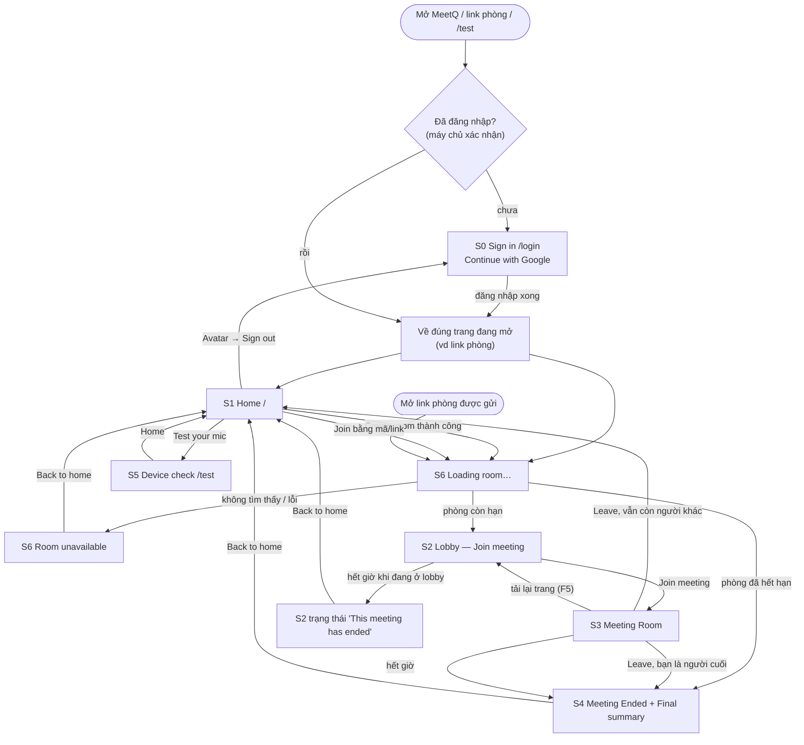
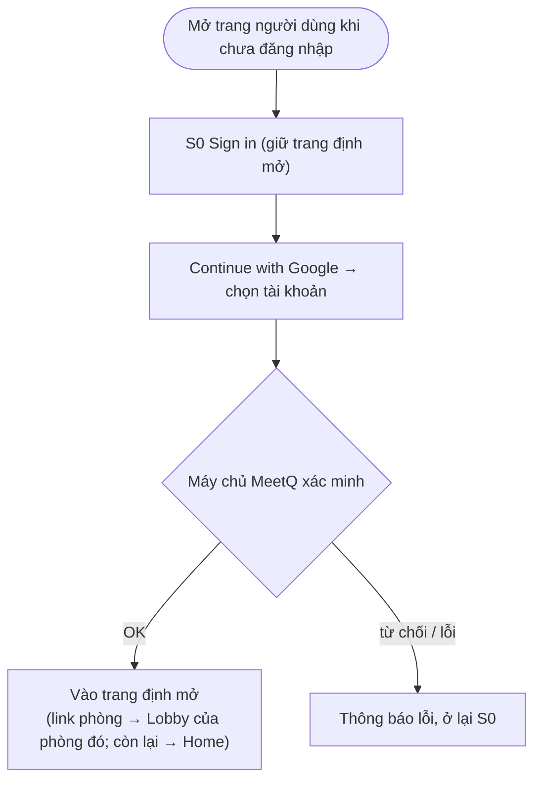
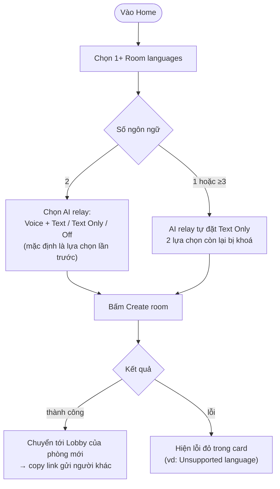
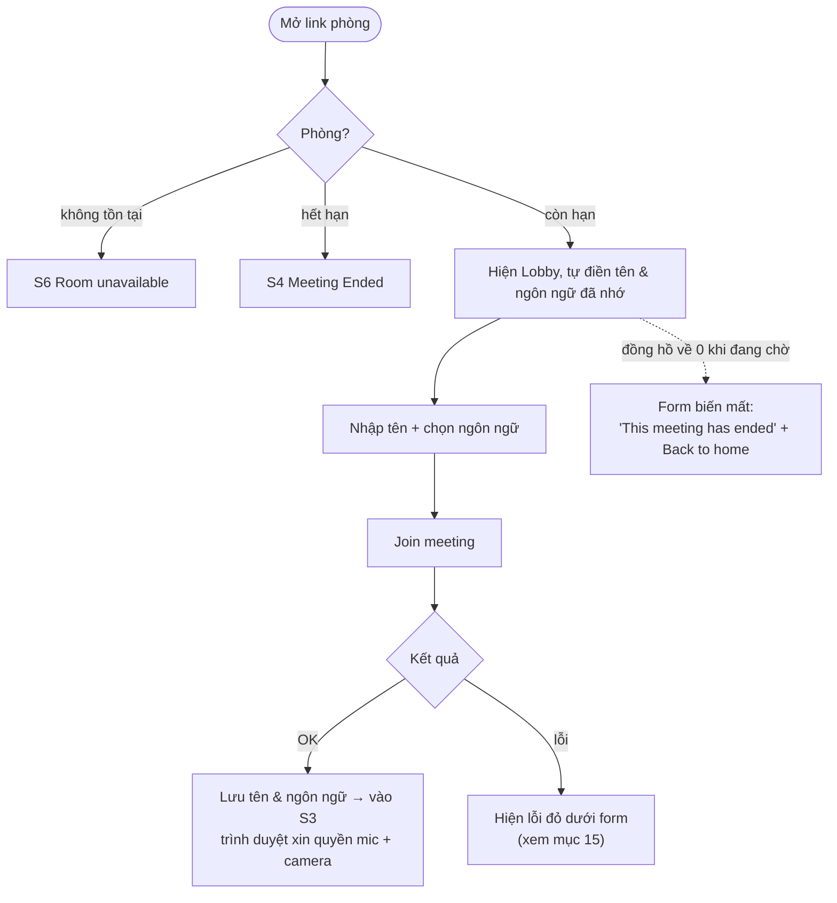
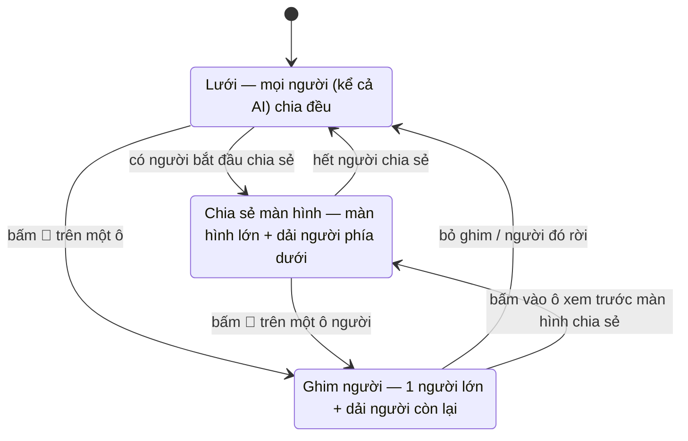
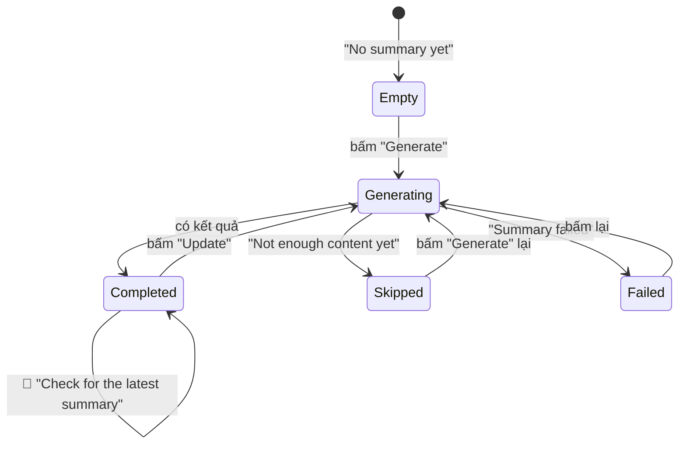
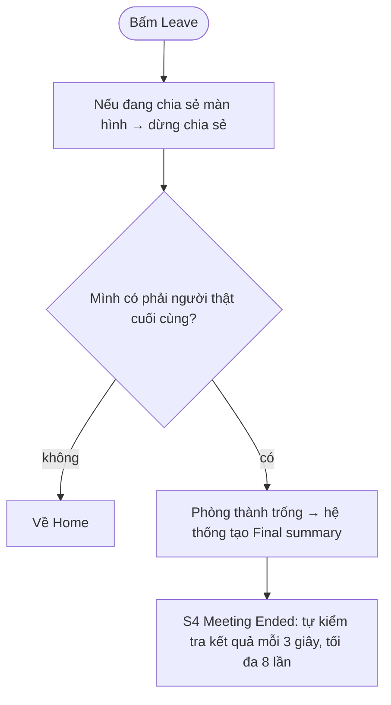
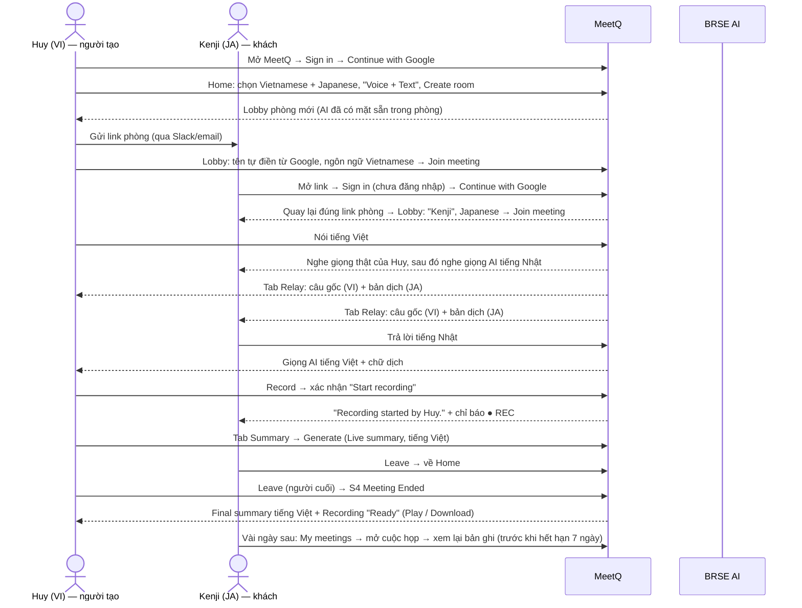

# 03 — MeetQ: Tính năng & Workflow sản phẩm (product context cho AI)

> **Mục đích:** Tài liệu này mô tả MeetQ **ở góc nhìn sản phẩm và người dùng**: có những màn hình nào, người dùng làm gì ở từng màn hình, hệ thống phản hồi ra sao, và các quy tắc nghiệp vụ. Tài liệu **không** đi vào công nghệ.
> Dùng file này làm **context đầu vào cho AI** khi cần viết prompt/spec cho một tính năng mới, để AI hiểu đúng sản phẩm hiện có và không đề xuất trùng hoặc mâu thuẫn.
>
> Snapshot: 2026-10-03 (sau đợt làm lại giao diện ngày 2026-10-03). Nhãn giao diện được giữ nguyên **bằng tiếng Anh, trong dấu ngoặc kép**, đúng như người dùng thấy trên màn hình.

## Mục lục

1. [MeetQ là gì](#1-meetq-là-gì)
2. [Thuật ngữ](#2-thuật-ngữ)
3. [Người dùng & vai trò](#3-người-dùng--vai-trò)
4. [Quy tắc nghiệp vụ cốt lõi](#4-quy-tắc-nghiệp-vụ-cốt-lõi)
5. [Bản đồ màn hình & điều hướng](#5-bản-đồ-màn-hình--điều-hướng)
6. [S0 — Đăng nhập (Sign in)](#s0--đăng-nhập-sign-in) · [S1 — Trang chủ (Home)](#s1--trang-chủ-home)
7. [S2 — Phòng chờ (Lobby)](#s2--phòng-chờ-lobby)
8. [S3 — Phòng họp (Meeting Room)](#s3--phòng-họp-meeting-room)
9. [S4 — Cuộc họp đã kết thúc (Meeting Ended)](#s4--cuộc-họp-đã-kết-thúc-meeting-ended)
10. [S5 — Kiểm tra thiết bị (Device Check)](#s5--kiểm-tra-thiết-bị-device-check)
11. [S6 — Các trạng thái lỗi/tải](#s6--các-trạng-thái-lỗitải)
12. [Hành trình người dùng end-to-end](#12-hành-trình-người-dùng-end-to-end)
13. [AI relay hoạt động thế nào (góc nhìn người dùng)](#13-ai-relay-hoạt-động-thế-nào-góc-nhìn-người-dùng)
14. [Những gì hệ thống ghi nhớ](#14-những-gì-hệ-thống-ghi-nhớ)
15. [Danh sách thông báo & lỗi người dùng có thể thấy](#15-danh-sách-thông-báo--lỗi-người-dùng-có-thể-thấy)
16. [Những gì CHƯA có / giới hạn đã biết](#16-những-gì-chưa-có--giới-hạn-đã-biết)
17. [Hướng dẫn dùng tài liệu này để viết prompt tính năng mới](#17-hướng-dẫn-dùng-tài-liệu-này-để-viết-prompt-tính-năng-mới)

---

## 1. MeetQ là gì

**MeetQ** là ứng dụng họp video chạy trên trình duyệt dành cho các nhóm **nói nhiều ngôn ngữ khác nhau** (bối cảnh chính: team Việt Nam làm việc với khách hàng Nhật, vai trò BrSE — Bridge System Engineer).

Mỗi phòng họp có một **thành viên AI** tên **"BRSE AI"**. AI nghe từng người nói, rồi chuyển lời của họ sang ngôn ngữ của người nghe:

- bằng **chữ** (dòng dịch hiện trong tab "Relay"), và/hoặc
- bằng **giọng nói AI** phát vào cuộc họp (chỉ với phòng có đúng 2 ngôn ngữ).

Mọi người vẫn nghe **giọng thật** của nhau. Giọng AI chỉ là một luồng **phát thêm**.

Giá trị cốt lõi:

| # | Giá trị | Mô tả ngắn |
| --- | --- | --- |
| V1 | Mỗi người nói tiếng của mình | Không cần phiên dịch viên người thật |
| V2 | Phụ đề + dịch trực tiếp | Câu gốc và bản dịch hiện song song theo thời gian thực |
| V3 | Giọng dịch AI | Phòng 2 ngôn ngữ có thể nghe bản dịch bằng giọng nói |
| V4 | Tóm tắt cuộc họp | Ý chính, quyết định, việc cần làm, rủi ro, câu hỏi mở |
| V5 | Đăng nhập một chạm bằng Google | Đăng nhập Google → tạo phòng → gửi link → vào họp |

Ngôn ngữ hỗ trợ (7): **Vietnamese, English, Japanese, Chinese, Korean, French, Spanish**.

---

## 2. Thuật ngữ

| Thuật ngữ | Nghĩa trong sản phẩm |
| --- | --- |
| **Room / Phòng** | Một cuộc họp. Có mã dạng `rm_xxxxxxxxxxxx` và link `/rooms/<mã>` |
| **Room languages** | Danh sách ngôn ngữ của phòng, chọn lúc tạo phòng (1–7 ngôn ngữ) |
| **Your language** | Ngôn ngữ **bạn nói** trong phòng, chọn trong số Room languages. Đây cũng là ngôn ngữ bạn muốn đọc/nghe bản dịch |
| **BRSE AI / AI relay** | Thành viên AI ảo trong phòng, chuyên chuyển lời nói giữa các ngôn ngữ |
| **Relay** | Một bản dịch AI tạo ra cho một câu nói |
| **Source line** | Dòng chữ của câu gốc (người thật nói gì, ngôn ngữ gốc) |
| **Relay line** | Dòng bản dịch của câu đó sang ngôn ngữ khác |
| **Live / partial** | Dòng đang được cập nhật dần, chưa chốt |
| **Relay mode** | Cách AI relay phát bản dịch: "Voice + Text" hoặc "Text Only" (phòng 1 ngôn ngữ là "Captions"; ngoài ra có chế độ nội bộ "Summary capture"). Là state **của phòng**, tách riêng với bật/tắt AI. Khi tạo phòng, lựa chọn "Off" nghĩa là tạo phòng với AI tắt |
| **Live summary** | Bản tóm tắt tạm, tạo **trong lúc họp** khi người dùng bấm |
| **Final summary** | Bản tóm tắt cuối, tạo **sau khi phòng kết thúc** |
| **Lobby** | Màn hình nhập tên và chọn ngôn ngữ trước khi vào phòng |
| **Stage** | Khu vực trung tâm hiển thị video và màn hình chia sẻ |
| **Side panel** | Cột bên phải có 4 tab: "Relay", "Chat", "Summary", "People" |
| **Pin** | Ghim một người hoặc một màn hình chia sẻ lên khu vực chính của stage |

---

## 3. Người dùng & vai trò

| Vai trò | Ai | Có thể làm |
| --- | --- | --- |
| **Người dùng MeetQ** | Bất kỳ ai **đăng nhập bằng Google** | Dùng mọi màn hình người dùng (Home, Lobby, Meeting Room, Device check). Chưa đăng nhập thì chỉ thấy màn hình Sign in |
| **Người tạo phòng** | Người dùng MeetQ đã đăng nhập, ở trang chủ | Tạo phòng, chọn ngôn ngữ và chế độ AI, gửi link. **Không có quyền gì đặc biệt** so với người khác sau khi vào phòng |
| **Người tham gia** | Người dùng MeetQ đã đăng nhập, có link | Vào phòng, nói, bật/tắt mic & camera, chia sẻ màn hình, chat, đổi ngôn ngữ, **bật/tắt AI relay cho cả phòng**, tạo tóm tắt |
| **BRSE AI** | Thành viên ảo do hệ thống thêm vào | Nghe, dịch, phát giọng dịch. Không có camera, không chat, không bị điều khiển |
| **Admin vận hành** | Người vận hành hệ thống, có **tài khoản admin riêng** | Đăng nhập Admin Portal `/admin/login` bằng **Username + Password** (không dùng Google; đăng nhập Google **không** cho quyền admin, và đăng xuất ở bên này không đăng xuất bên kia) để xem phòng đang chạy, chẩn đoán BRSE AI, lịch sử meeting, bản ghi hình & thời hạn lưu trữ (R-56, R-57), issues, analytics. Nhận thông báo Telegram (phòng mới / có người vào) nếu bật. Xem [docs/admin/admin-overview.md](../admin/admin-overview.md) |

> **Lưu ý về "Host":** giao diện có sẵn nhãn "Host", nút "Mute" người khác và thông báo "The host muted your microphone". Tuy nhiên hiện **hệ thống không chỉ định host**, và chức năng mute người khác **chưa hoạt động** phía máy chủ. Xem [mục 16](#16-những-gì-chưa-có--giới-hạn-đã-biết).

---

## 4. Quy tắc nghiệp vụ cốt lõi

Đánh số `R-xx` để prompt tính năng mới có thể tham chiếu.

### Phòng & thời gian

- **R-01** Người dùng phải **đăng nhập bằng Google** trước khi dùng MeetQ (Home, mở link phòng, Device check). Không có đăng ký riêng: lần đầu đăng nhập Google là có tài khoản. Máy chủ MeetQ xác minh đăng nhập; giao diện chỉ coi là đã đăng nhập khi máy chủ xác nhận. Trong phòng, danh tính hiển thị vẫn là **tên hiển thị** (mặc định lấy tên Google, có thể sửa ở Lobby) và **ngôn ngữ**.
- **R-01a** Mở link phòng khi chưa đăng nhập → màn hình Sign in ("Sign in to join the meeting") → đăng nhập xong **quay lại đúng phòng đó**, không về Home. Chỉ quay lại được các trang của MeetQ, không bao giờ sang trang web khác.
- **R-01b** Đăng xuất từ menu avatar (góc trên phải) → về màn hình Sign in. Phiên hết hạn khi đang dùng → về Sign in kèm "Your session ended. Sign in again to continue." (nếu đang mở link phòng thì vẫn giữ link).
- **R-01c** Admin đăng nhập riêng ở `/admin/login` bằng Username + Password. Hai loại đăng nhập độc lập hoàn toàn.
- **R-02** Mỗi phòng có **thời hạn cố định** tính từ lúc tạo, do cấu hình máy chủ quyết định (`ROOM_MEETING_DURATION_SECONDS`, production hiện đặt **30 phút**). Trang Home hiển thị đúng giá trị này ("Rooms stay open for N minutes"). Đồng hồ đếm ngược hiển thị trên phòng.
- **R-03** Khi hết giờ: phòng **đóng**, không nhận thêm người, AI dừng, các nút bị khoá, và hệ thống **tự tạo Final summary**.
- **R-04** Khi **người thật cuối cùng rời phòng**, phòng được coi là "trống" và hệ thống **tự tạo Final summary**. Nếu có người vào lại trước khi hết giờ, phòng hoạt động tiếp.
- **R-05** Không giới hạn số người trong phòng (về sau có thể cấu hình).

### Ngôn ngữ

- **R-10** Lúc tạo phòng phải chọn **ít nhất 1** ngôn ngữ, tối đa cả 7.
- **R-11** Người tham gia **chỉ được chọn ngôn ngữ nằm trong Room languages**.
- **R-12** Có thể **đổi ngôn ngữ của mình bất cứ lúc nào** trong phòng. AI tự đổi hướng dịch theo.
- **R-13** Không thể thêm hoặc bớt ngôn ngữ của phòng sau khi đã tạo.

### Chế độ AI relay (phụ thuộc số ngôn ngữ)

| Số Room languages | "Voice + Text" | "Text Only" | "Off" | Người dùng nhận được |
| --- | --- | --- | --- | --- |
| **1** | ✘ khoá | ✔ (bắt buộc) | ✘ khoá | Phụ đề câu gốc (transcript), không dịch. Nhãn hiển thị là "Captions" |
| **2** | ✔ (mặc định) | ✔ | ✔ | Voice + Text: chữ dịch + giọng AI. Text Only: chỉ chữ dịch. Off: họp thường |
| **3 trở lên** | ✘ khoá | ✔ (bắt buộc) | ✘ khoá | Câu gốc + chữ dịch sang **từng** ngôn ngữ còn lại mà đang có người nghe. Không có giọng AI |

- **R-20** Giọng AI **chỉ có** ở phòng đúng **2 ngôn ngữ** với chế độ "Voice + Text".
- **R-21** Với phòng có **đúng 2 ngôn ngữ**, người tham gia có thể chuyển giữa "Voice + Text" và "Text Only" **ngay trong cuộc họp** (selector cạnh công tắc AI relay trên header ở màn hình rộng, và trong Settings → AI relay ở mọi màn hình). Thay đổi áp dụng cho **cả phòng**, đồng bộ realtime tới mọi người, người vào sau và người tải lại trang đều thấy mode hiện tại. Phòng 1 ngôn ngữ (Captions) và phòng từ 3 ngôn ngữ (Text Only) không có lựa chọn này; máy chủ từ chối mọi yêu cầu bật voice cho các phòng đó. Phòng đã hết hạn không đổi được mode.
- **R-21a** Bật/tắt AI và relay mode là **hai state độc lập**. Đổi mode khi AI đang tắt chỉ lưu mode, **không** tự bật AI; khi bật lại, AI chạy theo mode đã lưu.
- **R-21b** Ranh giới khi đổi mode: STT, dịch và text relay chạy liên tục, không gián đoạn. Mỗi câu dịch quyết định có giọng AI hay không **tại thời điểm bắt đầu dịch câu đó**: câu đang được đọc bằng giọng AI sẽ đọc hết; câu đang chờ trong hàng đợi và mọi câu sau đi theo mode mới. Không phát lại bằng giọng các câu đã dịch trước đó. BRSE AI không rời phòng, không ai bị ngắt kết nối.
- **R-22** **Bất kỳ người tham gia nào** cũng có thể bật/tắt AI relay và đổi relay mode, và thay đổi áp dụng cho **cả phòng**. Nếu hai người đổi gần như cùng lúc, máy chủ xử lý tuần tự; mọi màn hình hội tụ về thay đổi được chấp nhận sau cùng.
- **R-23** Khi tắt AI: BRSE AI rời phòng, không còn bản dịch mới, các dòng relay gần đây lưu tạm trên máy chủ bị xoá. Khi bật lại: AI vào lại phòng với **relay mode hiện tại của phòng** (mode chọn lúc tạo, hoặc mode được đổi sau đó). Nếu lúc tạo chọn "Off" ở phòng 2 ngôn ngữ, mode lưu sẵn là "Voice + Text" và có thể đổi sang "Text Only" trước khi bật.
- **R-23a** BRSE AI là **người phiên dịch, không phải trợ lý**: chỉ lên tiếng khi có người thật vừa nói một câu hợp lệ, và chỉ nói bản dịch của đúng câu đó. Không chào khi vào phòng, không nói "tôi sẵn sàng dịch", "mời bạn nói", "xin nói lại", không tự giới thiệu, không lên tiếng khi im lặng, tạp âm hay chỉ có "ừm/à/uh". Câu ngắn có nghĩa ("OK", "Vâng", "Đúng ạ", "はい", "Hello") vẫn được dịch. Câu hỏi gửi tới AI ("AI ơi, dịch được không?") được **dịch như một câu hỏi**, không được trả lời; câu ra lệnh cho AI được dịch nguyên văn, không được làm theo. Nếu bản dịch trông như một câu trả lời của trợ lý, nó bị huỷ trước khi ai nghe thấy hoặc đọc thấy — người nghe không nhận gì cho câu đó, thay vì nhận một câu sai. Nếu giọng AI lỗi, bản dịch dạng chữ vẫn hiện.
- **R-24** Có chế độ nội bộ **"Summary capture"**: AI nghe im lặng để phục vụ tóm tắt, không hiện bản dịch cho ai. Người dùng **không chọn được** chế độ này trên giao diện.

### Chat

- **R-30** Chat hiển thị cho **toàn bộ** phòng, mỗi tin tối đa **2000 ký tự**.
- **R-31** Khi gửi có thể chọn "Original" (gửi nguyên văn) hoặc "Translated" (kèm bản dịch sang mọi ngôn ngữ còn lại của phòng). Lựa chọn này chỉ hiện với phòng có từ 2 ngôn ngữ.
- **R-32** Nếu dịch chat bị lỗi, hoặc bản dịch trông như câu trả lời của trợ lý thay vì bản dịch, tin vẫn được gửi **nguyên văn** (không kèm bản dịch).

### Tóm tắt

- **R-40** **Live summary**: người dùng bấm "Generate"/"Update" khi muốn. Bản tóm tắt dựa trên **các câu và tin chat gần đây**, viết bằng **ngôn ngữ của người bấm**.
- **R-41** **Final summary**: tạo tự động khi phòng kết thúc (R-03, R-04), dựa trên **toàn bộ** nội dung cuộc họp, và được lưu **trong thời hạn lưu trữ của cuộc họp** (R-55), sau đó bị xoá cùng các nội dung khác.
- **R-42** Tóm tắt **chỉ dựa trên những gì thực sự được nói hoặc chat**. AI không tự suy ra quyết định, người phụ trách hay deadline. Nếu nội dung quá ít, tóm tắt báo "Not enough content".
- **R-43** Một bản tóm tắt gồm: đoạn tổng quan, "Key points", "Decisions", "Action items" (kèm người phụ trách/hạn chót nếu có nói rõ), "Risks and blockers", "Open questions", "Next steps", "Participants", và dòng thống kê nguồn ("Based on …").

### Ghi hình & lưu trữ cuộc họp

- **R-50** Người tham gia (đã đăng nhập, đang ở trong phòng) có thể **Start / Stop recording** bằng nút "Record" trên thanh điều khiển. Cuộc họp **không tự ghi hình**; bấm Record luôn hiện hộp xác nhận "Start recording? Everyone in this meeting will be notified that recording has started." Admin **không** bắt đầu ghi hình được.
- **R-51** Ghi hình là **trạng thái của cả phòng**: ai bấm Stop cũng được; người bấm Record rời phòng, mất mạng hay tải lại trang thì ghi hình **vẫn tiếp tục** (ghi ở phía máy chủ). Mỗi phòng chỉ có **một** bản ghi đang chạy; bấm Record lần nữa không tạo bản ghi thứ hai.
- **R-52** **Không có ghi hình ẩn**: khi đang ghi, mọi người thấy chỉ báo cố định **"● REC 12:34"** ở đầu trang (hoặc "Starting recording…" / "Stopping recording…"), và nhận thông báo "Recording started by <tên>." / "Recording stopped." / "Recording failed." Người vào sau thấy "This meeting is being recorded." ngay ở Lobby và khi vào phòng.
- **R-53** Bản ghi gồm âm thanh, video, chia sẻ màn hình và giọng AI **đang phát trong phòng** (định dạng MP4). Ghi hình không phụ thuộc chế độ AI (Voice + Text, Text Only, Captions, AI tắt) và không thay đổi quy tắc ngôn ngữ (R-20). Lỗi ghi hình **không** làm hỏng cuộc họp: relay, chat, video vẫn chạy bình thường.
- **R-54** Ghi hình tự dừng khi phòng hết giờ hoặc người thật cuối cùng rời phòng. Start → Stop → Start tạo **nhiều đoạn** (segment) riêng, không ghi đè nhau.
- **R-55** Khi cuộc họp kết thúc, hệ thống tự **lưu trữ (archive)** toàn bộ dữ liệu cuộc họp — thông tin cuộc họp, người tham gia, câu gốc, bản dịch, chat, tóm tắt và các bản ghi hình (nếu có) — vào kho lưu trữ riêng tư. Cuộc họp không ghi hình vẫn được lưu trữ phần dữ liệu.
- **R-56** Dữ liệu lưu trữ được giữ **7 ngày** (mặc định) tính từ lúc cuộc họp kết thúc. Admin đổi được **mặc định của hệ thống** (chỉ áp dụng cho các cuộc họp kết thúc sau đó) và **thời hạn riêng của từng cuộc họp**. Người dùng thường **không** đổi được thời hạn.
- **R-57** Hết thời hạn, **toàn bộ** bản ghi hình, câu gốc, bản dịch, chat, tóm tắt và dữ liệu người tham gia của cuộc họp đó **bị xoá vĩnh viễn**; chỉ còn dấu vết tối thiểu (mã cuộc họp, thời điểm xoá) cho vận hành. Admin cũng có thể "Delete now".
- **R-58** Chỉ người **đã tham gia** cuộc họp (theo tài khoản Google, không theo tên hiển thị) mới xem/phát/tải được bản ghi và nội dung lưu trữ, kể cả sau khi đã rời phòng, trong thời hạn lưu trữ. Link phát/tải chỉ có hiệu lực vài phút.

---

## 5. Bản đồ màn hình & điều hướng

| ID | Màn hình | URL | Khi nào hiện |
| --- | --- | --- | --- |
| S0 | Sign in | `/login` | Khi chưa đăng nhập và mở bất kỳ màn hình người dùng nào. Nút "Continue with Google" |
| S1 | Home | `/` | Mặc định sau khi đăng nhập. Mọi URL không hợp lệ đều quay về đây |
| S2 | Lobby ("Join meeting") | `/rooms/<mã>` | Mở link phòng khi **chưa** vào phòng |
| S3 | Meeting Room | `/rooms/<mã>` | Sau khi bấm "Join meeting" thành công |
| S4 | Meeting Ended | `/rooms/<mã>` | Phòng đã hết hạn, hoặc bạn là người cuối cùng rời phòng |
| S5 | Device check | `/test` | Từ nút "Test your mic" ở Home |
| S6 | Loading / Room unavailable | `/rooms/<mã>` | Đang tải phòng, hoặc phòng không tồn tại |
| S7 | My meetings / Meeting archive | `/meetings`, `/meetings/<mã>` | Từ nút "My meetings" ở Home, hoặc "Open meeting archive" ở S4 |
| A0 | Admin sign in | `/admin/login` | Mở `/admin/...` khi chưa có phiên admin. Username + Password, không có Google |



> **Quan trọng:** người tạo phòng **không tự động vào phòng**. Sau khi tạo, họ cũng đi qua Lobby (S2) như mọi người khác.

---

## S0 — Đăng nhập (Sign in)

**Mục đích:** đăng nhập MeetQ bằng tài khoản Google trước khi dùng bất kỳ màn hình người dùng nào.

| Thành phần | Hành vi |
| --- | --- |
| Tiêu đề | "Sign in to MeetQ"; khi đến từ link phòng: "Sign in to join the meeting" + "You'll go straight to the meeting after signing in." |
| **"Continue with Google"** | Nút chính thức của Google. Bấm → chọn tài khoản Google (popup) → MeetQ xác minh → vào trang đang định mở |
| Đang xác minh | Nút đổi thành "Signing in…" |
| Lỗi | "Google sign-in couldn't be verified. Try again." / "This Google account isn't allowed to use MeetQ." / "Google confirmed your account, but MeetQ couldn't keep you signed in. Allow cookies for this site and try again." / "Couldn't reach MeetQ…" |
| Ghi chú | "MeetQ uses your Google name, email and photo for your account. You can still change the name others see before joining a meeting." |



Trong lúc kiểm tra đăng nhập khi mở app, chỉ hiện spinner; không hiện nội dung trang cần đăng nhập.

**Menu tài khoản** (avatar ở góc trên phải của Home, Lobby, Device check): ảnh đại diện, tên, email, **"Sign out"** → về S0.

---

## S1 — Trang chủ (Home)

**Mục đích:** giới thiệu sản phẩm, tạo phòng mới, hoặc vào một phòng có sẵn.

### Bố cục

```text
┌──────────────────────────────────────────────────────────────────┐
│ [MQ] MeetQ                                      [🎤 Test your mic] │
├───────────────────────────────┬──────────────────────────────────┤
│ Meetings where everyone       │ (Thông báo info, nếu có)          │
│ speaks their own language     │ ┌──────────────────────────────┐ │
│                               │ │ Create a room                │ │
│ MeetQ joins your call as an   │ │ Room languages: [chip]x7     │ │
│ AI interpreter...             │ │ AI relay: [Voice+Text|Text   │ │
│                               │ │           Only|Off]          │ │
│ • Live captions in every      │ │ [      Create room       ]   │ │
│   language                    │ │ Rooms stay open for N min.   │ │
│ • AI voice relay              │ └──────────────────────────────┘ │
│ • Summary when you're done    │ ┌──────────────────────────────┐ │
│                               │ │ Have a room link?            │ │
│ [Ví dụ: VI → EN, JA relay]    │ │ [rm_abc123 or https://…][Join]│ │
│                               │ └──────────────────────────────┘ │
├───────────────────────────────┴──────────────────────────────────┤
│ © MeetQ                                       Contact · LinkedIn  │
└──────────────────────────────────────────────────────────────────┘
```

Trên mobile, form tạo phòng nằm ngay dưới tiêu đề.

### Thành phần & hành vi

| Thành phần | Hành vi |
| --- | --- |
| "Test your mic" | Mở S5 |
| Khối giới thiệu | Tiêu đề, mô tả, 3 tính năng, và một **ví dụ tĩnh**: câu tiếng Việt kèm 2 dòng relay EN/JA. Không tương tác được |
| **"Room languages"** | 7 chip bật/tắt, chọn được nhiều chip. Dòng gợi ý bên dưới: "Select at least one language." hoặc "Vietnamese, Japanese selected" |
| **"AI relay"** | Nút chọn 3 lựa chọn "Voice + Text" / "Text Only" / "Off". Lựa chọn nào không hợp lệ theo số ngôn ngữ thì bị khoá, rê chuột để xem lý do (bảng ở R-20). Dòng gợi ý đổi theo số ngôn ngữ đã chọn |
| **"Create room"** | Khoá khi chưa chọn ngôn ngữ nào. Khi bấm sẽ hiện "Creating room…". Thành công → chuyển sang S2 của phòng mới |
| **"Room ID or link"** + "Join" | Chấp nhận cả mã phòng lẫn link đầy đủ. Không hợp lệ → "Enter a valid room ID or link." Hợp lệ → chuyển sang S2 |
| Footer | Link Contact (email) và LinkedIn |

### Workflow tạo phòng



### Ghi nhớ

- Lựa chọn "AI relay" gần nhất được nhớ trên trình duyệt.
- Room languages **không** được nhớ; lần nào cũng chọn lại.

---

## S2 — Phòng chờ (Lobby)

**Mục đích:** biết phòng có gì, ai đang ở trong, nhập tên và chọn ngôn ngữ, rồi vào phòng.

### Bố cục

```text
┌───────────────────────────────────────────────┐
│ [MQ] MeetQ                                    │
├───────────────────────────────────────────────┤
│  Join meeting                                 │
│  Room       rm_abc123def456                   │
│  Languages  Vietnamese, Japanese              │
│  AI relay   Text + AI voice                   │
│  Time left  27m left                          │
│ ───────────────────────────────────────────── │
│  Your name      [ Huy                    ]    │
│  Your language  [ Vietnamese          ▼ ]     │
│    You'll hear and read others in this lang.  │
│  [            Join meeting             ]      │
│                                               │
│  In this room  2                              │
│   (LN) Linh       Japanese · In room          │
│   (TA) Tuan       Vietnamese · In room        │
│   (AI) BRSE AI    Voice + text relay part.    │
└───────────────────────────────────────────────┘
```

### Thành phần & hành vi

| Thành phần | Hành vi |
| --- | --- |
| **Room** | Mã phòng |
| **Languages** | Danh sách Room languages |
| **AI relay** | "Text + AI voice", "Text relay only", "Captions" (phòng 1 ngôn ngữ), "Summary capture", hoặc "Off" |
| **Time left** | Đếm ngược ("27m left"). Hiện "Expired" nếu hết hạn |
| **"Your name"** | Tối đa 40 ký tự. Tự điền **tên Google**; nếu lần trước người này đã đổi sang tên khác thì điền tên đã đổi (nhớ riêng theo từng tài khoản). Vẫn sửa được trước khi vào |
| **"Your language"** | Chỉ liệt kê Room languages. Tự chọn ngôn ngữ lần trước nếu có trong phòng. Phòng chỉ có 1 ngôn ngữ thì tự chọn luôn |
| **"Join meeting"** | Khoá cho tới khi có tên và ngôn ngữ. Khi bấm hiện "Joining…" |
| **"In this room N"** | Hiện tối đa 5 người thật (thêm dòng "+N more participants"), mỗi người kèm "Ngôn ngữ · Trạng thái", cộng dòng BRSE AI kèm mô tả chế độ. Phòng trống: "No one has joined yet. You'll be the first." |

### Workflow



---

## S3 — Phòng họp (Meeting Room)

**Mục đích:** họp: nghe, nói, xem video, đọc bản dịch, chat, tóm tắt.

### Bố cục tổng

```text
┌────────────────────────────────────────────────────────────────────────┐
│ [MQ] Vietnamese ⇄ Japanese                 ●Connected [Vietnamese▼] (●)AI relay │
│      rm_abc123 · 👥 3 · 🕒 24m left                                      │
├────────────────────────────────────────────────────────────────────────┤
│ (Danh sách cảnh báo nếu có)                                             │
├─────────────────────────────────────────────┬──────────────────────────┤
│                 STAGE                        │ SIDE PANEL               │
│  ┌──────────┐ ┌──────────┐                   │ [Relay 12][Chat 3]       │
│  │  Linh    │ │  Tuan    │                   │ [Summary][People 3]   ✕  │
│  │ Japanese │ │You·Viet. │                   │                          │
│  └──────────┘ └──────────┘                   │  Linh  Japanese → Viet.  │
│  ┌──────────┐                                │  "Chúng ta bắt đầu nhé"  │
│  │ ✨ AI    │ Voice + text relay              │   始めましょう            │
│  │ Playing  │                                │                          │
│  └──────────┘                                │                          │
├─────────────────────────────────────────────┤                          │
│ [🎤 Mute][📷 Stop video][🖥 Share screen]   [▤][⚙][⎋ Leave]           │
└─────────────────────────────────────────────┴──────────────────────────┘
```

Khi vào phòng, trình duyệt **tự bật mic và camera** (sau khi người dùng cấp quyền).

### S3.1 Thanh trên cùng (Header)

| Thành phần | Hành vi |
| --- | --- |
| Tiêu đề | Ghép các ngôn ngữ của phòng, ví dụ "Vietnamese ⇄ Japanese" |
| Mã phòng | Hiện để người dùng copy hoặc đọc cho người khác |
| 👥 số người | Tính cả BRSE AI |
| 🕒 thời gian | "24m left". Chuyển màu cảnh báo khi còn **dưới 5 phút**. Hết giờ thì hiện "Ended" |
| Trạng thái kết nối | "Connecting" / "Connected" / "Reconnecting" / "Disconnected" |
| **"Your language"** | Đổi ngôn ngữ của bạn (chỉ trong Room languages). Có hiệu lực ngay cho bạn và cho AI |
| **Công tắc AI relay** | Nhãn "AI relay" (hoặc "Captions" ở phòng 1 ngôn ngữ). Bật/tắt cho **cả phòng**. Trong lúc xử lý hiện "Updating…". Bị khoá khi phòng hết hạn hoặc khi đang đổi relay mode |
| **Relay mode** | Chỉ ở phòng đúng 2 ngôn ngữ, màn hình từ 1024px trở lên (màn nhỏ hơn: Settings → AI relay). Dropdown "Voice + Text" ("Live translation appears as text and AI voice.") / "Text Only" ("Live translation appears as text without AI voice."). Hiện "Updating…" và khoá trong lúc máy chủ xử lý; lỗi hiện cảnh báo vàng (vd "Could not update AI relay mode. Try again.") và giữ mode thật của phòng. Bị khoá khi phòng hết hạn |

### S3.2 Danh sách cảnh báo (Alerts)

Các cảnh báo hiện xếp chồng dưới header:

| Mức | Nội dung |
| --- | --- |
| Đỏ | "This meeting has ended. The room time limit has been reached." |
| Đỏ | "The host muted your microphone." |
| Đỏ | Lỗi kết nối (mất kết nối, ngôn ngữ không hợp lệ…) |
| Vàng | Lỗi bật/tắt AI relay, lỗi mic/camera/thiết bị, lỗi chia sẻ màn hình, lỗi thao tác mute |

### S3.3 Stage (khu video)

Stage có 3 chế độ hiển thị và tự chuyển giữa chúng:



**Ô người tham gia (tile):**

| Phần | Người thật | BRSE AI |
| --- | --- | --- |
| Nội dung | Video. Tắt camera thì hiện chữ cái đầu tên (ô của mình ghi thêm "Camera off") | Biểu tượng ✨ kèm **trạng thái AI**: "Idle", "Capturing" (đang nghe), "Queued" (đang chờ lượt), "Translating", "Playing" (đang phát giọng), "Blocked Due To Overlap" (có người nói chồng), "Error". AI tắt thì hiện "Relay off" |
| Tên & dòng phụ | "You · Host · Ngôn ngữ · trạng thái bất thường" | Chế độ: "Voice + text relay" / "Text relay" / "Summary capture" / "Relay off" |
| Biểu tượng | 🔇 bị host mute, 🖥 đang chia sẻ màn hình | — |
| Viền sáng | Khi người đó đang nói | — |
| Nút 📌 | "Pin to stage" / "Unpin" | Có |

**Chia sẻ màn hình:** nhãn "<Tên> is sharing" (thêm "+ N more" nếu nhiều người cùng chia sẻ; chỉ một màn hình được hiện lớn, ưu tiên màn hình của chính bạn). Trong lúc chờ hình hiện "Screen share is connecting…". Có thể ghim màn hình chia sẻ.

### S3.4 Thanh điều khiển (Control bar)

| Nút | Hành vi |
| --- | --- |
| "Mute" / "Unmute" | Bật/tắt mic. Nếu bị host mute thì hiện "Muted by host" và không tự mở lại được |
| "Start video" / "Stop video" | Bật/tắt camera |
| "Share screen" / "Stop sharing" | Chọn cửa sổ hoặc màn hình để chia sẻ. Trong lúc xử lý hiện "Starting…" / "Stopping…" |
| "Record" / "Stop recording" | Chỉ hiện khi máy chủ hỗ trợ ghi hình. "Record" mở hộp xác nhận (R-50) → "Start recording". Khi đang ghi, nút đỏ "Stop recording" (dừng ngay, không hỏi lại). Trong lúc xử lý: "Starting…" / "Stopping…". Trên điện thoại chỉ hiện biểu tượng; chỉ báo REC luôn ở đầu trang |
| ▤ (Show/Hide side panel) | Mở/đóng side panel |
| ⚙ "Settings" | Mở ngăn kéo cài đặt (S3.6) |
| "Leave" | Rời phòng (xem workflow S3.7) |

### S3.5 Side panel — 4 tab

Hành vi chung: mỗi tab có **số đếm** (Relay, Chat, People). Màn hình rộng dưới 1024px thì panel **mặc định đóng**. Trên tablet panel nổi đè lên stage, trên điện thoại thì chiếm toàn màn hình. Đóng panel **không mất** tin chat đang soạn dở. Dùng phím ← → để chuyển tab.

#### Tab "Relay" — câu gốc & bản dịch

```text
┌───────────────────────────────────────────┐
│ Tuan   Vietnamese                    Live │  ← source line (đang nói, chưa chốt)
│ Mình sẽ deploy lên k8s trong tuần này     │
├───────────────────────────────────────────┤
│ Tuan   Vietnamese → Japanese              │  ← relay line
│ 今週中に k8s にデプロイします               │    (bản dịch — chữ lớn)
│ Mình sẽ deploy lên k8s trong tuần này     │    (câu gốc — chữ nhỏ)
└───────────────────────────────────────────┘
```

- Hiện **25 dòng gần nhất**, dòng mới nhất được làm nổi.
- Tự cuộn xuống khi có dòng mới, **trừ khi** người dùng đang cuộn lên đọc lại.
- Mỗi câu nói thường cho ra 1 source line và 1 relay line cho mỗi ngôn ngữ đích.
- Thông báo khi chưa có nội dung, tuỳ chế độ:

| Chế độ | Tiêu đề | Mô tả |
| --- | --- | --- |
| AI tắt | "Relay is off" | "BRSE text relay is not running for this room." |
| 1 ngôn ngữ | "Caption mode" | "Single-language captions will appear here. AI voice is off." |
| ≥3 ngôn ngữ | "Waiting for speech" | "Multi-language text relay will appear here. AI voice is off." |
| Text Only | "Waiting for speech" | "Text relay will appear here. AI voice is off." |
| Summary capture | "Summary capture" | "BRSE is listening for summary context without public relay." |
| Voice + Text | "Waiting for speech" | "Text and AI voice relay will appear here." |

#### Tab "Chat"

| Thành phần | Hành vi |
| --- | --- |
| Danh sách tin | Tên (của mình hiện "You"), ngôn ngữ, giờ gửi. Trạng thái "Sending…" hoặc "Not sent". Bên dưới tin gốc là các khối bản dịch theo từng ngôn ngữ; khi đang dịch hiện "Translating…" |
| Ô soạn | Tự giãn theo nội dung. **Enter** để gửi, **Shift+Enter** để xuống dòng. Tối đa 2000 ký tự |
| "Send as: Original / Translated" | Chỉ có ở phòng từ 2 ngôn ngữ. Lựa chọn được nhớ |
| Khi bị khoá | Ô soạn ghi "Chat is unavailable right now" (mất kết nối, đang rời phòng, phòng hết hạn) |
| Chưa có tin | "No messages yet — Messages you send here are visible to everyone in the room." |

#### Tab "Summary"



- Tiêu đề là "Live summary" (trong lúc họp) hoặc "Final summary" (khi phòng đã kết thúc). Có dòng "Updated <thời gian> · <ngôn ngữ>".
- Nội dung, nếu có, hiện theo thứ tự: đoạn tổng quan → "Key points" → "Decisions" → "Action items" (kèm người phụ trách / hạn chót) → "Risks and blockers" → "Open questions" → "Next steps" → "Participants" → "Based on N included messages · … transcripts · … relay lines · … chat messages".
- Mục nào trống thì **ẩn đi**.

#### Tab "People"

| Thành phần | Hành vi |
| --- | --- |
| Mỗi dòng | Ảnh chữ cái đầu tên (AI hiện "AI"), tên, "(You)", nhãn "Host", "Ngôn ngữ · In room / Joining / Reconnecting / Disconnected / Muted by host", biểu tượng đang chia sẻ màn hình |
| Dòng AI | Mô tả chế độ: "AI voice + text relay participant" / "BRSE text relay participant" / "BRSE summary participant" / "BRSE relay is off" |
| Nút "Mute" | Chỉ host thấy, cạnh người khác (xem giới hạn ở mục 16) |

### S3.6 Ngăn kéo cài đặt (Settings)

Mở từ ⚙. Đóng bằng ✕, phím Esc, hoặc bấm ra ngoài.

| Phần | Thành phần | Hành vi |
| --- | --- | --- |
| **AI relay** | "Enabled" (công tắc) | Giống công tắc AI relay trên header (cùng một state) |
| | "Mode" | Giống selector Relay mode trên header (cùng một state). Khi AI tắt ghi "AI relay is off. This mode is used when it's turned back on." Phòng 1 hoặc ≥3 ngôn ngữ không có lựa chọn, chỉ có dòng giải thích |
| **Audio** | "Microphone" (công tắc) | Giống nút Mute |
| | "Input device" | Chọn micro |
| | "Output device" | Chọn loa/tai nghe cho **toàn bộ** âm thanh phòng (giọng người + giọng AI). Trình duyệt không hỗ trợ thì ghi "This browser can't change the output device." |
| **View** | Theme "Light" / "Dark" | Mặc định theo hệ điều hành. Lựa chọn tay **không được nhớ** sau khi tải lại trang |
| | Layout "Wide stage" / "Balanced" / "Compact" | Tỉ lệ giữa stage và side panel. Lựa chọn **được nhớ** |

### S3.7 Rời phòng



### S3.8 Các sự kiện xảy ra trong lúc họp

| Sự kiện | Người dùng thấy |
| --- | --- |
| Người mới vào / rời | Ô video và dòng People xuất hiện hoặc biến mất. Số người cập nhật |
| Ai đó đổi ngôn ngữ | Nhãn ngôn ngữ của họ đổi. Hướng dịch của AI đổi theo |
| Ai đó bật/tắt AI relay | Công tắc AI đổi trạng thái ở **mọi** máy. Ô BRSE AI xuất hiện hoặc biến mất. Tab Relay đổi thông báo |
| Ai đó đổi relay mode | Selector đổi ở **mọi** máy. Ô BRSE AI đổi "Voice + text relay" ↔ "Text relay". Tab Relay đổi thông báo ("Text relay will appear here. AI voice is off." ↔ "Text and AI voice relay will appear here."). Không ai bị ngắt kết nối |
| AI đang xử lý | Trạng thái trên ô AI đổi: Capturing → Translating → Playing → Idle |
| Còn dưới 5 phút | Đồng hồ chuyển màu cảnh báo |
| Hết giờ | Cảnh báo đỏ, các nút bị khoá, chuyển sang S4 |
| Mất mạng | Trạng thái kết nối chuyển "Reconnecting" / "Disconnected", kèm cảnh báo |
| Tải lại trang (F5) | **Rời phòng ngầm**: quay về Lobby, phải bấm Join lại và vào như một người mới |

---

## S4 — Cuộc họp đã kết thúc (Meeting Ended)

**Hiện khi:** mở link của phòng đã hết hạn, phòng hết giờ trong lúc bạn đang họp, hoặc bạn là người cuối cùng rời phòng.

```text
┌──────────────────────────────────────────────────────┐
│ Meeting ended                        [Back to home]  │
│ This room is closed. The final summary appears       │
│ below once it's ready.                               │
├──────────────────────────────────────────────────────┤
│ Final summary            [🔄 Check latest] [Prepare final] │
│ Updated Oct 3, 14:05 · VI                            │
│ <đoạn tổng quan>                                     │
│ Key points • … / Decisions • … / Action items • …    │
└──────────────────────────────────────────────────────┘
```

| Trạng thái | Hiển thị | Hành động |
| --- | --- | --- |
| Đang kiểm tra | "Checking summary" | — |
| Chưa có | "Final summary is not available yet" | "Prepare final" |
| Đang tạo | "Final summary is being prepared" | Tự kiểm tra lại |
| Ít nội dung | "Final summary is not available" + lý do | — |
| Lỗi | "Final summary failed" | "Retry" |
| Có kết quả | Toàn bộ nội dung tóm tắt (R-43) | "Check latest" |

**Recording** (chỉ hiện nếu cuộc họp có ghi hình và bạn đã tham gia): từng đoạn ghi kèm trạng thái — "Recording is being prepared." (tự cập nhật) → "Ready" với **Play** và **Download** — cùng dòng "Expires in N days". Link "Open meeting archive" mở trang S7.

Ngôn ngữ của Final summary là ngôn ngữ của người kích hoạt việc tạo (ví dụ người cuối cùng rời phòng). Nếu tạo lại bằng ngôn ngữ khác thì bản tóm tắt được viết lại bằng ngôn ngữ đó.

---

## S5 — Kiểm tra thiết bị (Device Check)

**Mục đích:** kiểm tra mic và thử chất lượng dịch **trước** khi họp. Không cần phòng.

| Card | Thành phần | Workflow |
| --- | --- | --- |
| **"Microphone"** | Nhãn trạng thái ("Not started", "Permission", "Connecting", "Listening", "Silent", "Stopped", "Error"), thanh đo mức âm lượng (dB), dòng phản hồi | "Start mic test" → cấp quyền mic → nói thử → "We can hear you." hoặc "No speech detected. Check that the right microphone is selected." → "Stop" |
| **"Translation"** | "From" → "To" (7 ngôn ngữ, phải khác nhau: "Pick two different languages."), 2 cột chữ gốc / chữ dịch, có hiển thị câu đang chạy | Chọn cặp ngôn ngữ → "Start translation test" → nói → thấy chữ gốc và chữ dịch → "Stop". Chỉ đổi được ngôn ngữ khi đang dừng |

Bản thử dịch hiện chỉ trả về **chữ**, không có giọng đọc.

---

## S6 — Các trạng thái lỗi/tải

| Trạng thái | Hiển thị | Lối ra |
| --- | --- | --- |
| Đang tải phòng | Spinner kèm "Loading room…" | Tự chuyển màn hình |
| Phòng không tồn tại hoặc lỗi | "Room unavailable" + lý do (vd "Room not found.") | "Back to home" |
| URL lạ | — | Tự chuyển về Home |
| Đang kiểm tra đăng nhập | Spinner toàn màn hình | Tự chuyển: vào trang, hoặc S0 Sign in |

---

## S7 — My meetings & Meeting archive

**Mục đích:** xem lại cuộc họp mình đã tham gia trong thời hạn lưu trữ.

- **`/meetings`**: bảng "Meeting · Date · Duration · Recording (None / Processing / Ready / Failed) · Expires (vd "6 days")". Trống: "No meetings yet". Cuộc họp hết hạn tự biến mất.
- **`/meetings/<mã>`**: tiêu đề ngôn ngữ phòng, ngày, thời lượng; dòng "Available until <ngày> (expires in N days)". Các tab:
  - **Recording**: từng đoạn ghi ("Recording 1", "Recording 2" kèm giờ bắt đầu–kết thúc, thời lượng, dung lượng) với **Play** (phát ngay trên trang) và **Download**. Đang xử lý: "Recording is being prepared." (tự cập nhật, không hiện trình phát lỗi). Không ghi hình: "This meeting wasn't recorded."
  - **Summary**: Final summary.
  - **Transcript / Relay / Chat**: **toàn bộ** nội dung (không giới hạn 25 dòng), tải thêm bằng "Show more".
  - **People**: người tham gia (đánh dấu "(you)").
- Hết hạn: "This meeting has expired — Its recording, summary, transcript and chat were deleted when the retention period ended." Không phải người tham gia: "Meeting not found".

**Admin** có thêm trang "Recordings" (`/admin/recordings`): danh sách archive với bộ lọc Ready / Processing / Failed / Expiring in 48 h / Expired, trang chi tiết (đoạn ghi, dung lượng, file lưu trữ, đổi thời hạn có cảnh báo "Apply and expire", "Delete now" phải gõ DELETE), và "Settings → Data & retention" để đổi mặc định.

---

## 12. Hành trình người dùng end-to-end

### J1 — Người tạo phòng tổ chức họp Việt–Nhật



### J2 — Họp nhiều quốc gia (VI, JA, EN)

1. Tạo phòng với 3 ngôn ngữ. AI relay tự đặt "Text Only" (không có giọng AI).
2. Mỗi người chọn ngôn ngữ của mình ở Lobby.
3. Khi một người nói, tab Relay hiện câu gốc và **một dòng dịch cho mỗi ngôn ngữ còn lại** đang có người nghe.
4. Chat có thể gửi ở chế độ "Translated" để có bản dịch sang 2 ngôn ngữ còn lại.

### J3 — Ghi chép một ngôn ngữ (chỉ cần phụ đề và biên bản)

1. Tạo phòng với 1 ngôn ngữ. Chế độ "Captions".
2. Tab Relay hiện phụ đề những gì mọi người nói (không dịch).
3. Cuối buổi có Final summary.

### J4 — Người đến muộn

1. Mở link → Lobby thấy "In this room 3" và thời gian còn lại.
2. Vào phòng → thấy **một phần** câu nói và tin chat gần đây (không phải toàn bộ lịch sử).

### J5 — Phòng hết giờ giữa chừng

1. Còn dưới 5 phút: đồng hồ chuyển màu cảnh báo.
2. Hết giờ: cảnh báo đỏ, nút bị khoá, AI dừng.
3. Mọi người chuyển sang S4. Final summary được tạo tự động.
4. Mở lại link sau đó → vào thẳng S4 để xem Final summary.

---

## 13. AI relay hoạt động thế nào (góc nhìn người dùng)

Các hành vi sau là **có chủ đích**. Prompt tính năng mới không nên coi đây là lỗi.

| # | Hành vi | Lý do |
| --- | --- | --- |
| A1 | AI chỉ dịch **sau khi bạn ngừng nói khoảng 0,7 giây** | AI chờ hết câu để dịch đủ ý |
| A2 | Ngừng giữa câu lâu hơn 0,7 giây sẽ bị tách thành 2 câu; mảnh đầu nếu còn dở dang (kết thúc bằng "và", "nhưng", "thì"…) có thể **không được dịch** | AI không dịch nửa câu để tránh dịch sai nghĩa |
| A3 | Các tiếng như "ừm", "à", "えっと", tiếng ồn, tiếng gõ phím **không được dịch** | Lọc nhiễu |
| A4 | Câu ngắn có nghĩa ("ok", "vâng", "đúng rồi", "はい") **vẫn được dịch** | — |
| A5 | AI **không trả lời** câu hỏi và không làm theo yêu cầu trong câu nói. Ví dụ "AI ơi tóm tắt giúp" sẽ được **dịch nguyên văn** cho người kia | AI chỉ là người phiên dịch |
| A6 | Bản dịch không có kiểu "Anh ấy nói rằng…" mà dịch như chính người nói đang nói | Phong cách phiên dịch trực tiếp |
| A7 | Thuật ngữ IT (k8s, API, Docker, deploy, CI/CD…), tên riêng và số được **giữ nguyên** | Phù hợp bối cảnh họp kỹ thuật |
| A8 | **Mỗi lúc AI chỉ dịch cho một người**. Nếu 2 người nói chồng, người nói sau phải chờ lượt (trạng thái "Queued" / "Blocked Due To Overlap") | Tránh giọng AI chồng lên nhau |
| A9 | Khi nhiều người nói chồng liên tục, AI có thể thay nhiều câu bằng **một câu tóm ý ngắn** | Giúp người nghe không bị ngợp |
| A10 | Bản dịch đến **quá trễ** (khoảng hơn 8 giây sau khi câu bắt đầu) sẽ bị bỏ | Dịch muộn gây rối hơn là không dịch |
| A11 | Câu gốc hiện **trước**, bản dịch hiện sau. Bản dịch hiện chữ dần dần ("Live") | — |
| A12 | Mọi người luôn nghe giọng thật. Giọng AI phát **thêm** và hiện mọi người đều nghe (kể cả người nói cũng nghe bản dịch câu của mình) | — |
| A13 | Nếu nhiều người ngồi chung phòng, giọng người bên cạnh lọt vào mic của bạn sẽ được hệ thống **tự lọc**, để AI không nhầm đó là bạn nói | Chống dịch nhầm người |
| A14 | Ngôn ngữ dịch được quyết định bởi "Your language" của **người nói** và của **người nghe**, AI **không tự đoán** ngôn ngữ | Nói sai ngôn ngữ đã chọn thì kết quả sẽ kém |

---

## 14. Những gì hệ thống ghi nhớ

| Ghi nhớ | Ở đâu | Bao lâu |
| --- | --- | --- |
| Phiên đăng nhập MeetQ (Google) | Máy chủ + cookie bảo mật của trình duyệt | Tới khi Sign out hoặc phiên hết hạn |
| Phiên Admin (tách riêng) | Máy chủ + cookie riêng | Tới khi Sign out hoặc phiên hết hạn |
| Tên hiển thị đã đổi (theo tài khoản), ngôn ngữ lần gần nhất | Trình duyệt | Lâu dài |
| Lựa chọn "AI relay" khi tạo phòng | Trình duyệt | Lâu dài |
| Chế độ chat "Original/Translated" | Trình duyệt | Lâu dài |
| Layout phòng | Trình duyệt | Lâu dài |
| Theme chọn tay | — | Mất khi tải lại trang |
| Phiên đang ở trong phòng | Tab hiện tại | Mất khi tải lại trang |
| Câu nói và tin chat **gần đây** (để người vào sau xem lại) | Máy chủ | Đến khi phòng hết hạn |
| **Toàn bộ** câu gốc, bản dịch, tin chat, người tham gia, các bản tóm tắt | Máy chủ + kho lưu trữ riêng tư (archive) | **Theo thời hạn lưu trữ của cuộc họp** (mặc định 7 ngày sau khi kết thúc, R-56), rồi bị xoá. Xem lại ở S7 "My meetings" |
| Bản ghi hình (nếu có người bấm Record) | Kho lưu trữ riêng tư | Cùng thời hạn với cuộc họp, rồi bị xoá |

Hệ thống **chỉ ghi hình khi có người bấm Record** (R-50) và luôn báo cho mọi người trong phòng (R-52). Cuộc họp kết thúc **trước** khi tính năng lưu trữ được bật (dữ liệu cũ) không bị xoá tự động.

---

## 15. Danh sách thông báo & lỗi người dùng có thể thấy

| Màn hình | Thông báo | Khi nào |
| --- | --- | --- |
| Sign in | "Google sign-in couldn't be verified. Try again." / "This Google account isn't allowed to use MeetQ." / "Sign-in isn't available on this MeetQ server yet." / "Too many sign-in attempts…" | Đăng nhập thất bại |
| Sign in | "Your session ended. Sign in again to continue." | Phiên hết hạn khi đang dùng |
| Admin sign in | "Incorrect username or password." / "Too many failed attempts…" | Đăng nhập admin thất bại |
| Home | "Select at least one room language." | Tạo phòng mà chưa chọn ngôn ngữ |
| Home | "Unsupported language: …" / "Remove duplicate languages." / "Could not create room." | Lỗi khi tạo phòng |
| Home | "Enter a valid room ID or link." | Mã/link không hợp lệ |
| Lobby | "Please enter your display name." / "Choose your language from the room languages." | Thiếu thông tin |
| Lobby | "Room languages are unavailable. Reload the page or ask the host to recreate the room." | Phòng không có cấu hình ngôn ngữ |
| Lobby | "Room is full." / "Room not found." / "This meeting has expired and is no longer accepting participants." / "LiveKit is unavailable right now." / "Display name must be 1 to 40 characters." / "Your language must match the room languages: …" / "Could not join room. Check backend availability." | Join thất bại |
| Room | "This meeting has ended. The room time limit has been reached." | Hết giờ |
| Room | "The host muted your microphone." | Bị mute |
| Room | "Language must match the room languages: …" | Đổi sang ngôn ngữ không hợp lệ |
| Room/Chat | "Sending…" / "Not sent" / "Translating…" | Trạng thái tin nhắn |
| Summary | "No summary yet" / "Summary is being prepared" / "Not enough content yet" / "Summary failed" | Trạng thái tóm tắt |
| Device check | "Pick two different languages." / "No speech detected…" | Kiểm tra thiết bị |

---

## 16. Những gì CHƯA có / giới hạn đã biết

Khi viết tính năng mới, coi các mục dưới đây là **khoảng trống**: có thể đề xuất làm, nhưng không được giả định là đã tồn tại.

| # | Chưa có / giới hạn | Ghi chú |
| --- | --- | --- |
| G1 | **Lịch sử cuộc họp của tôi** | Đã có đăng nhập Google (R-01) nhưng **chưa** có trang "cuộc họp của tôi". Final summary chỉ xem được qua link phòng. Phòng chưa gắn với tài khoản người tạo |
| G2 | **Host thật sự** | Giao diện có sẵn nhãn Host và nút Mute, nhưng hệ thống chưa chỉ định host và mute người khác chưa hoạt động. Hiện ai cũng ngang quyền, kể cả bật/tắt AI cho cả phòng |
| G3 | ~~Đổi chế độ Voice+Text ↔ Text Only trong phòng~~ | Đã có (2026-10-03), xem R-21 |
| G4 | Thêm/bớt ngôn ngữ của phòng sau khi tạo | Không có |
| G5 | Gia hạn thời gian phòng | Không có |
| G6 | ~~Ghi âm / ghi hình~~ | Đã có (R-50…R-58). Chưa có: tải **toàn bộ** gói lưu trữ (zip) một lần, ghi riêng từng người nói |
| G7 | Xem lại **toàn bộ** transcript **trong lúc họp** | Tab Relay chỉ hiện 25 dòng gần nhất. Sau khi họp xong, toàn bộ transcript/relay/chat xem được ở S7 trong thời hạn lưu trữ |
| G8 | Lọc giọng AI theo người nghe | Mọi người đều nghe mọi giọng AI, kể cả bản dịch câu của chính mình |
| G9 | Chọn giọng đọc AI, tốc độ, âm lượng riêng cho giọng AI | Không có (một giọng cố định) |
| G10 | Giữ phiên khi tải lại trang | Tải lại = vào lại như người mới |
| G11 | Chế độ "Summary capture" trên giao diện | Có trong hệ thống nhưng không chọn được |
| G12 | Thử dịch có giọng đọc ở trang Device check | Hiện chỉ có chữ |
| G13 | Thông báo trong app (toast/âm báo) khi có người vào, có tin chat mới | Chỉ có số đếm trên tab |
| G14 | Thuật ngữ riêng của dự án/công ty (glossary) | AI chỉ dùng danh sách thuật ngữ IT chung |
| G15 | ~~Lệch thông tin thời hạn phòng~~ | Đã sửa (2026-10-03): Home lấy thời lượng từ cấu hình máy chủ |
| G16 | Khi tạo phòng 1 hoặc từ 3 ngôn ngữ trở lên, không chọn được "Off" | Phải tạo rồi tắt AI bằng công tắc trong phòng |
| G17 | ~~Giao diện quản trị / thống kê~~ | Đã có Admin Portal `/admin` (2026-10-03): chỉ đọc, một mật khẩu chung, chưa RBAC; usage/cost AI chưa có dữ liệu |

---

## 17. Hướng dẫn dùng tài liệu này để viết prompt tính năng mới

### 17.1 Cách dùng

1. Đưa **toàn bộ file này** cho AI làm context.
2. Mô tả ý tưởng tính năng bằng 1–3 câu.
3. Yêu cầu AI viết spec/prompt theo **mẫu ở 17.3**, và **tham chiếu** đúng ID màn hình (S1–S6), quy tắc (R-xx), hành vi AI (A-xx) và khoảng trống (G-xx).

### 17.2 Checklist ảnh hưởng: mỗi tính năng mới cần trả lời

- [ ] Ảnh hưởng **màn hình nào** (S1–S6)? Thêm vào **khu vực nào** (Header, Stage, Control bar, tab nào của Side panel, Settings)?
- [ ] Ai được dùng: mọi người tham gia hay chỉ một số người? (Hiện chưa có host thật — G2)
- [ ] Hành vi khác nhau thế nào theo **số ngôn ngữ của phòng** (1 / 2 / ≥3) và **chế độ AI** (Voice+Text / Text Only / Off)?
- [ ] Có xung đột với **R-xx** nào không? (vd: R-21a bật/tắt AI và relay mode là hai state riêng)
- [ ] Hành vi khi **phòng hết hạn**, khi **mất kết nối**, khi **tải lại trang**?
- [ ] Hành vi trên **điện thoại / tablet** (side panel toàn màn hình hoặc nổi đè)?
- [ ] Có thay đổi gì cần **ghi nhớ** (mục 14)?
- [ ] Thông báo/lỗi mới nào cần thêm (mục 15)? Viết bằng **tiếng Anh**, cùng giọng văn với giao diện hiện tại.
- [ ] Có ảnh hưởng tới **Summary** (nội dung đưa vào tóm tắt) không?
- [ ] Có ảnh hưởng tới **những gì người khác trong phòng thấy** (đồng bộ cho mọi người) không?

### 17.3 Mẫu prompt/spec

```markdown
## Tính năng: <tên>

### Bối cảnh
- Sản phẩm: MeetQ (xem tài liệu 03-product-features-and-workflows.md)
- Vấn đề người dùng: <ai gặp vấn đề gì, ở màn hình nào>
- Liên quan: <S-xx, R-xx, A-xx, G-xx>

### Mục tiêu
- <kết quả mong muốn, đo được>

### Phạm vi
- Trong phạm vi: ...
- Ngoài phạm vi: ...

### Workflow người dùng
1. Ở <S-xx / khu vực>, người dùng <hành động>
2. Hệ thống <phản hồi>
3. ...

### Thay đổi giao diện theo màn hình
| Màn hình / khu vực | Thay đổi | Nhãn UI (tiếng Anh) |
| --- | --- | --- |

### Quy tắc nghiệp vụ mới / thay đổi
- R-new-1: ...

### Biến thể theo cấu hình phòng
| 1 ngôn ngữ | 2 ngôn ngữ Voice+Text | 2 ngôn ngữ Text Only | ≥3 ngôn ngữ | AI Off |

### Trạng thái & lỗi
- Loading: ...
- Empty: ...
- Error: "<thông báo tiếng Anh>"
- Phòng hết hạn: ...

### Tiêu chí chấp nhận
- [ ] Given ... When ... Then ...
```

### 17.4 Ví dụ ý tưởng tính năng (lấy từ khoảng trống)

| Ý tưởng | Dựa trên | Màn hình |
| --- | --- | --- |
| Tải transcript và summary về máy (PDF/Markdown) | G6, G7 | S3 tab Summary, S4 |
| Chỉ định host + chỉ host được bật/tắt AI, mute người khác | G2, R-22 | S2, S3 Header, S3 People |
| Glossary thuật ngữ riêng của dự án khi tạo phòng | G14, A7 | S1, S3 Settings |
| Lọc giọng AI: chỉ nghe bản dịch sang ngôn ngữ của mình | G8, A12 | S3 Settings |
| Gia hạn phòng thêm 15 phút | G5, R-02 | S3 Header |
| Trang "Cuộc họp của tôi" (theo tài khoản Google) liệt kê phòng và summary đã tham gia | G1 | S1 |
